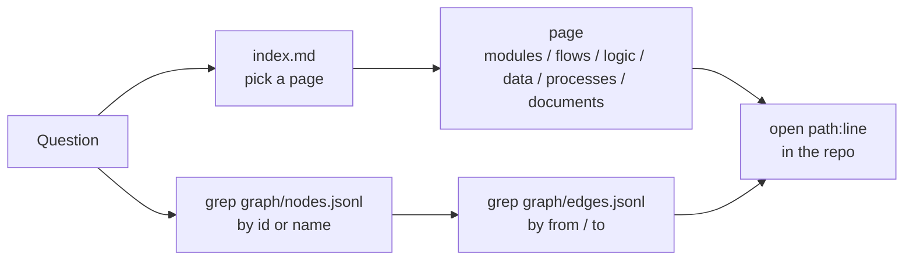

# databricks-audit-app knowledge graph

A committed map of the Crosshire repo: 8352 nodes and 23453 edges, each pointing at `path:line` in the code, plus hand-written pages on modules, flows, rules, data and processes.

- Built: 2026-11-10
- Commit: `f3d2565` (`f3d2565a9ae1e2b1a57983b8bc996372c0dfe8de`); first built at `b8d2db1`, updated incrementally for the 2026-11-10 16:00 review fixes
- Per-file SHA-256 of the 1232 tracked files at build time: `meta.json` (`file_hashes`).

## How to use it



1. Start at [index.md](index.md): big picture, entry points, and a "where to look" table for every page.
2. Look up a node by id: `grep '"id": "function:app/core/data.py:' graph/nodes.jsonl`.
3. Find what touches it: `grep '"to": "table:system.billing.usage"' graph/edges.jsonl` (callers, readers) or `"from": ...` (what it calls or reads).
4. Open the cited `path:line` in the repo to confirm. `evidence` can be a line, a range `a-b`, or a list `a-b,c`.

**ID patterns**

| Kind | Example |
|---|---|
| File / folder | `file:app/api/app.py`, `folder:web/src/components` |
| Python | `function:app/core/rollup.py:_build_tree`, `class:app/api/app.py:_PrincipalMiddleware` (methods `Class.method`) |
| Test | `test_case:tests/test_api.py:test_x` |
| API | `endpoint:GET /api/status` |
| dbt | `dbt_model:cost_alloc`, `dbt_source:system_billing.usage`, `dbt_test:<model>:<test>[:<col>]`, `dbt_macro:<name>`, `dbt_seed:workspace_env_overrides` |
| Data | `table:system.billing.usage`, `table:databricks_audit_dashboard.<x>`, `column:<model>.<col>` |
| UI | `ui_screen:tab_cost`, `ui_screen:tab_cost:trend`, `ui_screen:dashboard:lh06_cost` |
| Semantic | `business_rule:<name>`, `flow:<name>`, `process:<name>`, `document:<path>`, `example_data:<path>` |
| Config | `config:<path>`, `config:env:<NAME>`, `secret_ref:<NAME>` (name only, never a value) |

Status: `extracted` = read straight from code; `inferred` = derived (e.g. fixture writes, screen -> `f_<id>` reads); `unclear` = not settled.

## Layout

| Path | What | Made by |
|---|---|---|
| `index.md` | Entry page | model |
| `modules/`, `flows/`, `logic/`, `data/`, `processes/`, `documents/` | Reference pages, `path:line` on every fact | model |
| `data/model.json` | Entities, keys, relations of the DuckDB data model | model-run script |
| `graph/nodes.base.jsonl`, `graph/edges.base.jsonl` | Static extraction of every tracked file | `_scripts/extract.py` |
| `graph/extra/*.jsonl` | Flows, data model, logic, web, dashboards/processes/docs additions | model-run scripts |
| `graph/nodes.jsonl`, `graph/edges.jsonl` | Merged graph (use these) | `_scripts/merge.py` |
| `meta.json` | Build date, commit, file hashes, counts, what made each file | script |

## Stats (merged graph)

Nodes: 8352 (extracted 8309, inferred 43). Edges: 23453 (extracted 22708, inferred 745).

| Node type | Count |
|---|---|
| function | 2721 |
| test_case | 1562 |
| file | 958 |
| column | 880 |
| dbt_test | 645 |
| dbt_model | 340 |
| table | 252 |
| module | 248 |
| ui_screen | 187 |
| config | 144 |
| class | 98 |
| folder | 71 |
| dbt_source | 49 |
| example_data | 42 |
| business_rule | 40 |
| endpoint | 35 |
| document | 24 |
| process | 20 |
| dbt_macro | 10 |
| flow | 8 |
| external_system | 7 |
| secret_ref | 6 |
| directory | 2 |
| database | 1 |
| dbt_seed | 1 |
| repo | 1 |

| Edge type | Count |
|---|---|
| calls | 6712 |
| contains | 6268 |
| reads | 3265 |
| part_of | 1385 |
| derived_from | 1186 |
| configures | 913 |
| imports | 903 |
| depends_on | 808 |
| illustrates | 792 |
| writes | 415 |
| documents | 414 |
| implements | 257 |
| exposes | 68 |
| deploys | 23 |
| fk | 17 |
| ref | 16 |
| triggers | 8 |
| grants | 2 |
| schedules | 1 |


## Known gaps

- Python calls: only direct names, module aliases, imported `Class.method` and `self.method`; calls on instances, callbacks and `importlib` loads by path are missed.
- TypeScript: only top-level exports are nodes; no TS-to-TS call graph beyond `Api.*` and direct `/api` fetches.
- SQL reads: `FROM`/`JOIN` on `system.*` or `databricks_audit_dashboard.*` only; comma joins are missed.
- Screen -> `dbt_model:f_<id>` reads are inferred (the UI only calls `/api/finding/{id}`).
- The steps in `flows/add_a_check.md` are inferred; the repo does not document their order.

## How to update

Run from the repo root:

```
python databricks-audit-app-knowledge-graph/_scripts/extract.py     # rebuild graph/*.base.jsonl from the working tree (tracked + untracked, not ignored; deleted files dropped) (~40 s)
python databricks-audit-app-knowledge-graph/_scripts/merge.py       # base + extra -> graph/nodes.jsonl, edges.jsonl
python databricks-audit-app-knowledge-graph/_scripts/validate.py    # 0 errors expected; prints random evidence lines to eyeball
python databricks-audit-app-knowledge-graph/_scripts/stats.py       # recompute counts in README.md and meta.json
```

- `merge.py` dedupes nodes by id and edges by (from, to, type), keeping the best status. It maps a dangling id to an existing one where it can (function<->class, `tab_queries` -> `tab_query`, endpoint params), else adds an `unclear` stub. It also trims `line_end` values that run one line past the end of the file.
- The extractor does not regenerate `graph/extra/*.jsonl` or the Markdown pages. After a code change, compare the `file_hashes` in `meta.json` with the new files to find the stale pages. Re-check their `path:line` citations, or regenerate them, before you trust them.
- After the update, recompute `meta.json` (hashes, counts, commit).
