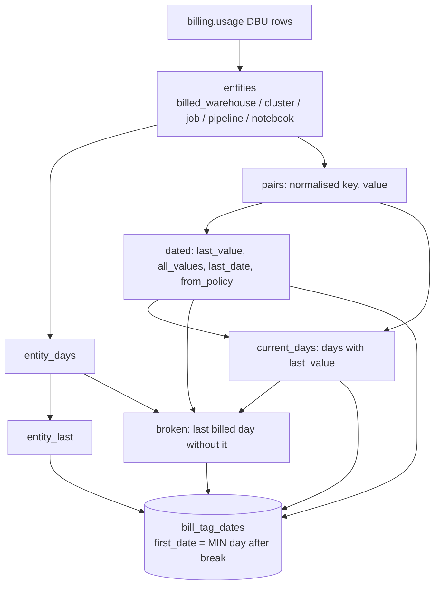

# tags.bill_tag_dates

For each billed warehouse, all-purpose cluster, job, pipeline and serverless notebook: each tag key's last value on the bill and the first day of that value's latest unbroken run, so the Tags page can say "on the bill since <date>" (`dbt/models/tags/bill_tag_dates.sql:1-8`).

- Schema/materialization: `tags`, table (`dbt/models/tags/bill_tag_dates.sql:1`); DuckDB only (`:9-11`). Twin: `app/direct_sql/tags/bill_tag_dates.sql:1-7`.
- Grain / key: (entity_type, workspace_id, entity_id, tag_key) (`dbt/models/tags/_tags_idx.yml:95-116`); not_null first_date (`:106-108`).

## Rules

- billed_cluster excludes job and pipeline run clusters (`dbt/models/tags/bill_tag_dates.sql:28-29`); billed_notebook only when no warehouse/cluster/job/pipeline (`:37-40`).
- `raw_key` / `last_value` come from one billing row: the latest `usage_end_time`, then value, then key break a same-hour tie (`dbt/models/tags/bill_tag_dates.sql:59-61`).
- `from_policy`: a usage/budget policy put the key on its last day (`dbt/models/tags/bill_tag_dates.sql:20,64-65`).
- `first_date` = first day of the latest unbroken run of `last_value` over the entity's billed days (`dbt/models/tags/bill_tag_dates.sql:69-100`).

## Columns

`entity_type, workspace_id, entity_id, tag_key, raw_key, last_value, all_values, first_date, last_date, entity_last_date, from_policy` (`dbt/models/tags/bill_tag_dates.sql:90-91`).

## Example (illustrative)

- Warehouse billed 1-10 Jul with `team=a`, 11 Jul with no tag, 12-20 Jul with `team=a`: first_date 12 Jul, last_date 20 Jul.

## Read by

- `app/core/tag_bill.py:12` (bill value overrides perf compute tags), `app/core/tag_compliance.py:165-168`.
