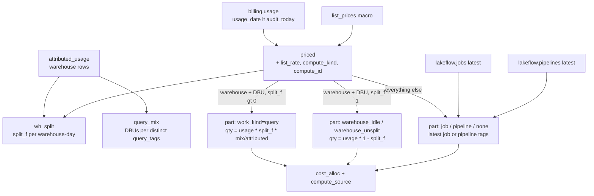

# tags.cost_alloc

The single dollar split of `system.billing.usage` that `cost_unit`, `cost_unit_tag` and `cost_day` all read: one row per (billing row, part), priced at the effective list price (`dbt/models/tags/cost_alloc.sql:2-6`).

- Materialization: `ephemeral` (inlined CTE, no table) (`dbt/models/tags/cost_alloc.sql:1`).
- DuckDB only; raises on any other target (`dbt/models/tags/cost_alloc.sql:7-9`). Databricks twin: `app/direct_sql/tags/_cost_alloc.sql:1-7`, pasted into export queries at `__COST_ALLOC__` / `__COST_ALLOC_WINDOW__` (`tools/export_direct_results.py:66-68`).
- Grain: (rid, part). `rid = usage.record_id` (`dbt/models/tags/cost_alloc.sql:12`); a warehouse DBU row produces several parts sharing one rid.

## Flow

## Rules (each with source)

- Price: LEFT JOIN de-duplicated `list_prices()` on sku_name, cloud, usage_unit and `usage_end_time` in [price_start_time, price_end_time) (`dbt/models/tags/cost_alloc.sql:38-45`); rate = `pricing.effective_list.default` (`:40`).
- compute_kind order: warehouse_id, cluster_id, endpoint_id/endpoint_name, app_id, then job/pipeline/notebook/budget or usage policy/serverless -> `serverless`, else `other` (`dbt/models/tags/cost_alloc.sql:22-32`).
- compute_id = first non-NULL of warehouse_id, cluster_id, endpoint_id, endpoint_name, app_id, budget_policy_id, usage_policy_id (`dbt/models/tags/cost_alloc.sql:33-35`).
- Warehouse split fraction: `split_f = LEAST(attributed, billed) / billed` per (workspace, warehouse, day), 0 when either is 0 (`dbt/models/tags/cost_alloc.sql:55-68`).
- Query part qty = `usage_quantity * split_f * mix_dbus / attributed_dbus`, one per distinct `query_tags` set (`dbt/models/tags/cost_alloc.sql:70-75,84-93`).
- Remainder part: `warehouse_idle` when the day had attribution, else `warehouse_unsplit`; qty = `usage_quantity * (1 - split_f)` (`dbt/models/tags/cost_alloc.sql:95-103`).
- Non-warehouse-DBU rows: one part; work_kind job / pipeline / none, work_tags = latest job or pipeline tags (`dbt/models/tags/cost_alloc.sql:76-83,105-117`).
- compute_source label: `billing:warehouse|cluster|endpoint|app|budget_policy|serverless|other` (`dbt/models/tags/cost_alloc.sql:119-127`).

## Columns

`rid, usage_date, workspace_id, cloud, sku_name, billing_origin_product, usage_unit, is_serverless, is_photon, is_perf_optimized, has_custom_tags, custom_tags, compute_kind, compute_id, work_kind, work_id, work_tags, work_source, list_rate, qty, compute_source` (`dbt/models/tags/cost_alloc.sql:85-127`).

## Example (fixture `tests/fixtures/tagworld.py:17-23`, all $1/DBU)

| Warehouse-day | billed DBU | attributed (query_tags) | split_f | parts (work_kind: qty) |
|---|---|---|---|---|
| `tg_wh_a1` D(1) | 100 | 70: s1+s2 `{tg_cc: q_fin}` 40, s3 no tags 20, s4 `{tg_app: bi}` 10 | 0.7 | query q_fin 40, query (none) 20, query bi 10, warehouse_idle 30 |
| `tg_wh_a1` D(3) | 50 | none | 0 | warehouse_unsplit 50 |
| `tg_wh_a2` D(1) | 40 | 50: s5 `{tg_cc: q_mkt}` 30, s6 no tags 20 | 1.0 (LEAST caps at billed) | query q_mkt 24, query (none) 16, no idle part |

- q_mkt = 40 x 1.0 x 30 / 50 = 24 (`dbt/models/tags/cost_alloc.sql:89`). Parts always sum to the billed row (proved by `tags.cost_reconciliation`).
- Pinned in the rollup test: `warehouse tag: alpha` 150 = q_fin 40 + untagged queries 30 + idle 30 + not split 50; `untagged warehouse` 40 = q_mkt 24 + untagged queries 16 (`tests/test_tag_rollup_models.py:160-174`).

## Read by

- `ref('cost_alloc')`: `dbt/models/tags/cost_unit.sql:19`, `dbt/models/tags/cost_unit_tag.sql:19`, `dbt/models/tags/cost_day.sql:21`.
