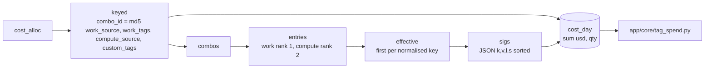

# tags.cost_day

Every billed dollar per day, labelled with one winning tag signature, so any spend panel can be narrowed by a tag filter; rows sum exactly to `system.billing.usage` (`dbt/models/tags/cost_day.sql:1-12`).

- Schema/materialization: `tags`, table (`dbt/models/tags/cost_day.sql:1`); DuckDB only (`:13-15`). Twin: `app/direct_sql/tags/cost_day.sql:1-3` (whole snapshot, no window).
- Grain: (usage_date, workspace_id, cloud, sku_name, billing_origin_product, usage_unit, is_serverless, is_photon, is_perf_optimized, has_custom_tags, sig_id) via `GROUP BY ALL` (`dbt/models/tags/cost_day.sql:10,52-60`). No unique test in `_tags_*.yml` (unclear why).
- Not windowed: whole snapshot (`app/direct_sql/tags/cost_day.sql:2`).

## Rules

- Work value beats compute value per tag key (`rnk` 1 vs 2) (`dbt/models/tags/cost_day.sql:30-43`).
- Workspace-level tag is NOT in the row; `app/core/tag_spend.py` adds it at request time from `tag_workspace_history` (`dbt/models/tags/cost_day.sql:4-6`, `app/core/tag_spend.py:79`).
- `sig` = JSON list `[{k, v, l, s}]` (key, value, level, source) ordered by key; `'[]'` when untagged; `sig_id = md5(sig)` (`dbt/models/tags/cost_day.sql:44-53`).
- `usd` = priced qty * list_rate, `unpriced_quantity`, `quantity`, `as_of_date = audit_today()` (`dbt/models/tags/cost_day.sql:54-57`).

## Example (illustrative)

- Job part with job tag `team=a` and bill tag `team=b, cc=fin` -> sig `[{"k":"cc","v":"fin","l":"compute",...},{"k":"team","v":"a","l":"work",...}]`.

## Read by

- `app/core/tag_spend.py:122` (matching_cells), `app/core/tag_compliance.py:69` (Azure workspaces), `app/core/data.py:1500-1506` (`tag_spend_ready`).
