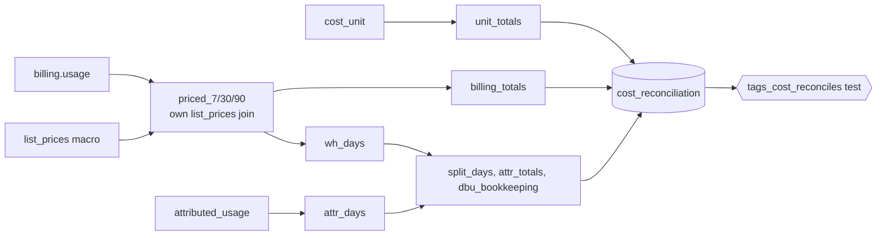

# tags.cost_reconciliation

Proof that `tags.cost_unit` accounts for every dollar: the priced billing total recomputed straight from `system.billing.usage` per (window_days, usage_unit), next to `cost_unit`'s own total (`dbt/models/tags/cost_reconciliation.sql:1-12`).

- Schema/materialization: `tags`, table (`dbt/models/tags/cost_reconciliation.sql:1`); DuckDB only (`:13-15`).
- Grain / key: (window_days, usage_unit) (`dbt/models/tags/_tags_roll.yml:95-99`); not_null on billing_usd, unit_usd (`:88-93`).
- Gate: singular test `dbt/tests/tags_cost_reconciles.sql:6-9` fails the build when `|billing_usd - unit_usd| >= 0.005` or unpriced quantity differs by `>= 0.0001`.

## Columns

| Column | Meaning | Source |
|---|---|---|
| billing_usd / billing_quantity / billing_unpriced_quantity | independent billing totals | `dbt/models/tags/cost_reconciliation.sql:43-50` |
| unit_usd / unit_quantity / unit_unpriced_quantity | sums from cost_unit | `dbt/models/tags/cost_reconciliation.sql:51-56` |
| attributed_dbus, attributed_unmatched_dbus | DBU-only; attributed DBUs with no billed warehouse-day | `dbt/models/tags/cost_reconciliation.sql:84-96` |
| scaled_warehouse_days | warehouse-days where attributed > billed | `dbt/models/tags/cost_reconciliation.sql:108-113` |
| warehouse_idle_usd, warehouse_unsplit_usd | the two remainder buckets in $ | `dbt/models/tags/cost_reconciliation.sql:120-131` |

- DBU-only columns are NULL on other usage_unit rows (`dbt/models/tags/cost_reconciliation.sql:141-145`).

## Direct-export variant

- Exported without unit_* columns (`app/direct_sql/tags/cost_reconciliation.sql:5-10`); the loader adds them from the loaded `tags.cost_unit` (`tools/load_direct_results.py:695-715`).

## Read by

- `app/core/rollup.py:773,786,795`.
