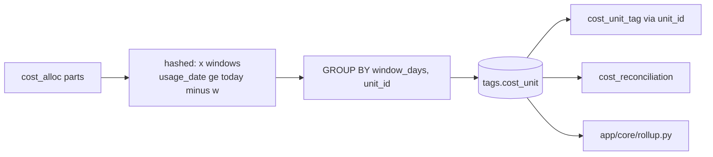

# tags.cost_unit

Every priced dollar of `system.billing.usage`, split by `cost_alloc` and summed per allocation unit and window; carries no tag columns (`dbt/models/tags/cost_unit.sql:1-8`).

- Schema/materialization: `tags`, table (`dbt/models/tags/cost_unit.sql:1`); DuckDB only (`:9-11`). Databricks twin: `app/direct_sql/tags/cost_unit.sql:1-3` (one window per export run, `__WINDOW_DAYS__`).
- Grain / key: (window_days, unit_id), `unique_grain` + not_null tests (`dbt/models/tags/_tags_roll.yml:8-35`).

## unit_id

- `md5(workspace_id|compute_kind|compute_id|work_kind|work_id|usage_unit|<custom_tags as sorted "k=v">)`, `~` for NULL (`dbt/models/tags/cost_unit.sql:13-18`).
- Stable across windows; a tag changed mid-window puts a resource in two units, so a unit's own tags are unambiguous (`dbt/models/tags/cost_unit.sql:6-8`).
- Windows: `unnest(var('windows'))` = 7, 30, 90 (`dbt/models/tags/cost_unit.sql:20-21`, `dbt/dbt_project.yml:31`).

## Columns

| Column | Meaning | Source |
|---|---|---|
| window_days, unit_id | key | `dbt/models/tags/cost_unit.sql:24-25` |
| workspace_id, compute_kind, compute_id, work_kind, work_id, usage_unit | unit identity (ANY_VALUE) | `dbt/models/tags/cost_unit.sql:26-31` |
| usd | sum of qty * list_rate where priced | `dbt/models/tags/cost_unit.sql:32` |
| unpriced_quantity | qty with no list price | `dbt/models/tags/cost_unit.sql:33` |
| quantity | all qty | `dbt/models/tags/cost_unit.sql:34` |
| record_count | COUNT(DISTINCT rid) | `dbt/models/tags/cost_unit.sql:35` |

- Units with zero usd and zero qty are dropped (`dbt/models/tags/cost_unit.sql:38`).
- Tests: not_null on compute_kind, work_kind, usage_unit (`dbt/models/tags/_tags_roll.yml:21-29`).

## Example (illustrative)

- Job 42 in workspace 1 on cluster c1, tags `{team: a}`, DBU -> one unit_id per window; the 7-day row sums only the last 7 days of those parts.

## Read by

- `app/core/rollup.py:330` (joined to `cost_unit_tag` at `:331-333`), `app/core/rls.py:205-210`, `dbt/models/tags/cost_reconciliation.sql:54`, `tools/load_direct_results.py:695-715` (adds unit_* columns to the loaded reconciliation).
