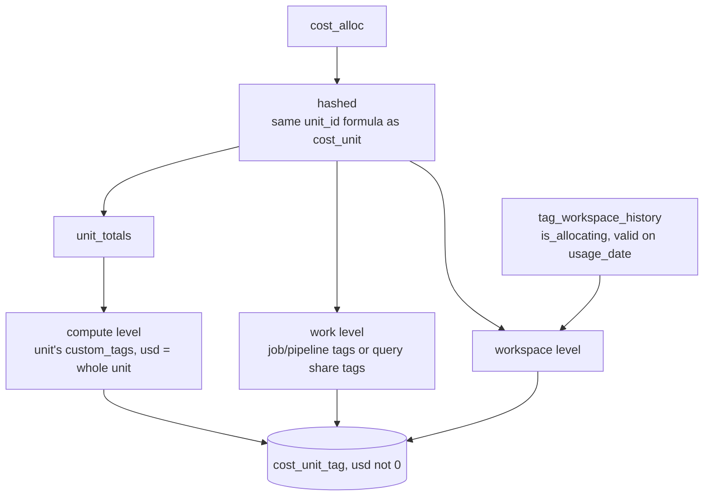

# tags.cost_unit_tag

The real tag values each `cost_unit` carries, at three levels (compute, work, workspace), with the dollars that carry them; no "untagged" rows (`dbt/models/tags/cost_unit_tag.sql:1-6`).

- Schema/materialization: `tags`, table (`dbt/models/tags/cost_unit_tag.sql:1`); DuckDB only (`:7-9`). Twin: `app/direct_sql/tags/cost_unit_tag.sql:1-5`.
- Grain / key: (window_days, unit_id, level, tag_key, tag_value) (`dbt/models/tags/_tags_roll.yml:66-73`); `level` accepted values compute/work/workspace (`dbt/models/tags/_tags_roll.yml:50-55`).

## Rules

- Same `unit_id` hash as `cost_unit` (`dbt/models/tags/cost_unit_tag.sql:15-18`).
- Compute level: each normalised key once per unit, alphabetically first raw key wins; usd = the unit's whole usd; source = compute_source (`dbt/models/tags/cost_unit_tag.sql:28-46`).
- Workspace level: join `tag_workspace_history` on workspace and `usage_date` in [valid_from, valid_to), only `is_allocating`; source `workspace_inferred` (`dbt/models/tags/cost_unit_tag.sql:51-59`).
- Work level: each part's work_tags (job/pipeline latest tags, or warehouse query-share tags), deduped per (rid, work_tags, key), summed per (unit, key, value) (`dbt/models/tags/cost_unit_tag.sql:65-82`).
- Only `usd <> 0` rows are kept (`dbt/models/tags/cost_unit_tag.sql:84-98`).
- Key normalisation: `norm_tag_key` (`dbt/macros/norm_tag_key.sql:18-24`).
- Untagged remainder is computed at request time from the unit's usd by `app/core/rollup.py` (`dbt/models/tags/cost_unit_tag.sql:4-5`).

## Columns

`window_days, unit_id, level, tag_key, raw_key, tag_value, source, usd` (`dbt/models/tags/cost_unit_tag.sql:84`).

## Example (illustrative)

- A $10 warehouse unit with bill tag `cost_center=fin`: compute row (`fin`, $10). Its query share with `{team: a}` worth $4: work row (`a`, $4). Workspace inferred `cost_center=fin`: workspace row ($10).

## Read by / written by

- Read: `app/core/rollup.py:331,341,349,733,756`; per-user rebuild `app/core/rls.py:334`.
- Re-written after build for `config/workspace.csv` workspaces (workspace level): `app/core/workspace_file.py:95-101`.
