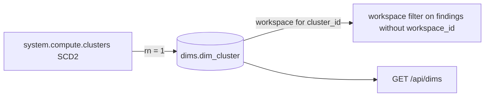

# dims.dim_cluster

Latest known name, source and owner per cluster, from `system.compute.clusters` (SCD2, latest row by change_time) (`dbt/models/dims/dim_cluster.sql:1-11`).

- Schema/materialization: `dims`, table (`dbt/models/dims/dim_cluster.sql:1`, `dbt/dbt_project.yml:63-65`).
- Grain / key: cluster_id alone, a globally unique GUID (`dbt/models/dims/dim_cluster.sql:8-9`, `dbt/models/dims/_dims.yml:42-55`).
- Versioning: `ROW_NUMBER() OVER (PARTITION BY cluster_id ORDER BY change_time DESC)`, rn = 1 (`dbt/models/dims/dim_cluster.sql:35-38,50`).
- Direct twin: `app/direct_sql/names/dim_cluster.sql`; stand-in columns `tools/load_direct_results.py:51-54`.

## Columns

`workspace_id, cluster_id, cluster_name, cluster_source, owned_by (PII, raw), delete_time` (`dbt/models/dims/dim_cluster.sql:42-48`).

- `owned_by` masked on read (`app/core/data.py:3164-3180`).

## Read by

- `app/core/data.py:3175` (`read_dim_cluster`); workspace scoping for cluster-only findings `app/core/data.py:509,523`; `GET /api/dims` (`app/api/app.py:600`).
