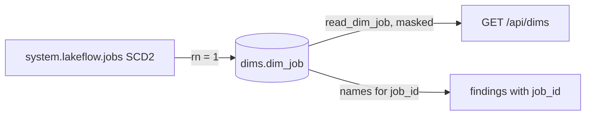

# dims.dim_job

Latest known name and owner per job, from `system.lakeflow.jobs` (SCD2, latest row by change_time) (`dbt/models/dims/dim_job.sql:1-9`).

- Schema/materialization: `dims`, table (`dbt/models/dims/dim_job.sql:1`, `dbt/dbt_project.yml:63-65`).
- Grain / key: (workspace_id, job_id); job_id is unique only within a workspace (`dbt/models/dims/dim_job.sql:7-9`, `dbt/models/dims/_dims.yml:23-40`).
- Versioning: latest row of SCD2 via `ROW_NUMBER() OVER (PARTITION BY workspace_id, job_id ORDER BY change_time DESC)` (`dbt/models/dims/dim_job.sql:28-31,44`).
- Direct twin: `app/direct_sql/names/dim_job.sql`; loader writes `dims.dim_job` or an empty stand-in with the same columns (`tools/load_direct_results.py:47-50,612-635`).

## Columns

| Column | PII | Source |
|---|---|---|
| workspace_id, job_id | no | `dbt/models/dims/dim_job.sql:36-37` |
| name | no | `dbt/models/dims/dim_job.sql:38` |
| run_as, run_as_user_name, creator_user_name | yes (raw, unmasked in table) | `dbt/models/dims/dim_job.sql:11-18,39-41` |
| delete_time | no | `dbt/models/dims/dim_job.sql:42` |

- Identity columns are masked on read (`app/core/data.py:3222-3242`, `_mask_dim_job` at `app/core/data.py:3187`).

## Read by

- `app/core/data.py:3237` (`read_dim_job`), `GET /api/dims` (`app/api/app.py:619`).
