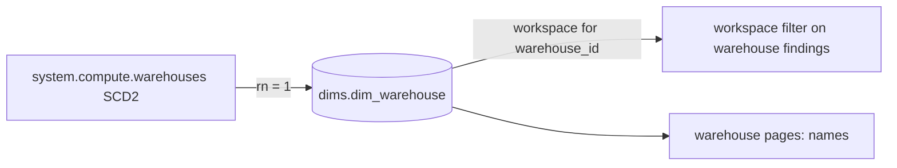

# dims.dim_warehouse

Latest known name and creator per SQL warehouse, from `system.compute.warehouses` (SCD2, latest row by change_time) (`dbt/models/dims/dim_warehouse.sql:1-10`).

- Schema/materialization: `dims`, table (`dbt/models/dims/dim_warehouse.sql:1`, `dbt/dbt_project.yml:63-65`).
- Grain / key: warehouse_id alone (globally unique GUID) (`dbt/models/dims/dim_warehouse.sql:6-9`, `dbt/models/dims/_dims.yml:57-70`).
- Versioning: `ROW_NUMBER() OVER (PARTITION BY warehouse_id ORDER BY change_time DESC)`, rn = 1 (`dbt/models/dims/dim_warehouse.sql:29-32,43`).
- Direct twin: `app/direct_sql/names/dim_warehouse.sql`; stand-in columns `tools/load_direct_results.py:55-58`.

## Columns

`workspace_id, warehouse_id, warehouse_name, created_by (PII, raw), delete_time` (`dbt/models/dims/dim_warehouse.sql:36-41`).

- `created_by` masked on read (`app/core/data.py:3199-3216`).

## Read by

- `app/core/data.py:3211` (`read_dim_warehouse`), `app/core/data.py:523-524,537` (scope), `app/core/data.py:2572,2899,2977` (warehouse names), `GET /api/dims` (`app/api/app.py:621`).
