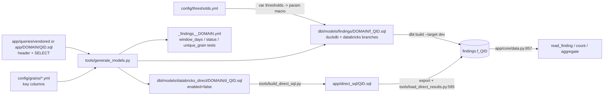

# Finding table pattern (findings.f_<query_id>)

Every check is one generated dbt model `f_<query_id>` materialized as table `findings.f_<query_id>`, one SQL file per check stacked once per window; 160 models today (`dbt/models/findings/generated_manifest.json`, `tools/generate_models.py:1-42`).

## How one finding table is made

## Model shape

- Config: `materialized='table'`, tags `finding|inventory`, `domain:<d>`, `tier:<t>`, optional `stars`, `drilldown` (`tools/generate_models.py:325-331,397`).
- Header comment: `-- GENERATED by tools/generate_models.py from <query path> (vendored @ <lock> | app-owned)` (`tools/generate_models.py:365-369,398`).
- Windowed: one `SELECT {{ w }} AS window_days, q.* FROM (...) q` per window 7/30/90 joined by UNION ALL; else one `SELECT 0 AS window_days` block (`tools/generate_models.py:400-415`).
- Two dialect branches: DuckDB = `translate()`, Databricks = `pin_time()` only (`tools/generate_models.py:349-352`, `dbt/models/findings/cost/f_cost_by_job.sql:7,53`).
- `system.<s>.<t>` -> `{{ source('system_<s>', '<t>') }}`, validated against sources.yml and the header `reads:` (`tools/generate_models.py:353-360`).
- Parameters `:x` -> `{{ param('<qid>', 'x', <default>) }}` (`tools/generate_models.py:235-250`, `dbt/macros/param.sql:10-30`).
- Schema `findings` regardless of target (`dbt/dbt_project.yml:60-62`, `dbt/macros/generate_schema_name.sql:8-14`).

## Keys and tests

- Grain = `window_days` + the query's own key columns from `config/grains/*.yml`; window_days must not be listed there (`tools/generate_models.py:417-439`).
- Tests per model: `window_days` not_null + accepted 0/7/30/90; `status` accepted OK/WARN/CRITICAL/NOT_ASSESSED when a finding; `unique_grain` on the grain (`tools/generate_models.py:487-507`).
- `unique_grain` severity is `warn` on dev (masked keys can collide), `error` on test (`dbt/tests/generic/test_unique_grain.sql:7-13`, `tools/dbt_run.py:18-19`).

## Worked example: f_cost_by_job

| Item | Value | Source |
|---|---|---|
| Query | app/queries/vendored/cost/cost_by_job.sql | `dbt/models/findings/cost/f_cost_by_job.sql:2` |
| Reads | billing.usage, list_prices (macro), lakeflow.jobs (latest), access.workspaces_latest | `dbt/models/findings/cost/f_cost_by_job.sql:31-45` |
| Grain | window_days, usage_date, cloud, workspace_id, billing_origin_product, job_id, is_serverless | `config/grains/cost_usage_only.yml:69`, `dbt/models/findings/cost/_findings__cost.yml:630-640` |
| Status rule | job-day DBUs >= crit 200 -> CRITICAL, >= warn 50 -> WARN | `dbt/models/findings/cost/f_cost_by_job.sql:23-29` |
| Columns + types | from test DB | `tools/dashboard_columns.json:2684` |
| Direct twin | d_cost_by_job -> app/direct_sql/cost_by_job.sql | `dbt/models/databricks_direct/cost/d_cost_by_job.sql:1-2`, `app/direct_sql/cost_by_job.sql:1-2` |

## Counts by domain

| Domain | Models | Windowed | Findings (rest inventory) | Vendored (rest app) |
|---|---|---|---|---|
| cost | 48 | 42 | 23 | 23 |
| jobs_pipelines | 32 | 29 | 22 | 22 |
| governance_access | 25 | 12 | 17 | 21 |
| performance | 20 | 20 | 12 | 13 |
| compute | 18 | 12 | 14 | 11 |
| storage | 12 | 10 | 10 | 6 |
| serving_ai | 5 | 5 | 2 | 4 |
| total | 160 | 130 | 100 | 100 |

- Scripted from `dbt/models/findings/generated_manifest.json`; vendored lock commit `f700dd5` (same file, `"commit"`).
- 54 models price through `list_prices()`; 3 carry `drilldown` (`tools/generate_models.py:70-74`).
- Skipped (not a SELECT on a system table): iceberg_uniform_metadata, storage_breakdown_analyze, table_props_time_travel_config (manifest `skipped`; reason rule `tools/generate_models.py:313-318`).

## How the app reads one

- Column whitelist from information_schema; missing table -> FindingNotBuiltError (`app/core/data.py:446-457`).
- `SELECT ... FROM findings."f_<qid>" WHERE window_days = ? ...` with bound params (`app/core/data.py:834-857`).
- Workspace/env filter only if the table has workspace_id, else through warehouse_id/cluster_id dims (`app/core/data.py:511-525`).
- Per-model columns/keys: `data/model.json` entities of type `finding_table`.
