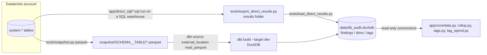
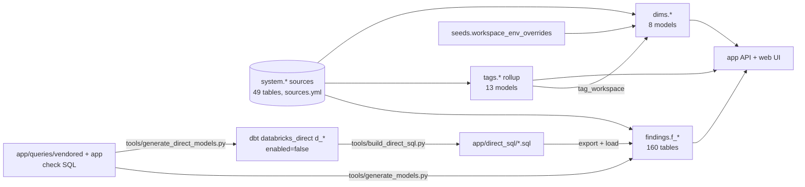

# Data model

One DuckDB file holds everything the app reads: `findings.f_<qid>` (160 check tables), `dims.*` (names), `tags.*` (tag rollup) and a few loader-only tables, all built either by dbt over snapshot parquet or by loading a Databricks direct export. Machine-readable version: `data/model.json`.

## Two ways the DuckDB tables get built

- Local build: every source is `read_parquet('<AUDIT_SNAPSHOT_DIR>/{schema}__{name}/*.parquet', union_by_name=true)` (`dbt/models/sources/sources.yml:12`); both profile targets are DuckDB (`dbt/profiles.yml:18-36`).
- Direct build: the loader writes `findings."f_<qid>"` (`tools/load_direct_results.py:580`), `dims."<name>"` (`tools/load_direct_results.py:609`, empty stand-in at `:620`) and `tags."<name>"` (`tools/load_direct_results.py:646-658`); the 12 tag tables it knows are listed at `tools/load_direct_results.py:73-77`.
- No constraint is enforced anywhere (CTAS tables). Keys below come from `unique_grain` tests (`dbt/tests/generic/test_unique_grain.sql:12-34`), `ROW_NUMBER ... PARTITION BY` or `GROUP BY`.

## Core entities

```mermaid
erDiagram
  SYSTEM_BILLING_USAGE ||--|{ COST_ALLOC : "one row splits into 1..n parts (rid)"
  SYSTEM_BILLING_LIST_PRICES |o--o{ COST_ALLOC : "0..1 price row per part (range join)"
  SYSTEM_BILLING_ATTRIBUTED_USAGE }o--o{ COST_ALLOC : "warehouse-day query share"
  SYSTEM_LAKEFLOW_JOBS }o--o{ COST_ALLOC : "latest job row gives work_tags"
  COST_UNIT }o--|{ COST_ALLOC : "parts summed per (window_days, unit_id)"
  COST_DAY ||--|{ COST_ALLOC : "parts summed per day + dims + sig_id"
  COST_UNIT ||--o{ COST_UNIT_TAG : "window_days, unit_id"
  COST_RECONCILIATION ||--o{ COST_UNIT : "window_days, usage_unit (aggregate)"
  TAG_WORKSPACE_HISTORY }o--o{ COST_UNIT_TAG : "workspace level, version valid on usage_date"
  TAG_WORKSPACE ||--|{ TAG_WORKSPACE_HISTORY : "is_current version per (workspace_id, tag_key)"
  TAG_WORKSPACE ||--o| TAG_ENTITY : "entity_type = workspace rows"
  TAG_INDEX |o--o{ TAG_ENTITY : "resource + UC rows grouped by (tag_key, tag_value, source)"
  PERF_UNIT ||--o{ PERF_UNIT_TAG : "window_days, unit_id"
  PERF_UNIT ||--o{ QUERY_TAG_KEYS : "window_days, unit_id"
  DIM_JOB ||--|{ SYSTEM_LAKEFLOW_JOBS : "latest SCD2 row per (workspace_id, job_id)"
  DIM_CLUSTER ||--|{ SYSTEM_COMPUTE_CLUSTERS : "latest SCD2 row per cluster_id"
  DIM_WAREHOUSE ||--|{ SYSTEM_COMPUTE_WAREHOUSES : "latest SCD2 row per warehouse_id"
  DIM_PIPELINE ||--|{ SYSTEM_LAKEFLOW_PIPELINES : "latest SCD2 row per (workspace_id, pipeline_id)"
  DIM_WORKSPACE ||--o{ F_FINDING : "workspace_id (app filter)"
  DIM_JOB |o--o{ F_FINDING : "workspace_id + job_id (names)"
  COST_UNIT {
    int window_days PK
    varchar unit_id PK
    varchar workspace_id
    varchar compute_kind
    varchar compute_id
    varchar work_kind
    varchar work_id
    varchar usage_unit
    double usd
    double unpriced_quantity
    double quantity
    bigint record_count
  }
  COST_UNIT_TAG {
    int window_days PK
    varchar unit_id PK
    varchar level PK
    varchar tag_key PK
    varchar tag_value PK
    varchar raw_key
    varchar source
    double usd
  }
  TAG_WORKSPACE_HISTORY {
    varchar workspace_id PK
    varchar tag_key PK
    date valid_from PK
    date valid_to
    varchar display_key
    varchar tag_value
    boolean is_allocating
    boolean is_current
  }
  TAG_ENTITY {
    varchar entity_type PK
    varchar workspace_id PK "NULL for uc_* rows"
    varchar entity_id PK
    varchar tag_key PK
    varchar raw_key
    varchar tag_value
    boolean is_allocating
    varchar source
  }
  DIM_JOB {
    varchar workspace_id PK
    varchar job_id PK
    varchar name
    varchar run_as
  }
  F_FINDING {
    int window_days PK
    varchar grain_cols PK "config/grains"
    varchar status
  }
  SYSTEM_BILLING_USAGE {
    varchar record_id PK "inferred"
    varchar workspace_id
    date usage_date
    varchar sku_name
    double usage_quantity
    map custom_tags
    struct usage_metadata
  }
```

Cardinality notes (reviewed against the SQL):

- `COST_UNIT` to `COST_ALLOC`: one part lands in up to three units (one per window it falls in), so many-to-many; per window it is N parts : 1 unit (`dbt/models/tags/cost_unit.sql:13-22,37`).
- `COST_RECONCILIATION` aggregates `cost_unit` per (window_days, usage_unit): one reconciliation row per many units, not the reverse (`dbt/models/tags/cost_reconciliation.sql:51-56,147`).
- `TAG_WORKSPACE` is the `is_current` row of each (workspace_id, tag_key) history: 1 current row : 1..n versions (`dbt/models/tags/tag_workspace.sql:12-15`, `dbt/models/tags/tag_workspace_history.sql:183`).
- `TAG_WORKSPACE_HISTORY` to `COST_UNIT_TAG` is many-to-many: a unit spanning two allocating versions with the same value (split by a `__mixed__` run) sums both into one row (`dbt/models/tags/cost_unit_tag.sql:51-59`); inferred from the GROUP BY, not tested.
- Dims are 1 dim row : 1..n SCD2 source rows (`ROW_NUMBER() ... = 1`), e.g. `dbt/models/dims/dim_job.sql:28-33,44`.
- Keys asserted by a `unique_grain` test: every tags model except `cost_day` (and ephemeral `cost_alloc`), plus dim_job/cluster/warehouse/pipeline and int_workspace_tag_hints. `cost_day`, `dim_notebook`, `dim_list_prices`, `dim_workspace` keys are inferred from GROUP BY / ROW_NUMBER only (`dbt/models/tags/cost_day.sql:60`, `dbt/models/dims/dim_notebook.sql:9-12`, `dbt/models/dims/dim_list_prices.sql:18-23`).

Evidence: grains `dbt/models/tags/_tags_roll.yml:31-35,66-73`, `dbt/models/tags/_tags_idx.yml:42-47,66-72`, `dbt/models/dims/_dims.yml:36-40`; joins `app/core/rollup.py:330-333`, `dbt/models/tags/cost_unit_tag.sql:55-57`, `dbt/models/tags/tag_workspace.sql:12-15`, `dbt/models/tags/cost_alloc.sql:43-45,91-92,115`.

## View | Built from | Rows

| View (schema.table) | Built from | Rows (grain) | Evidence |
|---|---|---|---|
| tags.cost_alloc (ephemeral, no table) | billing.usage, list_prices(), attributed_usage, lakeflow.jobs, lakeflow.pipelines | one per (billing row, part) | `dbt/models/tags/cost_alloc.sql:1-6` |
| tags.cost_unit | cost_alloc x windows 7/30/90 | (window_days, unit_id) | `dbt/models/tags/_tags_roll.yml:31-35` |
| tags.cost_unit_tag | cost_alloc, tag_workspace_history | (window_days, unit_id, level, tag_key, tag_value) | `dbt/models/tags/_tags_roll.yml:66-73` |
| tags.cost_day | cost_alloc | (usage_date, workspace, cloud, sku, product, unit, flags, sig_id) | `dbt/models/tags/cost_day.sql:10-12,60` |
| tags.cost_reconciliation | billing.usage, list_prices(), attributed_usage, cost_unit | (window_days, usage_unit) | `dbt/models/tags/_tags_roll.yml:95-99` |
| tags.perf_unit | query.history | (window_days, unit_id) | `dbt/models/tags/_tags_roll.yml:122-126` |
| tags.perf_unit_tag | perf_unit, query.history, compute.warehouses/clusters/instance_pools, tag_workspace_history | (window_days, unit_id, level, tag_key, tag_value) | `dbt/models/tags/_tags_roll.yml:156-163` |
| tags.query_tag_keys | query.history | (window_days, unit_id, own_keys, origin, job_id, pipeline_id, notebook_id) | `dbt/models/tags/query_tag_keys.sql:52-62` |
| tags.tag_workspace_history | billing.usage | (workspace_id, tag_key, valid_from), SCD2 | `dbt/models/tags/_tags_idx.yml:42-47` |
| tags.tag_workspace | tag_workspace_history WHERE is_current | (workspace_id, tag_key) | `dbt/models/tags/_tags_idx.yml:21-25` |
| tags.tag_entity | tag_workspace + warehouses, pools, clusters, jobs, pipelines, query.history, UC *_tags, billing.usage | (entity_type, workspace_id, entity_id, tag_key) | `dbt/models/tags/_tags_idx.yml:66-72` |
| tags.tag_index | billing.usage, tag_workspace, tag_entity, query.history, attributed_usage, ai_gateway.usage | (tag_key, tag_value, source) | `dbt/models/tags/_tags_idx.yml:89-94` |
| tags.bill_tag_dates | billing.usage | (entity_type, workspace_id, entity_id, tag_key) | `dbt/models/tags/_tags_idx.yml:110-116` |
| dims.dim_workspace | workspaces_latest, billing.usage, job_run_timeline, 10 regional tables, seed, int_workspace_tag_hints | workspace_id | `dbt/models/dims/dim_workspace.sql:37-58` |
| dims.int_workspace_tag_hints | billing.usage, tag_workspace | (workspace_id, canonical_key) | `dbt/models/dims/_dims.yml:107-111` |
| dims.dim_job | lakeflow.jobs latest row | (workspace_id, job_id) | `dbt/models/dims/_dims.yml:36-40` |
| dims.dim_cluster | compute.clusters latest row | cluster_id | `dbt/models/dims/_dims.yml:52-55` |
| dims.dim_warehouse | compute.warehouses latest row | warehouse_id | `dbt/models/dims/_dims.yml:67-70` |
| dims.dim_pipeline | lakeflow.pipelines latest row | (workspace_id, pipeline_id) | `dbt/models/dims/_dims.yml:85-89` |
| dims.dim_notebook | billing.usage notebook rows | (workspace_id, notebook_id) | `dbt/models/dims/dim_notebook.sql:9-12` |
| dims.dim_list_prices | list_prices() current rows | (cloud, sku_name, currency_code) | `dbt/models/dims/dim_list_prices.sql:18-23` |
| seeds.workspace_env_overrides | dbt/seeds/workspace_env_overrides.csv (header only) | workspace_id (convention) | `dbt/models/_seeds.yml:4-12` |
| findings.f_<qid> (160) | one check SQL each (100 vendored, 60 app) | (window_days + config/grains/<file>.yml cols) | `tools/generate_models.py:504-507` |
| direct_export_meta, direct_export_findings_meta | export manifest.json | 1 row / 1 row per query_id | `tools/load_direct_results.py:812-846` |
| usage.*, warehouse.*, storage.*, governance.* | export sub-folders | unclear | `tools/load_direct_results.py:712-803` |

## Layer lineage

- `d_*` is not a layer above `f_*`: both are rendered from the same check SQL; `d_*` holds only the Databricks branch and is never built (`tools/generate_direct_models.py:15-24`, `dbt/models/databricks_direct/cost/d_cost_by_job.sql:1`).
- `f_*` models carry both dialect branches behind `` (`dbt/models/findings/cost/f_cost_by_job.sql:7,53,99`).
- Most-read sources by finding models (scripted count of `source()` calls): billing.usage 71, query.history 32, lakeflow.job_run_timeline 25, lakeflow.jobs 23, access.workspaces_latest 19.

## Object pages

- Tags chain: [cost_alloc](cost_alloc.md), [cost_unit](cost_unit.md), [cost_unit_tag](cost_unit_tag.md), [cost_day](cost_day.md), [cost_reconciliation](cost_reconciliation.md), [perf_unit_tag](perf_unit_tag.md)
- Tag lookup: [tag_workspace_history](tag_workspace_history.md), [tag_workspace](tag_workspace.md), [tag_entity](tag_entity.md), [tag_index](tag_index.md), [bill_tag_dates](bill_tag_dates.md)
- Dims: [dim_job](dim_job.md), [dim_cluster](dim_cluster.md), [dim_warehouse](dim_warehouse.md), [dim_pipeline](dim_pipeline.md)
- Pattern: [findings_pattern](findings_pattern.md); source: [system_billing_usage](system_billing_usage.md)
