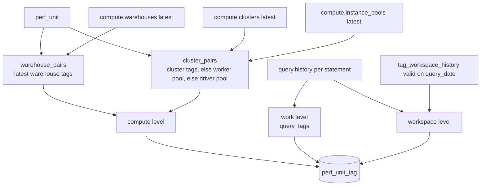

# tags.perf_unit_tag

`tags.perf_unit`'s real tag values (compute, work, workspace level) with the five performance metrics summed per value; no dollars (`dbt/models/tags/perf_unit_tag.sql:1-11`).

- Schema/materialization: `tags`, table (`dbt/models/tags/perf_unit_tag.sql:1`). Twin: `app/direct_sql/tags/perf_unit_tag.sql:1-8` (recomputes perf_unit locally; hash must match).
- Grain / key: (window_days, unit_id, level, tag_key, tag_value) (`dbt/models/tags/_tags_roll.yml:156-163`); level accepted compute/work/workspace (`:140-145`).
- Parent: `tags.perf_unit` (window_days, unit_id), unit_id = `md5(workspace_id|compute_kind|compute_id)` (`dbt/models/tags/perf_unit.sql:41-45`, `dbt/models/tags/_tags_roll.yml:122-126`).

## Rules

- Latest tags per resource: ROW_NUMBER over (workspace_id, warehouse_id / instance_pool_id / cluster_id) by change_time DESC (`dbt/models/tags/perf_unit_tag.sql:29-49`).
- Cluster per-key fallback: priority 1 cluster tags, 2 worker pool, 3 driver pool; best per (workspace, cluster, key) (`dbt/models/tags/perf_unit_tag.sql:50-78`).
- Compute level joins `perf_unit` by (workspace_id, compute_kind, compute_id) (`dbt/models/tags/perf_unit_tag.sql:79-107`).
- Work level recomputes the same history/hash as `perf_unit` (`dbt/models/tags/perf_unit_tag.sql:108-161`); source `query_tags`.
- Workspace level: `tag_workspace_history` row valid on statement start day, allocating only (`dbt/models/tags/perf_unit_tag.sql:162-176`).
- After a direct load, `app/core/tag_bill.apply_bill_to_perf` replaces the compute level with the bill's value for warehouses/clusters whose tag is on today's bill (`app/core/tag_bill.py:8-39`, called `tools/load_direct_results.py:701-703`).

## Columns

`window_days, unit_id, level, tag_key, raw_key, tag_value, source, statements, failed_statements, duration_ms, queue_ms, spill_bytes` (`dbt/models/tags/perf_unit_tag.sql:178-192`).

## Note

- Here warehouses are partitioned by (workspace_id, warehouse_id) (`dbt/models/tags/perf_unit_tag.sql:32`), while `dim_warehouse` and `tag_entity` use warehouse_id alone (`dbt/models/dims/dim_warehouse.sql:30`, `dbt/models/tags/tag_entity.sql:53`). Same result if warehouse_id is globally unique (`dbt/models/dims/dim_warehouse.sql:6-9`).

## Read by

- `app/core/rollup.py:397,407,415,761,1094`; written again by `app/core/tag_bill.py:30` and `app/core/workspace_file.py:95-101`.
