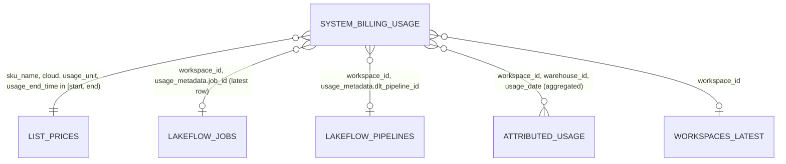

# system.billing.usage

The Databricks billing record table; the most-read source in the repo (71 finding models plus every tag cost model and four dims) and the base of every dollar figure.

- dbt source `system_billing.usage`, read from snapshot parquet `<AUDIT_SNAPSHOT_DIR>/billing__usage/*.parquet` (`dbt/models/sources/sources.yml:81-87`).
- Meta: time_column `usage_date`, retention 365 days, has workspace_id and custom_tags (`dbt/models/sources/sources.yml:84-87`).
- Column contract used in tests: `tests/fixtures/ddl.py:23`.

## Key columns

| Column | Type (fixture DDL) | Used for | Source |
|---|---|---|---|
| record_id | VARCHAR | row id -> `rid` in cost_alloc (inferred PK) | `dbt/models/tags/cost_alloc.sql:12`, `dbt/models/tags/cost_unit.sql:35` |
| workspace_id | VARCHAR | every grain; NULL/`'0'` = account level | `app/core/data.py:519` |
| usage_date | DATE | day bucket, window filter, `< audit_today()` | `dbt/models/tags/cost_alloc.sql:46` |
| usage_end_time | TIMESTAMP | price-row match | `dbt/models/tags/cost_alloc.sql:44-45` |
| sku_name, cloud, usage_unit | VARCHAR | price join key | `dbt/models/tags/cost_alloc.sql:43` |
| usage_quantity | DOUBLE | DBUs / units | `dbt/models/tags/cost_alloc.sql:18` |
| custom_tags | MAP(VARCHAR, VARCHAR) | compute-level tags, workspace inference | `dbt/models/tags/tag_workspace_history.sql:44` |
| usage_metadata | STRUCT | warehouse_id, cluster_id, job_id, dlt_pipeline_id, endpoint_id/name, app_id, notebook_id/path, instance_pool_id, budget_policy_id, usage_policy_id, job_run_id | `dbt/models/tags/cost_alloc.sql:19-35`, `tests/fixtures/ddl.py:23` |
| product_features | STRUCT | is_serverless, is_photon, performance_target | `dbt/models/tags/cost_alloc.sql:14-16` |
| identity_metadata | STRUCT (PII: run_as, created_by, owned_by, run_by) | masked in-SQL by checks | `tests/fixtures/ddl.py:23` |
| billing_origin_product | VARCHAR | product split | `dbt/models/tags/cost_alloc.sql:13` |

## Joins

- Price join via de-duplicated `list_prices()` (`dbt/macros/list_prices.sql:10-37`, `dbt/models/tags/cost_alloc.sql:38-45`).
- Jobs/pipelines: `dbt/models/tags/cost_alloc.sql:76-83,115-116`.
- Attributed usage: `dbt/models/tags/cost_alloc.sql:48-67`.
- Workspaces: `dbt/models/findings/cost/f_cost_by_job.sql:45`.

## Business rules applied on read

- Read up to the as-of cutoff: `usage_date < audit_today()` (`dbt/models/tags/cost_alloc.sql:46`, `dbt/macros/audit_time.sql:12-26`). Complete days only on a dbt build; a direct export with `include_today: true` (default) moves the cutoff to tomorrow, so today's partial day is in (`tools/export_direct_results.py:332-341`, `config/settings.yml:19-22`). See [as_of_cutoff](../logic/as_of_cutoff.md).
- Price basis = effective list price `pricing.effective_list.default`, USD rows only (`dbt/macros/list_prices.sql:3-8,32`, `dbt/models/tags/cost_alloc.sql:40`).
- Workspace tag inference ignores budget/usage-policy rows (`dbt/models/tags/tag_workspace_history.sql:30-32`).
- Dollars are reconciled back to this table per window (`dbt/models/tags/cost_reconciliation.sql:17-50`, `dbt/tests/tags_cost_reconciles.sql:6-9`).

## Downstream (dbt)

- tags: cost_alloc, cost_reconciliation, tag_workspace_history, tag_entity, tag_index, bill_tag_dates (`source('system_billing', 'usage')` at `dbt/models/tags/cost_alloc.sql:37`, `dbt/models/tags/cost_reconciliation.sql:22`, `dbt/models/tags/tag_workspace_history.sql:26`, `dbt/models/tags/tag_entity.sql:330`, `dbt/models/tags/tag_index.sql:33`, `dbt/models/tags/bill_tag_dates.sql:21`).
- dims: dim_workspace, dim_notebook, int_workspace_tag_hints (`dbt/models/dims/dim_workspace.sql:44`, `dbt/models/dims/dim_notebook.sql:13`, `dbt/models/dims/int_workspace_tag_hints.sql:26`).
- 71 finding models (full list: `graph/extra/data_model.edges.jsonl`, edges `reads` -> `table:system.billing.usage`).
