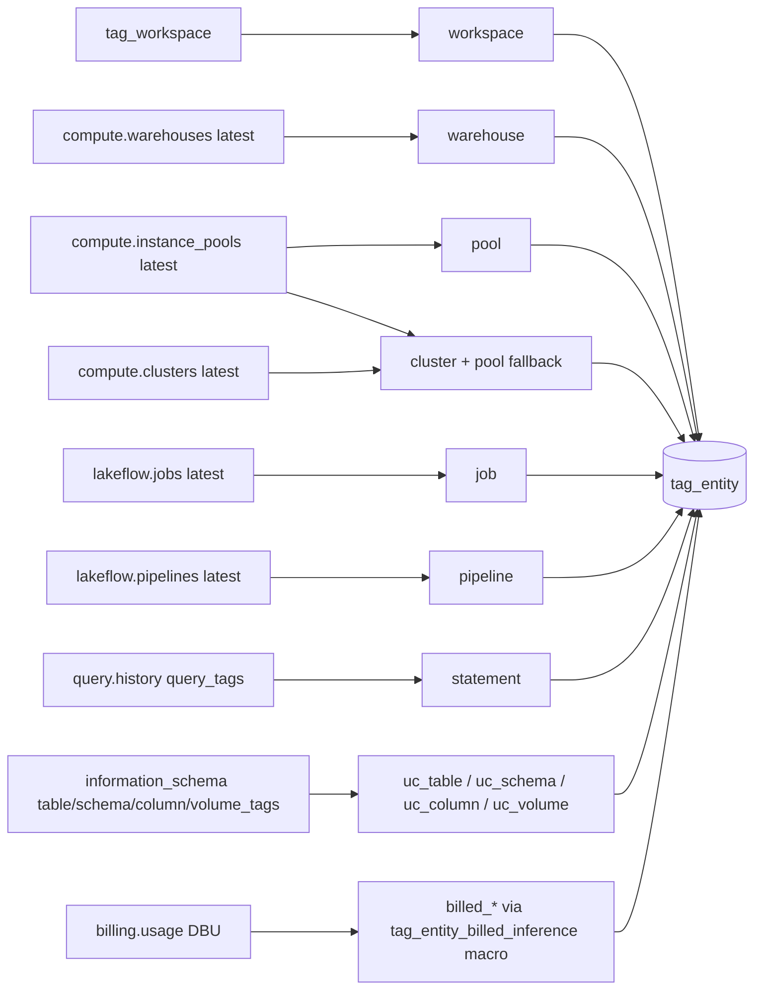

# tags.tag_entity

One row per place a Databricks object carries a tag key: resource/job/pipeline/statement tags, Unity Catalog tags, the inferred workspace tag and the DBU-dominant billed value per billed id (`dbt/models/tags/tag_entity.sql:1-27`).

- Schema/materialization: `tags`, table (`dbt/models/tags/tag_entity.sql:1`); DuckDB only (`:30-32`). Twin: `app/direct_sql/tags/tag_entity.sql:1-8` (billed_* types combined in one pipeline).
- Grain / key: (entity_type, workspace_id, entity_id, tag_key) (`dbt/models/tags/_tags_idx.yml:49-72`). workspace_id is NULL for `uc_*` (`dbt/models/tags/tag_entity.sql:12`).
- Whole snapshot, not windowed (`dbt/models/tags/tag_entity.sql:199-200`).

## Entity types and sources

| entity_type | source label | Built at |
|---|---|---|
| workspace | workspace_inferred | `dbt/models/tags/tag_entity.sql:40-45` |
| warehouse | warehouse_tags | `dbt/models/tags/tag_entity.sql:51-69` |
| pool | pool_tags | `dbt/models/tags/tag_entity.sql:74-92` |
| cluster | cluster_tags, pool_tags (per-key fallback, worker then driver pool) | `dbt/models/tags/tag_entity.sql:98-150` |
| job / pipeline | job_tags / pipeline_tags | `dbt/models/tags/tag_entity.sql:155-196` |
| statement | query_tags | `dbt/models/tags/tag_entity.sql:202-217` |
| uc_table / uc_schema / uc_column / uc_volume | uc_*_tags; id = lower catalog.schema[.table[.column\|volume]] | `dbt/models/tags/tag_entity.sql:224-293` |
| billed_warehouse, billed_cluster, billed_pool, billed_endpoint, billed_endpoint_name, billed_job, billed_pipeline | billing:<kind> (DBU-weighted arg_max) | `dbt/models/tags/tag_entity.sql:301-363,375-382` |

## Rules

- Latest SCD2 row per resource by change_time; warehouse/cluster/pool partitioned by id alone, job/pipeline by (workspace_id, id) (`dbt/models/tags/tag_entity.sql:53,76,100,157,178`).
- Two raw spellings of one normalised key: alphabetically first wins (`dbt/models/tags/tag_entity.sql:61`).
- billed_* inference: value if coverage >= coverage_floor and share >= share_floor, else `__untagged__` / `__mixed__` (`dbt/macros/tag_entity_billed_inference.sql:89-94`).
- billed_endpoint_name only when endpoint_id is absent (no double count) (`dbt/models/tags/tag_entity.sql:349-355`).
- Direct-load trimming: loader keeps only configured tag keys plus all `uc_*` rows (`tools/load_direct_results.py:637-643`).

## Columns

`entity_type, workspace_id, entity_id, tag_key, raw_key, tag_value, is_allocating, source, share, coverage, reason` (`dbt/models/tags/tag_entity.sql:8-23`).

## Read by

- `ref`: `dbt/models/tags/tag_index.sql:69,126`.
- App: `app/core/tags.py:584,598` (tag filter scalar subquery), `app/core/tag_compliance.py:128,141,185`; missing table -> `TagModelsNotBuiltError` (`app/core/tags.py:46`).
