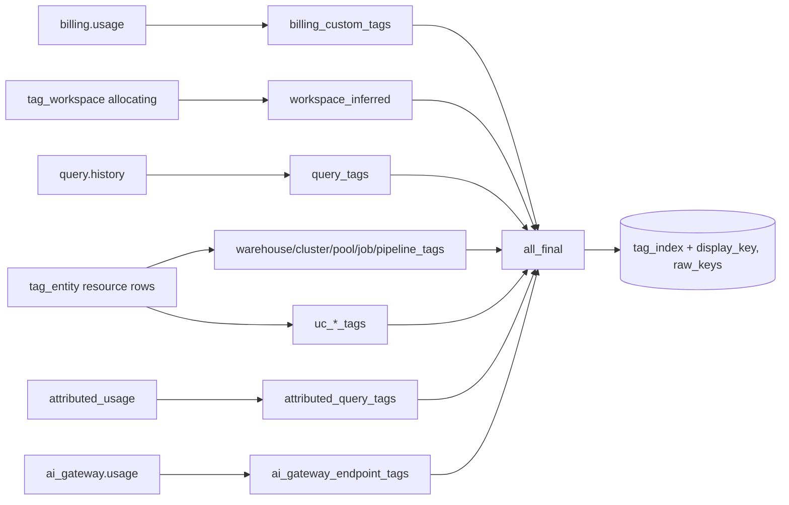

# tags.tag_index

Searchable index of every tag key/value seen anywhere in the snapshot, per source; the table `GET /api/tags` and the tag picker read (`dbt/models/tags/tag_index.sql:1-21`).

- Schema/materialization: `tags`, table (`dbt/models/tags/tag_index.sql:1`); DuckDB only (`:22-24`). Twin: `app/direct_sql/tags/tag_index.sql:1-5` (inlines tag_workspace/tag_entity chains).
- Grain / key: (tag_key, tag_value, source) (`dbt/models/tags/_tags_idx.yml:74-94`).

## Sources and what counts as an object

| source | object_count | dbus | Line |
|---|---|---|---|
| billing_custom_tags | billing rows | yes | `dbt/models/tags/tag_index.sql:31-49` |
| workspace_inferred | workspaces (allocating) | share * dbus_tagged | `dbt/models/tags/tag_index.sql:55-62` |
| resource tags | distinct entity | NULL | `dbt/models/tags/tag_index.sql:68-79` |
| query_tags | distinct statements | NULL | `dbt/models/tags/tag_index.sql:85-99` |
| attributed_query_tags | distinct record_id | active_usage_quantity | `dbt/models/tags/tag_index.sql:105-119` |
| uc_*_tags | distinct entity, workspace_count NULL | NULL | `dbt/models/tags/tag_index.sql:125-135` |
| ai_gateway_endpoint_tags | distinct endpoint | NULL | `dbt/models/tags/tag_index.sql:140-155` |

- display_key: raw spelling with the most objects, ties alphabetical; raw_keys: up to 10 distinct spellings (`dbt/models/tags/tag_index.sql:7-10,161-192`).

## Columns

`tag_key, display_key, raw_keys, tag_value, source, object_count, workspace_count, dbus, first_seen, last_seen` (`dbt/models/tags/tag_index.sql:207-220`).

## Read by

- `app/core/tags.py:202,231` (`read_tag_index`); missing -> "rebuild to search tags" (`app/core/tags.py:167`). Per-user rebuild under RLS: `app/core/rls.py:329`. `config/workspace.csv` rows replaced: `app/core/workspace_file.py:111-119`.
