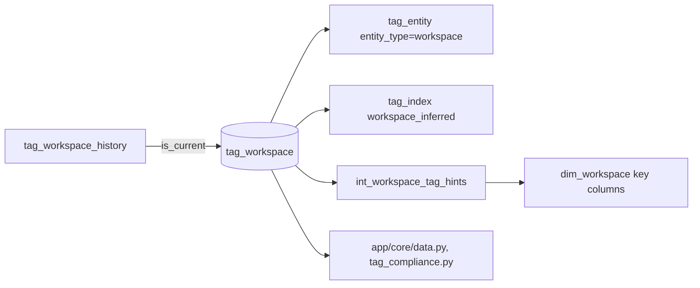

# tags.tag_workspace

The workspace's tag per key today: the current row of `tag_workspace_history` (`dbt/models/tags/tag_workspace.sql:1-15`).

- Schema/materialization: `tags`, table (`dbt/models/tags/tag_workspace.sql:1`); no own dialect guard, but its parent is DuckDB-only (`dbt/models/tags/tag_workspace_history.sql:18-20`). Twin: `app/direct_sql/tags/tag_workspace.sql:1-9`.
- Grain / key: (workspace_id, tag_key) (`dbt/models/tags/_tags_idx.yml:9-25`).
- Filter: `WHERE is_current` (`dbt/models/tags/tag_workspace.sql:15`).

## Columns

`workspace_id, tag_key, display_key, tag_value, is_allocating, top_value, top_values, share, coverage, dbus_tagged, dbus_total, reason, valid_from` (`dbt/models/tags/tag_workspace.sql:12-13`).

- `tag_value`: real value, `__mixed__` or `__untagged__`; only a real value allocates (`dbt/models/tags/tag_workspace.sql:5-7`).
- Screens describing a workspace read this; spend reads the history by usage date (`dbt/models/tags/tag_workspace.sql:10-11`).

## Read by

- dbt: `dbt/models/tags/tag_entity.sql:44`, `dbt/models/tags/tag_index.sql:59,163`, `dbt/models/dims/int_workspace_tag_hints.sql:108`.
- App: `app/core/data.py:1739,2997`, `app/core/tag_compliance.py:278,300`.
- Loader adds `<key>` columns to `dims.dim_workspace` from it (`tools/load_direct_results.py:196-231`).
- Overwritten for `config/workspace.csv` rows: `app/core/workspace_file.py:77`.
