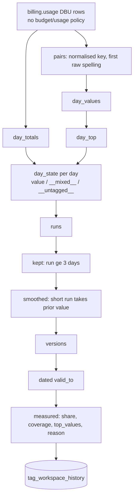

# tags.tag_workspace_history

The workspace's own tag per key, inferred from its bill and kept as SCD type 2 versions; no system table holds workspace tags (`dbt/models/tags/tag_workspace_history.sql:1-17`).

- Schema/materialization: `tags`, table (`dbt/models/tags/tag_workspace_history.sql:1`); DuckDB only (`:18-20`). Twin: `app/direct_sql/tags/_workspace_history.sql:1-7` (CTE block `ws_history`, pasted at `__WORKSPACE_HISTORY__`, `tools/export_direct_results.py:63-65`) and `app/direct_sql/tags/tag_workspace_history.sql:1-8`.
- Grain / key: (workspace_id, tag_key, valid_from) (`dbt/models/tags/_tags_idx.yml:27-47`).
- Versioning: `valid_from` inclusive, `valid_to` exclusive = next version's valid_from, NULL on current; `is_current = valid_to IS NULL` (`dbt/models/tags/tag_workspace_history.sql:12-13,114-117,183`).

## Business rules

- Inputs: DBU rows with workspace_id, before today, excluding budget/usage-policy rows (policy tags are not the workspace's) (`dbt/models/tags/tag_workspace_history.sql:24-33`).
- Day state: `__untagged__` if tagged DBUs < coverage_floor of the day's DBUs; top value if its share >= share_floor; else `__mixed__` (`dbt/models/tags/tag_workspace_history.sql:59-73`).
- Floors: `share_floor` default 0.6, `coverage_floor` default 0.5 (`dbt/models/tags/tag_workspace_history.sql:21-22`), fed from the merged settings (`config/settings.yml:61-62`, `settings.local.yml` wins) by `tools/dbt_run.py:139-146`.
- A run becomes a version once it held 3 days (to next run or today) (`dbt/models/tags/tag_workspace_history.sql:84-92`); a shorter run inherits the previous standing value (`:93-103`).
- First version starts on the workspace's first billed day, so earlier days read `__untagged__` (`dbt/models/tags/tag_workspace_history.sql:11-12,59-61`).
- display_key = raw spelling with most DBUs account-wide (`dbt/models/tags/tag_workspace_history.sql:147-157`).
- `is_allocating = tag_value NOT IN ('__mixed__','__untagged__')` (`dbt/models/tags/tag_workspace_history.sql:180`); `reason` text explains each case (`:190-209`).

## Columns

`workspace_id, tag_key, display_key, tag_value, is_allocating, valid_from, valid_to, is_current, top_value, top_values, share, coverage, dbus_tagged, dbus_total, reason` (`dbt/models/tags/tag_workspace_history.sql:175-210`).

## Example (illustrative)

| workspace_id | tag_key | tag_value | valid_from | valid_to | is_current |
|---|---|---|---|---|---|
| 111 | costcenter | `__untagged__` | 2026-06-01 | 2026-07-10 | false |
| 111 | costcenter | fin | 2026-07-10 | NULL | true |

## Read by

- `ref`: `dbt/models/tags/tag_workspace.sql:14`, `dbt/models/tags/cost_unit_tag.sql:55`, `dbt/models/tags/perf_unit_tag.sql:172`.
- App: `app/core/tag_spend.py:79`, `app/core/rollup.py:281`; overwritten for `config/workspace.csv` rows by `app/core/workspace_file.py:84`.
