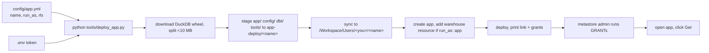

# Document: docs/databricks-app.md

Step-by-step guide (165 lines) to running the same app inside Databricks as a Databricks App, deployed by `tools/deploy_app.py`.

## Sections

| Section | Lines | Covers | Documents (code) |
|---|---|---|---|
| Intro | 1-15 | same app, results on app disk, nothing written to catalogs | `app/api/app.py` |
| What you need | 17-24 | repo set up, `.env`, Databricks CLI, permission to create apps | `tools/deploy_app.py:1-10` |
| 1. Pick who it runs as | 26-35 | `run_as: user` (token in `app.yaml`) vs `app` (service principal) | `tools/deploy_app.py:81-94` |
| 2. Name the app | 37-47 | `config/app.yml`, `config/app.local.yml` wins | `config/app.yml` |
| 3. Deploy | 49-68 | five deploy steps; wheel parts joined by `tools/app_start.py` | `tools/deploy_app.py:108-175`, `tools/app_start.py` |
| 4. Grants | 70-84 | `GRANT USE CATALOG/USE SCHEMA, SELECT` per system schema; BROWSE for catalogs | `tools/deploy_app.py:94-106` (`grant_sql`) |
| 5. Open and load | 86-91 | Get, share with Can use | `app/api/refresh.py` |
| Update | 93-97 | pull, redeploy, click Get | `processes/update_to_new_version.md` |
| Limit what each person sees | 99-123 | `rls.enabled/table/columns/apply`, matching, fail closed, export folder unfiltered | `app/core/rls.py`, `config/entitlements.example.sql` |
| What differs from a laptop | 125-135 | everyone sees everything, token in workspace file, disk wiped, Medium = 2 CPU/6 GB, tested versions | `config/settings.yml` `load.threads` |
| If something fails | 137-149 | error table | `tools/deploy_app.py` |
| For production (not built yet) | 151-165 | own schema/warehouse, copy job, two read options | not built (doc says so, `docs/databricks-app.md:154`) |

## Key facts

- The deploy always uses the `.env` token; `run_as` decides whether the app keeps it (`docs/databricks-app.md:21-22`).
- With `run_as: user` the token is plain text in the synced `app.yaml` (`docs/databricks-app.md:132-133`); the 2026-11-10 review flags this as a question (`reviews/review-2026-11-10-repo.html:84`).
- A redeploy or restart wipes the disk: click Get again (`docs/databricks-app.md:97`, `131`).
