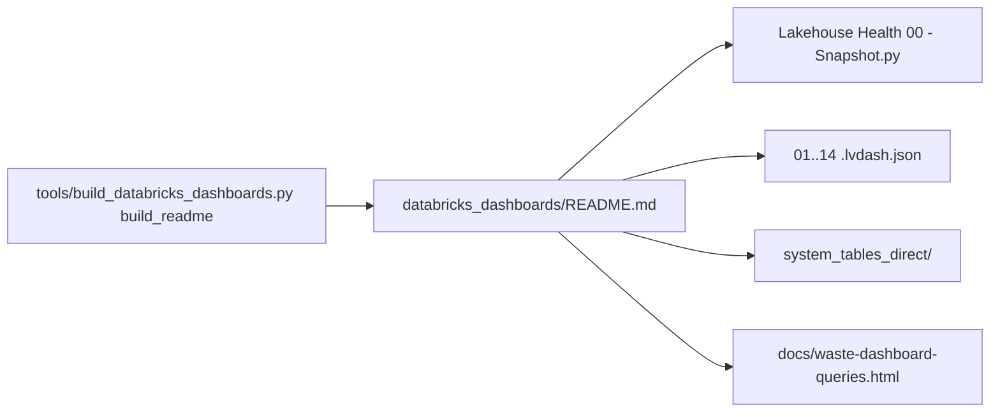

# Document: databricks_dashboards/README.md

User guide (183 lines, generated) for the 14 Lakehouse Health AI/BI dashboards: files, prerequisites, run the snapshot notebook, import, publish, use, refresh, cost tagging, troubleshooting, differences from the app, system tables read.

## Sections

| Section | Lines | Covers |
|---|---|---|
| Intro + contents | 1-12 | one notebook fills a schema; dashboards read only that |
| Files | 14-36 | notebook + 14 dashboards with page names; regenerate, don't hand-edit |
| Before you start | 38-45 | catalog, serverless/cluster, SQL warehouse (2X-Small), SELECT on system tables |
| 1. Run the notebook | 47-63 | widgets `catalog`, `tag_keys`, `chargeback_keys`, `query_tags`; 159 checks, 4 at a time; `snapshot_log` |
| 2. Import | 65-77 | import from file; last cell for links; catalog rebuild `--catalog --out-dir` |
| 3. Publish and share | 79-83 | Embed credentials, no schedule, Can view |
| Using the dashboards | 85-96 | layout per page, Workspace filter, statuses |
| New numbers | 98-102 | rerun notebook or schedule as job |
| Tagging what this costs | 104-111 | query tags vs bill tags for notebook and dashboards |
| If something fails | 113-122 | error table |
| What differs from the app | 124-131 | 30-day window, tags, auto-stop assumptions, 5,000 rows |
| System tables read | 133-183 | 49 `system.*` tables, derived from the checks' SQL |

## What it documents

- Generated by `build_readme` (`tools/build_databricks_dashboards.py:1312-1444`, inferred end); system table list from `system_tables_read()` (`tools/build_databricks_dashboards.py:1302-1309`).
- Notebook `databricks_dashboards/Lakehouse Health 00 - Snapshot.py` and the 14 `.lvdash.json` files; see `modules/dashboards.md` and `flows/dashboards_snapshot.md`.
- Points to `databricks_dashboards/system_tables_direct/README.md` and `tools/build_direct_dashboards.py` (`databricks_dashboards/README.md:36`).
