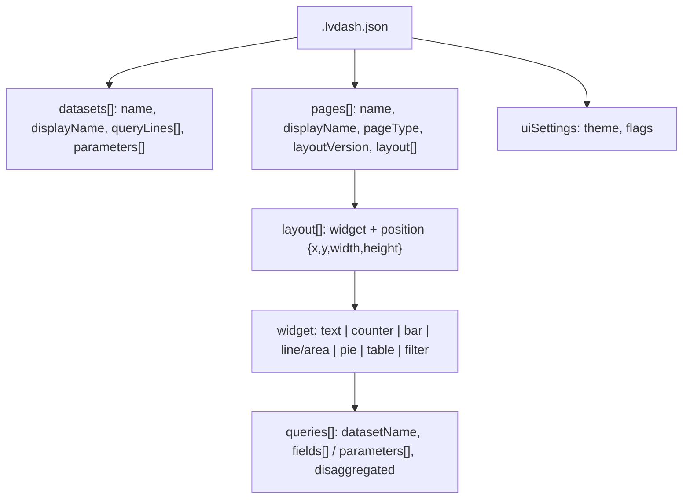

# Document: docs/lakeview-dashboard-format.md

Reference (698 lines) for the `.lvdash.json` AI/BI dashboard file format, reverse-engineered from a real export; the ground truth the two dashboard generators follow.

## Sections

| Section | Lines | Covers |
|---|---|---|
| Intro | 1-10 | source (real export, 28 datasets, 6 pages), placeholders |
| Top level | 12-44 | `datasets`, `pages`, `uiSettings` |
| Datasets | 46-120 | `queryLines` (concatenation must reproduce SQL), parameters (89-120) |
| Pages | 122-163 | `PAGE_TYPE_CANVAS` vs `PAGE_TYPE_GLOBAL_FILTERS`; grid 6 vs 12 columns (`GRID_V1`) (152-163) |
| Widgets | 165-462 | text, field naming, counter v2, bar v3, line/area, pie, table v1 |
| Filters | 464-622 | local multi-select, shared/global multi-select, date range |
| Minimum keys an import needs | 624-641 | required keys; `fieldName` must match a field or the widget is silently empty |
| Importing | 643-689 | UI, REST (`/api/2.0/lakeview/dashboards`), CLI (`databricks lakeview`), Asset Bundles (`embed_credentials`, `dataset_catalog`) |
| Sources | 691-698 | Databricks docs links (as text, not followed) |

## What it documents (code that relies on it)

- `tools/build_databricks_dashboards.py`: `query_lines()` cites the "concatenation must reproduce the SQL" rule (`tools/build_databricks_dashboards.py:228-233`); widget builders `526-890`.
- `tools/dashboard_kit.py`: GRID_V1 12-column layout (`tools/dashboard_kit.py:266-284`).
- `tools/build_direct_dashboards.py`: `GRID = 12`, time-range parameter (`tools/build_direct_dashboards.py:627-630`).
- `tests/test_databricks_dashboards.py`: shape tests mirror the minimum-keys list (`tests/test_databricks_dashboards.py:56-151`); the file references this doc (grep hit).
