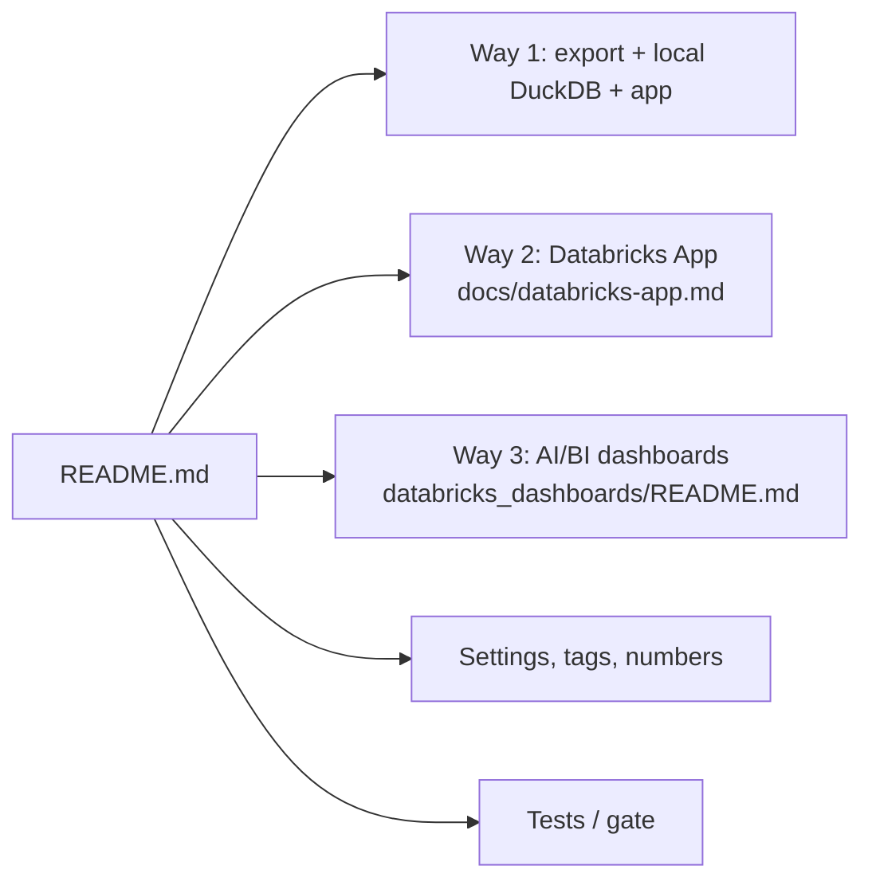

# Document: README.md

The main user guide (758 lines): what Crosshire is, the three ways to use it, setup, run, Databricks App, dashboards, updates, every screen, how numbers are counted, settings, tags, other load paths, troubleshooting, repo map and tests.

## Sections (line ranges)

| Section | Lines | Covers | Documents (code) |
|---|---|---|---|
| Intro, three ways | 1-27 | 160 checks on `system.*`, read-only; three ways | `app/direct_sql/`, `docs/databricks-app.md`, `databricks_dashboards/README.md` |
| What you need | 29-44 | Python 3.11+, UC + system tables, SQL warehouse, PAT with SELECT on system schemas | `requirements.txt` |
| Set up once | 46-63 | venv, `pip install`, `.env` with `DATABRICKS_SERVER_HOSTNAME`, `DATABRICKS_HTTP_PATH`, `DATABRICKS_TOKEN` | `.env.example` |
| Run | 65-175 | `tools/first_run.py` (export + load), windows, today partial, Refresh, export options table, sizes as another account, sizes job, table/volume sizes | `tools/first_run.py`, `tools/export_direct_results.py`, `tools/load_direct_results.py`, `app/api/refresh.py` |
| Where the files go | 177-202 | data folder per OS, `AUDIT_DATA_DIR`, which DB the app opens (4-step order) | `app/core/datasource.py`, `app/core/data.py:197-216` |
| Run as a Databricks App | 204-229 | `tools/deploy_app.py`, `config/app.yml`, RLS block | `tools/deploy_app.py`, `app/core/rls.py` |
| AI/BI dashboards | 231-244 | notebook + 14 dashboards; 7 live dashboards | `databricks_dashboards/` |
| Update to a new version | 246-258 | pull, keep own files, reinstall, re-export | `processes/update_to_new_version.md` |
| What the app shows | 260-344 | pages and sub-tabs, lenses, filters, URL hash keys, CSV/PDF | `web/src/components/roles.ts`, `tab_registry.ts`, `nav_hash.ts` |
| What the numbers mean | 346-413 | list price, statuses, possible waste (5 checks), savings, materiality, thresholds, environment, regions, windows, row cap | `config/materiality.yml`, `config/thresholds.yml`, `dbt/dbt_project.yml` env_patterns |
| Settings | 415-511 | settings table, local override, own views (`sources`), `dashboards`, `table_sizes`, editable files, env vars | `config/settings.yml`, `app/core/config.py` |
| Tags | 513-636 | tag resolution order, workspace tags from bill or `config/workspace.csv`, Tags page levels, three tag settings, top tags | `app/core/tags.py`, `app/core/rollup.py`, `config/tag_aliases.yml` |
| Other ways to load data | 638-692 | load someone else's export, other tools' files, fake account, snapshot + dbt | `tests/fake_account/build.py`, `tools/snapshot.py`, `tools/dbt_run.py` |
| API | 694-697 | `/api`, only `POST /api/refresh` writes; `/docs` | `app/api/app.py` |
| If something fails | 699-720 | error -> fix table; exit codes 2/1/130 | `tools/first_run.py:23-25` |
| Repository | 722-737 | folder map | repo tree |
| Tests | 739-753 | `gate.py` full/quick, web checks, rebuild `app/web/dist` | `tools/gate.py`, `web/vite.config.ts`, `tests/test_web_dist.py` |
| License | 755-758 | MIT or Apache-2.0 | `LICENSE-MIT`, `LICENSE-APACHE` |

## Key facts stated

- Only the export (and Refresh) queries the warehouse; browsing does not (`README.md:18-19`).
- Refresh keeps the newest two results folders and up to 500,000 rows per check; `first_run.py` keeps 50,000 (`README.md:95-103`).
- Possible waste = 5 priced checks, each resource once (`README.md:367-377`).
- Statuses: Critical, Warn, OK, Ranked, Not assessed, No data, No data (filtered), Reference (`README.md:352-365`).
- The app has no login; keep `AUDIT_API_HOST` local (`README.md:508`).
- Secrets referenced by name only: `DATABRICKS_TOKEN`, `DATABRICKS_HTTP_PATH`, `DATABRICKS_SERVER_HOSTNAME` (`README.md:57-63`).

## Possibly stale

- "It runs 160 SQL checks" (`README.md:6`) vs the notebook's 159 (`databricks_dashboards/README.md:60`): 160 `.sql` files in `app/direct_sql/`, one is a developer probe skipped by the dashboards (`tools/build_databricks_dashboards.py:905`). Both are consistent with their own scope.
