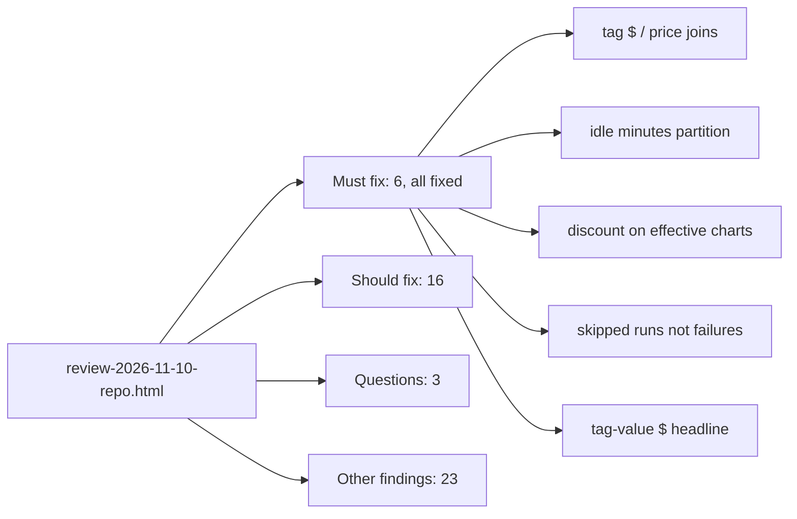

# Document: reviews/review-2026-11-10-repo.html

Whole-repo review (117 lines) at `main @ dda0df6`, verdict "Approve with changes": 6 must-fix (wrong numbers), 16 should-fix, 3 questions, 23 other findings; a status block says all must-fix items and the listed should-fix items were fixed, with a second pass.

## Header

- Scope `main @ dda0df6`; checks: `tsc --noEmit` pass, pyflakes 1 duplicate key + 1 unused import, pytest/dbt not run, 103 screens browsed with 0 console errors (`reviews/review-2026-11-10-repo.html:23-29`).
- Status after fixes: all six must-fix fixed; listed should-fix fixed; second pass: per-window people/warehouse exports, one dollar split (`tags.cost_alloc`, `_cost_alloc.sql`), seed row moved to `tests/fixtures/seeds`, `databricks` dbt target and `direct_check` macro removed, vendored fixes relocked, comment cuts (`reviews/review-2026-11-10-repo.html:32-49`). Matches recent commits `bca73da`, `d5647dd` (git log).

## Must fix (wrong numbers), `reviews/review-2026-11-10-repo.html:52-59`

| # | Where | Problem -> fix |
|---|---|---|
| 1 | `dbt/models/tags/cost_unit_tag.sql:35`, `app/direct_sql/tags/cost_unit_tag.sql:19`, `cost_reconciliation.sql:18`, `tools/direct_dashboard_load.py:64` | raw `list_prices` join with no USD filter/overlap cap double-counts -> use `list_prices()` / de-duplicated block |
| 2 | `app/direct_sql/tags/cost_day.sql:7` vs dbt `cost_day.sql:19` | `is_perf_optimized` differs -> same `PERFORMANCE_OPTIMIZED` test in both |
| 3 | `app/queries/app/compute/compute_warehouse_idle_minutes.sql:232,234` | `LEAD` not partitioned by `run_no` -> add it, regenerate |
| 4 | `web/src/tabs/tab_cost.tsx:297,491` and others | "effective" charts ignore discount -> apply `1 - discount_pct` |
| 5 | `web/src/tabs/tab_jobs.tsx:79-84` | SKIPPED counted as execution error -> separate bucket |
| 6 | `app/core/finding_columns.py:15` | `cost_chargeback_by_tag_value` headline $ summed across keys -> no headline $ |

Line numbers in this table are as of `dda0df6`, not re-checked against `b8d2db1`.

## Should fix (selected), `reviews/review-2026-11-10-repo.html:62-79`

- Findings fetch race (`web/src/App.tsx:913`); per-window people/warehouse users (`app/core/data.py`); partial `--only`/`--domain` export replacing the full folder (`tools/export_direct_results.py:1330`); masking of owners/user_name/grantees (`tools/table_detail.py`, `tools/workspace_activity.py`).
- Dashboard builders: stale-jobs 30-day threshold rewritten by the window swap (`tools/build_direct_dashboards.py:39`) - now kept via `KEEP_BY_ID` (`tools/build_direct_dashboards.py:50`); `COUNT(DISTINCT user_name)` typed as number (`tools/build_databricks_dashboards.py:757`).
- Data/design: env hint case (`dbt/models/dims/int_workspace_tag_hints.sql:50`), blank tag values, two dollar-by-tag pipelines, four product maps, tag-filter performance (`app/core/tag_spend.py:203`), seed test row, dead `databricks` dbt target, comment slop.

## Questions, `reviews/review-2026-11-10-repo.html:82-86`

- PAT stored plain in synced `app.yaml` with `run_as: user` (`tools/deploy_app.py:149`).
- Hour 00:00 peak in Cost "When you spend": fake data or daily billing rows?
- Tag tables filter `ingestion_date < as_of`, checks don't (`app/direct_sql/overview_spend_estimate.sql:59`).

## Other findings, `reviews/review-2026-11-10-repo.html:91-115`

- Visual: month labels, axis collision, table overflow, narrow text, dark-mode contrast.
- Code size/obvious: duplicate dict key in `tools/direct_guides.py:1157,1174`, unused import `app/core/rls.py:17`, Streamlit leftovers, unused helpers.
- Correctness: cache eviction race (`app/api/app.py:1116,1143`), routes ignoring `default_window` (`app/api/app.py:845`), `--sizes-only --mask-users` ignored, unredacted error strings (`tools/export_direct_results.py:1380,488,784`).
- Design: materiality floor hard-coded in dashboards (`tools/build_direct_dashboards.py:172`, `tools/build_databricks_dashboards.py:451`); gate existence probes dead, duplicated `.env`/redact helpers (`tools/gate.py:61`).
- Areas with no issues: API injection, query tags on direct SQL, customer names, type safety (`reviews/review-2026-11-10-repo.html:89`).

## What it documents

- The whole repo at `dda0df6`; every row names its own files (above). Not a design doc; a point-in-time review.
