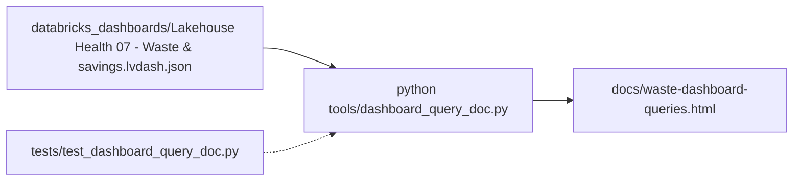

# Document: docs/waste-dashboard-queries.html

Generated HTML guide (1724 lines) to every query of the "Lakehouse Health 07 - Waste & savings" dashboard, for new readers: system tables, then per widget the tables read, each CTE step, the final query and commented SQL.

## Structure (line of each heading)

| Part | Lines | Content |
|---|---|---|
| Title + how to read | 28-51 | how to read a query |
| The tables | 52-59 | Databricks system tables; tables the dashboard reads |
| Page: Priced | 60-794 | KPIs Possible waste (62), Top 3 resources (141), Biggest single fix (222), Resources flagged (301); widgets by source/resource, idle warehouses, auto-stop saving, cache reuse, failed job runs, top resources |
| Page: What-if | 795-1419 | KPIs Serverless at 1 min (797), at 5 min (850), Pro/classic at 10 min (903), Idle hours saved (956); saving and cold starts by setting/warehouse; status; `compute_warehouse_idle_minutes` rows (1356) |
| Page: Flagged, not priced | 1420-1654 | KPIs flagged, rows flagged, not flagged, Serverless & Photon DBUs; flagged rows by check; every check worst first |
| Page: How it's counted | 1655-1694 | priced sources; flagged with no dollar figure |
| Page: Every page | 1695-1708 | `snapshot_banner` |
| Page: Global Filters | 1709-1724 | `workspace_options` |

## What it documents

- The dashboard file `databricks_dashboards/Lakehouse Health 07 - Waste & savings.lvdash.json` (pages at lines 1782, 3386, 6518, 7200, 7574).
- Its screen module `tools/dashboard_screens/waste.py:16-358`.
- Generator `tools/dashboard_query_doc.py:1-16` (OUT = `docs/waste-dashboard-queries.html`, line 16); linked from `databricks_dashboards/README.md:35`.
- Regenerate after rebuilding the Waste dashboard (inferred: it reads the committed `.lvdash.json`, `tools/dashboard_query_doc.py:15`).
