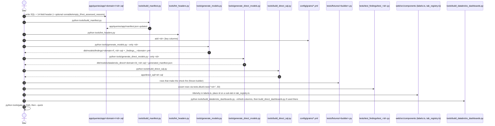

# Flow: add a new check

Steps to add an app-owned SQL check so it reaches the export, the app, the dashboards and the tests; each step names the file and the command that enforces it. Order is inferred from the generators' inputs and outputs; no single doc lists it.

## Steps with evidence

1. **Write the file** at `app/queries/app/<domain>/<id>.sql`; `query_id` = file name, `domain` = folder (`tools/lint_headers.py:87-90`). Header fields: `tools/header_schema.py:15-38`. Use `:period_days` for the window, never a hard-coded interval (`tools/lint_headers.py:63-68`). `status` only `OK/WARN/CRITICAL/NOT_ASSESSED` (`tools/lint_headers.py:44`).
2. **Manifest**: `python tools/build_manifest.py` (`tools/build_manifest.py:7-8`). Never hand-edit `manifest.json` (`tools/build_manifest.py:4-5`).
3. **Lint**: `python tools/lint_headers.py`, exit 1 on any violation, includes `build_manifest.py --check` (`tools/lint_headers.py:13-15`, `163-176`).
4. **Grain**: key columns in `config/grains/<batch>.yml`; do not list `window_days` (`config/grains/compute_snapshots.yml:1-3`); `fixture_coverage.py` requires it (`tools/fixture_coverage.py:20-21`).
5. **dbt finding model**: `python tools/generate_models.py --only <id>` (`tools/generate_models.py:5`); the header `reads:` must equal the tables in the body (`tools/generate_models.py:31-32`).
6. **Direct model**: `python tools/generate_direct_models.py --only <id>` (`tools/generate_direct_models.py:5`). The export only runs ids in its `generated_manifest.json` (`tools/export_direct_results.py:1130-1135`).
7. **Plain SQL**: `python tools/build_direct_sql.py` (`tools/build_direct_sql.py:1-6`); also needed after any `config/thresholds.yml` change (`README.md:389-392`).
8. **Fixture + test**: a builder module under `tests/fixtures/` with `build(con)` is found automatically (`tests/fixtures/build_fixtures.py:7-10`); test calls `rows(...)` with the id (`tools/fixture_coverage.py:22-24`, `tests/dbutil.py:4-6`).
9. **UI**: `labels.ts` entry `{ title, why }` (`web/src/components/labels.ts:67` example); placement in a sub-tab `ids` list (`web/src/components/tab_registry.ts:147` example). The dashboard builder reads both (`tools/build_databricks_dashboards.py:935-998`).
10. **Dashboards**: columns come from `tools/dashboard_columns.json`, refreshed from the test DB with `--refresh-columns` (`tools/build_databricks_dashboards.py:1052-1063`); test fails if stale (`tests/test_databricks_dashboards.py:525`). Committed dashboards must equal a rebuild (`tests/test_databricks_dashboards.py:294`).
11. **Rebuild UI** if `web/` changed (`README.md:750-753`), see `processes/build_web.md`.
12. **Gate**: full then quick (`tools/gate.py:4-7`), see `processes/gate.md`.

## Changing a vendored check instead

- Edit `app/queries/vendored/<domain>/<id>.sql` in place, then `python tools/sync_queries.py --relock --item <id>` and commit both (`tools/sync_queries.py:39-56`).
- Record the defect in `config/library_corrections.yml` (`app/core/library_corrections.py:3-12`).
- Then steps 5-12 above.
