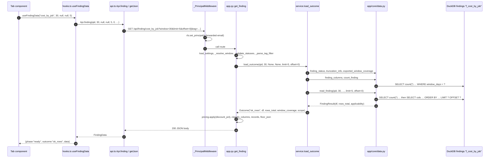

# Flow: one API request (browser tab → JSON)

A tab component calls a hook in `web/src/components/hooks.ts`, which calls `Api.*` in `web/src/api.ts`; FastAPI routes it in `app/api/app.py`, `app/api/service.py` decides the outcome, `app/core/data.py` runs bound-parameter SQL on DuckDB, and the route shapes JSON. Worked example: `GET /api/finding/cost_by_job?window=30&limit=5` (`tests/test_api.py:1133-1153`).



## Steps

1. A tab calls `useFindingData(queryId, windowDays, workspaceIds, envs, limit?, statuses?, columns?)`; default limit 5000; memo key includes the tag filter (`web/src/components/hooks.ts:85-90`). Callers e.g. `web/src/tabs/job_state.tsx:43`, `web/src/components/last_activity.tsx:39`.
2. Hook calls `Api.finding(...)` (`web/src/components/hooks.ts:97`) → `getJson('/api/finding/<id>', {window, workspace_ids, env, limit, offset, job_id, status, columns, ...tag})` (`web/src/api.ts:111-123`).
3. `qs()` repeats array params (`workspace_ids=a&workspace_ids=b`) and skips empty ones; the module tag filter becomes repeated `tag=key:value` (`web/src/api.ts:10-22`, `web/src/api.ts:53-57`).
4. `getJson` fetches with `Accept: application/json`; non-2xx throws `Error("<status> <detail>")` (`web/src/api.ts:24-37`).
5. `_PrincipalMiddleware` binds `x-forwarded-email` (only set on Databricks Apps) for row-level access (`app/api/app.py:187-205`).
6. `get_finding` loads settings (bad settings → 503 via handler), resolves window (default `default_window`, must be 7/30/90 else 422), validates `status`, parses tag params (`app/api/app.py:1156-1189`, `app/api/app.py:221-244`).
7. `service.load_outcome` runs the outcome order: not built/failed/blocked source → `not_assessed`; not exported window → `not_assessed`; count 0 → `ok_empty_window`; filters exclude all → `ok_empty_filters`; else `ok_rows` (`app/api/service.py:427-608`).
8. Store reads open the shared read-only connection (or the rls scoped one) (`app/core/data.py:304-329`); `read_finding` builds WHERE from window, workspace/env, job, status, tag; counts `rows_total`; selects the page with `ORDER BY` and `LIMIT ? OFFSET ?` (`app/core/data.py:822-904`).
9. Unknown `query_id` → `QueryNotFoundError` → 404 (`app/api/app.py:1197-1198`); DuckDB/OS failure → 200 with `outcome: "error"` (`app/api/service.py:521-524`, `app/api/app.py:1245-1247`).
10. For `ok_rows`: `pricing.apply` adds `<col>_disc` money twins, optional `columns` projection, `classify_columns` labels kinds, `records` makes JSON-safe rows (ids as strings) (`app/api/app.py:1267-1277`, `app/core/pricing.py:48`, `app/api/service.py:996`, `app/api/service.py:1053`).
11. Body assembled with paging, floor, `order_by`, `row_cap`, `window_coverage`, truncation (`app/api/app.py:1278-1313`).
12. Hook stores `{phase: "ready", outcome, data}` and reports filters the check ignored (`web/src/components/hooks.ts:98-103`).

## Example payload — `GET /api/finding/cost_by_job?window=30&limit=5`

Asserted by `tests/test_api.py:1133-1153` (`PLAIN_QUERY_ID = "cost_by_job"`, `tests/test_api.py:87`): status 200, `outcome == "ok_rows"`, `window_days == 30`, 5 rows, `returned == 5`, `rows_total > 5`, header has `read_this/healthy/investigate_if/actions/next/caveats`, `columns.workspace_id.kind == "id"`, `rows[0].workspace_id` is a string, `order_by` null or string.

Shape (top-level keys from `app/api/app.py:1201-1239`, `app/api/app.py:1278-1311`; values and the check's own column names are illustrative, not read from the fixture):

```json
{
  "query_id": "cost_by_job", "outcome": "ok_rows",
  "window_days": 30, "requested_window_days": 30,
  "is_finding": true, "windowed": true, "tag": null,
  "scope": {"has_workspace_id": true, "regional": false, "region_gap": null, "tag": null},
  "status": [], "library_corrections": [], "degraded_sources": [], "partial_sources": [],
  "header": {"title": "…", "domain": "cost", "tier": "…", "stars": false, "origin": "…",
             "read_this": "…", "healthy": "…", "investigate_if": "…", "actions": ["…"],
             "next": ["…"], "caveats": "…", "empty_if": "…"},
  "rows_total": 42, "rows_in_window": 42, "limit": 5, "offset": 0, "returned": 5,
  "columns": [{"name": "workspace_id", "kind": "id", "label": null},
              {"name": "est_usd_list", "kind": "money", "label": "list price (effective)"}],
  "rows": [{"workspace_id": "1111", "job_id": "…", "est_usd_list": 12.5, "status": "WARN"}],
  "floor": null, "excluded_no_workspace": null, "order_by": null,
  "discount_pct": 0.0, "row_cap": null, "window_coverage": {"…": "…"},
  "truncated": false, "truncated_max_rows": null
}
```

Other outcomes return the common keys plus one extra: `not_assessed` → `status_info`; `error` → `error`; `ok_empty_window` → `window_coverage`; `ok_empty_filters` → `rows_in_window`, `row_cap`, `excluded_no_workspace` (`app/api/app.py:1241-1265`). Test: `ok_empty_filters` with `workspace_ids=not-a-real-workspace` has `rows_in_window > 0` and no `rows` key (`tests/test_api.py:1205-1211`).

## Second example — `GET /api/findings?window=30` (findings table)

- Caller: `App.tsx` effect → `Api.findings(window_, workspaceIds, envs)` (`web/src/App.tsx:905-915`, `web/src/api.ts:105-108`).
- Route: `get_findings` → `_findings_answer` (cached by `_data_version`, window, scope, tag) → `service.list_findings` (one `finding_window_counts` batch) (`app/api/app.py:1018-1107`, `app/api/service.py:767-783`).
- Body: `{window_days, workspace_ids, env, tag, count, region_gap, findings: [{query_id, title, domain, tier, stars, origin, is_finding, windowed, window_days, outcome, row_count, status_counts, has_workspace_id, regional, not_assessed_reason, partial, tag_applied, tag_chain, tag_chain_label, library_corrections, severity_cap, not_assessed, money, affected}]}` (`app/api/app.py:1044-1099`).
- Test: `count == len(findings) == executable checks`; row `cost_by_job` is `ok_rows`, `row_count > 0`, `status_counts` keys ⊆ {CRITICAL, WARN, OK, NOT_ASSESSED} and sum to `row_count` (`tests/test_api.py:1059-1073`).

## Bootstrap order (every page load)

1. `GET /api/status` → `{state, settings_error, database, brand}` (`web/src/App.tsx:841-843`, `app/api/app.py:349-377`); test: healthy fixture → `state == "ready"` (`tests/test_api.py:271-277`).
2. If ready: `GET /api/meta` and `GET /api/workspaces` (`web/src/App.tsx:847-863`); meta test asserts `window_options == [7, 30, 90]`, `cost_cutoff`, model counts (`tests/test_api.py:444-468`).
3. Then `GET /api/findings` and per-tab `/api/finding/*`, `/aggregate`, `/api/rollup*`, etc. (`web/src/api.ts:68-135`).
