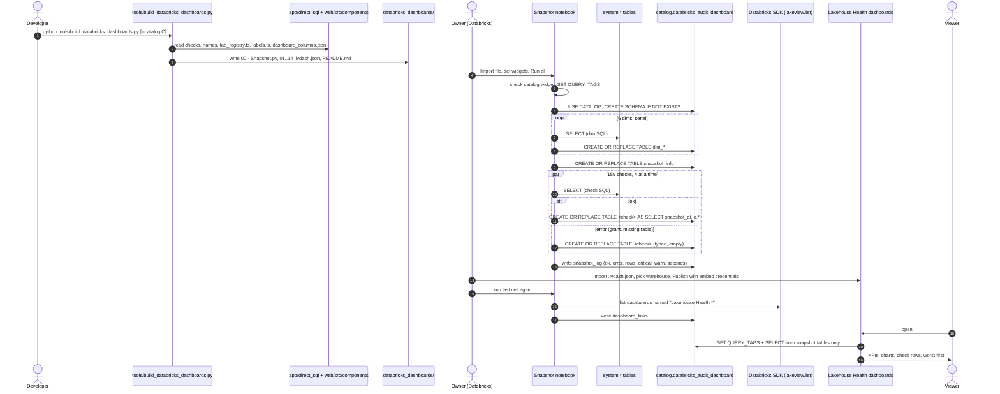

# Flow: build, snapshot and view the Lakehouse Health dashboards

How the 14 Lakehouse Health dashboards get their numbers: the repo builds a notebook and 14 `.lvdash.json` files, the notebook fills `<catalog>.databricks_audit_dashboard`, the dashboards read only that schema.

## Sequence

## Steps with evidence

1. Build: `main()` -> `build(catalog)` writes notebook, one file per tab, README (`tools/build_databricks_dashboards.py:1457-1493`).
2. Inputs read: checks and names with markers filled (`tools/build_databricks_dashboards.py:75-95`); tabs from `tab_registry.ts` (`tools/build_databricks_dashboards.py:951-984`); labels from `labels.ts` (`tools/build_databricks_dashboards.py:1005-1014`); columns from `tools/dashboard_columns.json` (`tools/build_databricks_dashboards.py:1082-1084`).
3. Owner imports and runs the notebook (`databricks_dashboards/README.md:47-63`).
4. Widgets: `databricks_dashboards/Lakehouse Health 00 - Snapshot.py:15-18`.
5. Catalog check and query tags: `databricks_dashboards/Lakehouse Health 00 - Snapshot.py:16301-16316`.
6. Schema create: `databricks_dashboards/Lakehouse Health 00 - Snapshot.py:16321-16323`.
7. Dims: `databricks_dashboards/Lakehouse Health 00 - Snapshot.py:16343`.
8. `snapshot_info`: `databricks_dashboards/Lakehouse Health 00 - Snapshot.py:16344-16348`.
9. Checks in parallel: `databricks_dashboards/Lakehouse Health 00 - Snapshot.py:16349-16350`; per-table logic `16328-16340`.
10. `snapshot_log`: `databricks_dashboards/Lakehouse Health 00 - Snapshot.py:16352-16357`.
11. Import and publish: `databricks_dashboards/README.md:65-83`.
12. Links cell: `databricks_dashboards/Lakehouse Health 00 - Snapshot.py:16361-16380`.
13. Dashboard queries carry `SET QUERY_TAGS` (`tools/build_databricks_dashboards.py:200-220`) and read only `{S}` tables (test `tests/test_databricks_dashboards.py:314`).

## Rules on this flow

- A failed check never stops the run; it reads "Not assessed" with the reason in `snapshot_log` (`databricks_dashboards/README.md:62-63`, notebook `16333-16335`).
- New numbers only when the notebook runs again; set no dashboard refresh schedule (`databricks_dashboards/README.md:81-82`, `98-102`).
- Wrong default catalog -> `TABLE_OR_VIEW_NOT_FOUND`; rebuild with `--catalog` (`databricks_dashboards/README.md:72-77`, `120`).
- Dashboard links need the SDK and the right to list dashboards; otherwise Overview shows no links (notebook `16376-16377`).
