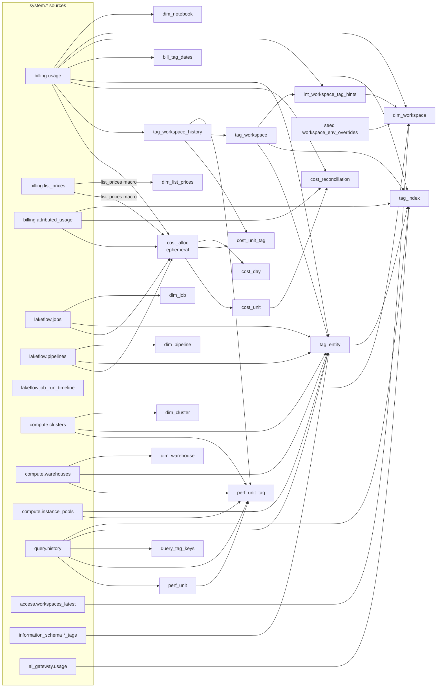
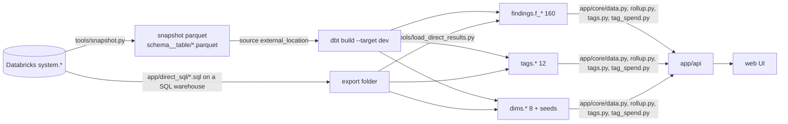

# dbt lineage

How a `system.*` row becomes an app number: sources -> (findings | tags | dims) -> DuckDB -> app, with the direct export as a second road into the same tables. Every `ref()` edge in the project is shown below; finding models never `ref()` anything (scripted scan of `dbt/models/findings/**`).

## Model-level lineage (tags + dims)

## ref() edges (all of them)

| Child | ref() parent | Evidence |
|---|---|---|
| cost_unit | cost_alloc | `dbt/models/tags/cost_unit.sql:19` |
| cost_unit_tag | cost_alloc, tag_workspace_history | `dbt/models/tags/cost_unit_tag.sql:19,55` |
| cost_day | cost_alloc | `dbt/models/tags/cost_day.sql:21` |
| cost_reconciliation | cost_unit | `dbt/models/tags/cost_reconciliation.sql:54` |
| perf_unit_tag | perf_unit, tag_workspace_history | `dbt/models/tags/perf_unit_tag.sql:83,93,172` |
| tag_workspace | tag_workspace_history | `dbt/models/tags/tag_workspace.sql:14` |
| tag_entity | tag_workspace | `dbt/models/tags/tag_entity.sql:44` |
| tag_index | tag_workspace, tag_entity | `dbt/models/tags/tag_index.sql:59,69,126,163` |
| int_workspace_tag_hints | tag_workspace | `dbt/models/dims/int_workspace_tag_hints.sql:108` |
| dim_workspace | workspace_env_overrides (seed), int_workspace_tag_hints | `dbt/models/dims/dim_workspace.sql:122,126,132` |

## End-to-end layers

- Snapshot read path: `dbt/models/sources/sources.yml:12`. Loader writes: `tools/load_direct_results.py:580,609,646-658`.
- Post-build rewrites (both roads): `config/workspace.csv` tags into tag tables (`tools/dbt_run.py:325-339`, `tools/load_direct_results.py:705-710`); bill tags into perf compute level (direct road only, `tools/load_direct_results.py:701-703`).

## Example 1: one warehouse dollar to the Chargeback screen (illustrative values)

1. `billing.usage` row: warehouse W, 10 DBU, `custom_tags {cost_center: fin}`, priced at $0.70 -> $7.00 (`dbt/models/tags/cost_alloc.sql:11-46`).
2. `attributed_usage` gives 6 of W's DBUs that day to queries tagged `{team: a}` -> cost_alloc parts: query 6 DBU, warehouse_idle 4 DBU (`dbt/models/tags/cost_alloc.sql:55-103`).
3. `cost_unit`: two units (query part, idle part), $4.20 and $2.80 (`dbt/models/tags/cost_unit.sql:13-38`).
4. `cost_unit_tag`: compute `cost_center=fin` on both; work `team=a` $4.20 on the query unit (`dbt/models/tags/cost_unit_tag.sql:28-82`).
5. `cost_reconciliation` checks $7.00 billing = $7.00 units (`dbt/tests/tags_cost_reconciles.sql:6-9`).
6. App: `app/core/rollup.py:326-352` joins unit + tag rows and computes the untagged remainder.

## Example 2: one check (f_cost_by_job)

1. Source SQL `app/queries/vendored/cost/cost_by_job.sql` -> `tools/generate_models.py` -> `dbt/models/findings/cost/f_cost_by_job.sql` (`:2`).
2. Reads `billing.usage`, `list_prices()`, latest `lakeflow.jobs`, `workspaces_latest` (`dbt/models/findings/cost/f_cost_by_job.sql:31-45`), stacked for 7/30/90 (`:3-5,101-104`).
3. Table `findings.f_cost_by_job`, grain from `config/grains/cost_usage_only.yml:69`.
4. App reads it with `read_finding` (`app/core/data.py:841`), names from `dims.dim_job` (`app/api/app.py:599`).
5. Direct road: `d_cost_by_job` -> `app/direct_sql/cost_by_job.sql` -> loader `findings."f_cost_by_job"` (`tools/load_direct_results.py:580`).

## Example 3: a workspace tag

- Bill DBUs of workspace 111 carry `CostCenter=fin` on >= 50% of DBUs and `fin` holds >= 60% of them for 3+ days -> new `tag_workspace_history` version (`dbt/models/tags/tag_workspace_history.sql:59-103`) -> `tag_workspace` current row -> `int_workspace_tag_hints` -> `dim_workspace.cost_center` when `cost_center` is a top tag (`dbt/models/dims/dim_workspace.sql:187-197`).
