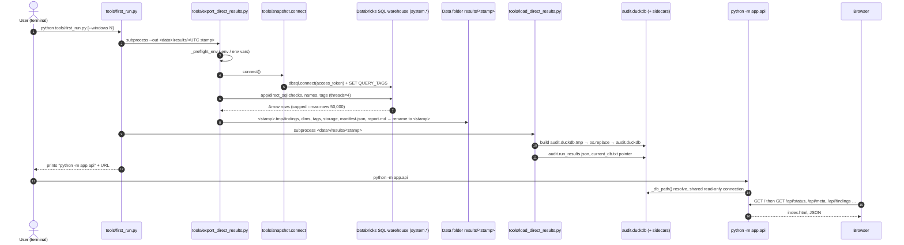
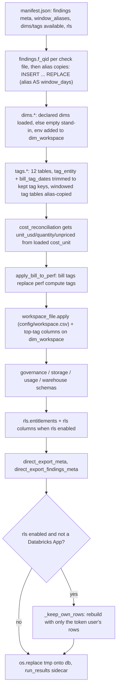

# Flow: export → load → serve (first run on a laptop)

`python tools/first_run.py` runs every check on a Databricks SQL warehouse, writes parquet files to the data folder, loads them into a local `audit.duckdb`; then `python -m app.api` serves it to the browser at `http://127.0.0.1:8000/` (`README.md:65-81`, `tools/first_run.py:1-35`).



## Steps

1. User runs `python tools/first_run.py [--windows N]` (`README.md:67-70`, `tools/first_run.py:79-83`).
2. `first_run.main` picks `<data dir>/results/<%Y%m%dT%H%M%SZ>`; data dir = `AUDIT_DATA_DIR` or OS default (`tools/first_run.py:98-106`, `tools/first_run.py:166`, `app/core/datasource.py:14-31`).
3. Step 1 spawns `python tools/export_direct_results.py --out <dir> [--windows N]` with `cwd=ROOT` (`tools/first_run.py:112-116`, `tools/first_run.py:126-129`, `tools/first_run.py:168-178`).
4. Export resolves credentials `DATABRICKS_SERVER_HOSTNAME`, `DATABRICKS_HTTP_PATH`, `DATABRICKS_TOKEN` from env or `.env`; missing → exit 2 (`tools/export_direct_results.py:816-873`, `tools/export_direct_results.py:1502-1504`).
5. Export refuses an `--out` inside the repo, needs `generated_manifest.json`, and turns `--windows` (days of history; default `default_window` = 30 from `config/settings.yml:18`, fallback 30) into a window plan: labels 7/30/90 each with `days_used = min(label, days)`; a label whose days_used a smaller label already covers is an alias and is never queried (`tools/export_direct_results.py:1115-1135`, `tools/export_direct_results.py:211-243`). So a plain first run exports 7 and 30 days and labels the 30-day rows as 90 too. Detail: [logic/window_plan_and_aliases.md](../logic/window_plan_and_aliases.md).
6. Export opens connections through `tools/snapshot.connect` — token auth, session query tags, UTC time zone, optional `sources` mapping (`tools/export_direct_results.py:1145`, `tools/export_direct_results.py:1198`, `tools/snapshot.py:485-555`, `tools/snapshot.py:77-99`).
7. Checks run in a thread pool (`--threads`, default 4), each capped at `--max-rows` (default 50,000) and written to `findings/<qid>.parquet`; names/tags/policies/entitlements run on a side thread (`tools/export_direct_results.py:1179-1215`, `tools/export_direct_results.py:1017`, `tools/export_direct_results.py:985`, `tools/export_direct_results.py:183-185`).
8. Table sizes, volumes, workspace and warehouse activity run after the checks (`tools/export_direct_results.py:1221-1240`).
9. `report.json`, `report.md`, `manifest.json` written; `<out>.tmp` renamed to `<out>` only on success (`tools/export_direct_results.py:1289-1322`, `tools/export_direct_results.py:1331-1340`).
10. Non-zero export exit stops the chain with advice (`tools/first_run.py:174-178`, `tools/first_run.py:132-148`).
11. Step 2 spawns `python tools/load_direct_results.py <dir>` (`tools/first_run.py:119-120`, `tools/first_run.py:180-189`).
12. Loader builds `<db>.tmp` with `load.memory_limit`/`threads` (`config/settings.yml:52-55`), fills it in the order listed under *Load internals* below, then `os.replace` onto `audit.duckdb` (`tools/load_direct_results.py:516-547`, `tools/load_direct_results.py:853`).
13. Loader writes the `audit.run_results.json` sidecar (`tools/load_direct_results.py:863-864`); `main` then sets the `current_db.txt` pointer only when the db is inside the data folder (a `--db` elsewhere leaves the pointer alone) (`tools/load_direct_results.py:927-932`, `app/core/datasource.py:55-62`).
14. `first_run` prints `python -m app.api` and `http://127.0.0.1:8000/` (`tools/first_run.py:191-194`).
15. `python -m app.api` picks host `127.0.0.1`, port `8000` (or `AUDIT_API_HOST`/`AUDIT_API_PORT`), prints the db, enables shared connections, warms the findings cache, starts uvicorn (`app/api/__main__.py:14-25`).
16. Each request resolves the db: `AUDIT_DB` → `current_db.txt` → `<data>/audit.duckdb` → `data/db_audit.duckdb` (`app/core/data.py:202-215`, `README.md:193-198`).
17. Browser loads `/` (built `app/web/dist/index.html`), then `GET /api/status` first; anything but `ready` shows the first-run screen (`app/api/app.py:1434-1452`, `web/src/App.tsx:841-843`, `web/src/components/first_run.tsx:1-2`).
18. When `ready`, the UI calls `/api/meta`, `/api/workspaces`, `/api/findings` (`web/src/App.tsx:847-863`, `web/src/App.tsx:905-915`). Request detail: `flows/api_request.md`.

## Load internals (order inside `_load_root`)



| Step | What | Evidence |
|---|---|---|
| Window aliases | from manifest `window_aliases`; no manifest -> inferred from the window_days the check files hold | `tools/load_direct_results.py:494-514`, `tools/load_direct_results.py:432-446` |
| Findings | `CREATE OR REPLACE TABLE findings."f_<qid>"`, then one INSERT per alias label for a windowed check | `tools/load_direct_results.py:575-591` |
| Dims | only dims the manifest declares; unreadable/missing -> empty stand-in with `DIM_STUB_COLUMNS` | `tools/load_direct_results.py:597-622`, `tools/load_direct_results.py:40-68` |
| Tags | `TAG_TABLE_NAMES` (12); `tag_entity`/`bill_tag_dates` keep `load.tag_keys` or the top `load.top_tag_keys` keys by DBUs, plus mandatory and top tags, plus every `uc_*` row | `tools/load_direct_results.py:73-77`, `tools/load_direct_results.py:625-643`, `tools/load_direct_results.py:147-171` |
| Tag aliases | windowed tag tables copied per alias label like findings | `tools/load_direct_results.py:662-673` |
| Reconciliation | unit_* columns added from loaded `cost_unit` (0 if absent) | `tools/load_direct_results.py:680-700` |
| Bill over perf | `apply_bill_to_perf` when perf_unit, perf_unit_tag and bill_tag_dates loaded | `tools/load_direct_results.py:701-703` |
| Workspace file | `workspace_file.apply`, then `_add_workspace_attributes` (top-tag columns) | `tools/load_direct_results.py:705-710`, `tools/load_direct_results.py:196-198` |
| Other schemas | governance, storage, usage, warehouse | `tools/load_direct_results.py:712-803` |
| Entitlements | `rls.load_entitlements` + `add_columns` | `tools/load_direct_results.py:804-808` |
| Meta | `direct_export_meta` (as_of, windows, window_coverage, window_aliases, ...) and per-check truncation | `tools/load_direct_results.py:812-846` |
| Local RLS | `_keep_own_rows` only off-app | `tools/load_direct_results.py:851-852`, `tools/load_direct_results.py:449-468` |

- Same post-build rewrite on the dbt road: `tools/dbt_run.py:325-339` applies `config/workspace.csv`; the bill-over-perf step runs on the direct road only (its only caller is `tools/load_direct_results.py:702-703`; test `tests/test_tag_bill.py:33`).

## Example (from tests)

- `tests/test_first_run.py:77-98`: with `AUDIT_DATA_DIR=tmp_path`, `first_run.main([])` makes exactly two calls: `[python, "tools/export_direct_results.py", "--out", <tmp>/results/<stamp>]` (no `--windows`) and `[python, "tools/load_direct_results.py", <same dir>]`, both with `cwd == ROOT`.
- Data folder after one run (illustrative, from `README.md:181-191`):

```text
%LOCALAPPDATA%\databricks-audit\
  results\20261110T081500Z\   findings\*.parquet, dims\, tags\, storage\, manifest.json, report.md
  audit.duckdb
  audit.run_results.json
  current_db.txt
```

## Failure points

- Export exit 2 = configuration (missing credential, folder inside repo); 1 = connector/auth/network; 130 = interrupted (`tools/first_run.py:24-25`, `README.md:703-711`).
- On Windows the load cannot replace `audit.duckdb` while the app holds it open — stop the app first (`README.md:80-81`, `README.md:709`). In-app Refresh avoids this by writing a new file (`flows/refresh_in_app.md`).
