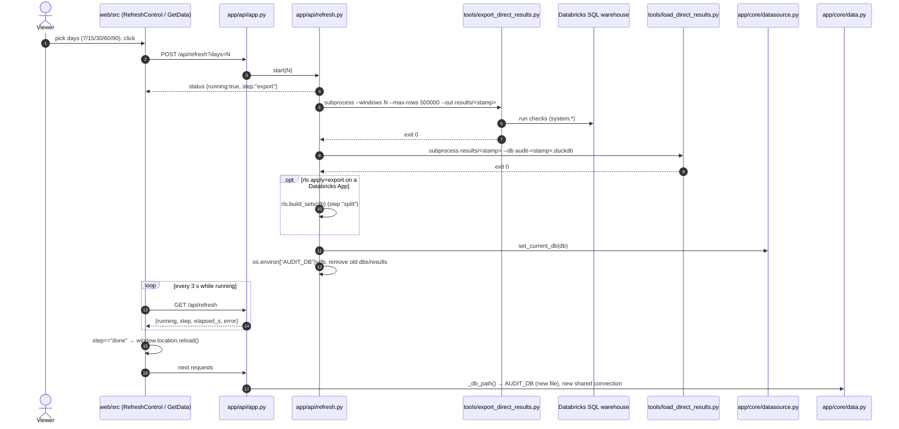

# Flow: Refresh in the app

The top-bar Refresh (or "Get the last N days" on an empty app) calls `POST /api/refresh?days=N`; a background thread runs the export and the load as subprocesses into a **new** `audit-<stamp>.duckdb`, points the app at it, deletes old files, and the page reloads (`app/api/refresh.py:1-5`, `README.md:95-103`).



## Steps

1. Refresh control lists `REFRESH_DAYS = [7, 15, 30, 60, 90]` (`web/src/api.ts:7-8`); top bar `RefreshControl` (`web/src/App.tsx:212-232`) and empty-app `GetData` (`web/src/components/first_run.tsx:25-47`) both use `useRefresh` (`web/src/components/first_run.tsx:9-23`).
2. `Api.refreshStart(days)` → `POST /api/refresh?days=N` (`web/src/api.ts:78`).
3. `post_refresh(days: int = Query(30, ge=1, le=90))` → `refresh.start(days)` (`app/api/app.py:389-392`).
4. `start` returns current status if one is running; else sets `{running: True, step: "export", days, started_at}` under a lock and starts `_run` in a daemon thread (`app/api/refresh.py:31-38`).
5. `_run` names `stamp = %Y%m%d-%H%M%S` (local time), `out = <data>/results/<stamp>`, `db = <data>/audit-<stamp>.duckdb` (`app/api/refresh.py:48-52`).
6. Export: `python tools/export_direct_results.py --windows N --max-rows 500000 --out <out>` with `cwd=ROOT`; non-zero → `RuntimeError` with last 3 output lines (`app/api/refresh.py:54`, `app/api/refresh.py:41-45`). Export internals: `flows/export_load_serve.md` steps 4-9.
7. `step = "load"`; `python tools/load_direct_results.py <out> --db <db>` (`app/api/refresh.py:55-56`).
8. Keep-set = new db + previous `AUDIT_DB` (`app/api/refresh.py:57-58`).
9. If `rls.mode() == "export"` and running as a Databricks App: `step = "split"`, `rls.build_sets(db)` writes one filtered db per grant set; their files join the keep-set (`app/api/refresh.py:59-62`, `app/core/rls.py:451-456`, `app/core/rls.py:510-542`).
10. `datasource.set_current_db(db)` writes `current_db.txt` atomically so a restart opens the new db (`app/api/refresh.py:63`, `app/core/datasource.py:55-62`).
11. `os.environ["AUDIT_DB"] = db` switches this process (`app/api/refresh.py:64`); `_base_db_path` reads `AUDIT_DB` first on every call (`app/core/data.py:202-208`).
12. Cleanup: every `audit-*.duckdb` except the new and the previous db (plus RLS set files) and orphan sidecars deleted; only the newest two `results/<stamp>` folders kept (`app/api/refresh.py:65-66`, `app/api/refresh.py:72-95`).
13. State → `{running: False, step: "done"}`; any exception → `step: "failed"`, `error: str(exc)`; old data stays (`app/api/refresh.py:67-69`, `README.md:100`).
14. UI polls `GET /api/refresh` every 3 s while running and reloads the page on `done` (`web/src/components/first_run.tsx:13-20`, `app/api/app.py:384-386`, `app/api/refresh.py:25-28`).
15. Next request: `_connect` sees a new file identity, opens a new shared connection and closes handles of old db versions so Windows can delete them (`app/core/data.py:301-320`, `app/core/data.py:280-287`).
16. Caches invalidate: `_data_version()` includes the db identity (`app/api/app.py:991-996`).

## Status payload

`refresh.status()` (`app/api/refresh.py:21-28`):

```json
{"running": true, "step": "export", "days": 15, "started_at": 1762762500.0,
 "finished_at": null, "error": null, "elapsed_s": 42}
```

`step` ∈ `export` → `load` → (`split`) → `done` | `failed` (`app/api/refresh.py:35`, `app/api/refresh.py:55`, `app/api/refresh.py:60`, `app/api/refresh.py:67-69`). Values above are illustrative.

## Example (from tests)

`tests/test_refresh.py:21-48` (subprocesses faked):
- Before: `audit-20000101-000000.duckdb` and three `results/` stamps in `tmp_path`.
- `refresh.start(15)` → final status `step == "done"`, `days == 15`, `error is None`.
- Calls made: `["tools/export_direct_results.py", "tools/load_direct_results.py"]`.
- `AUDIT_DB` now points at a new `.duckdb` under `tmp_path`; the old db is deleted; `current_db()` equals it; two `results/` folders remain, the oldest (`19991230-000000`) is gone.
- `tests/test_refresh.py:51-80`: the shared DuckDB connection switches to the new db file after refresh.

## Differences from `first_run.py`

| | first_run.py | Refresh |
|---|---|---|
| Rows kept per check | 50,000 (`tools/export_direct_results.py:183`) | 500,000 (`app/api/refresh.py:54`) |
| Db file | `audit.duckdb` (`app/core/datasource.py:11`) | `audit-<stamp>.duckdb` (`app/api/refresh.py:52`) |
| Stamp | UTC `%Y%m%dT%H%M%SZ` (`tools/first_run.py:99`) | local `%Y%m%d-%H%M%S` (`app/api/refresh.py:49`) |
| App running? | Stop it first on Windows (`README.md:80-81`) | Runs inside the app |
