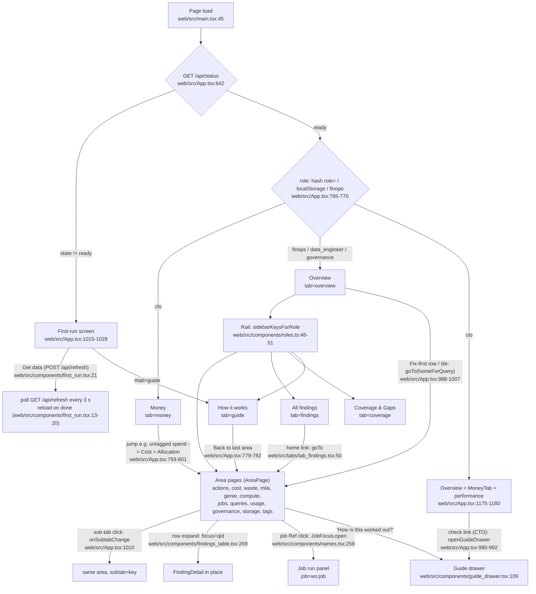
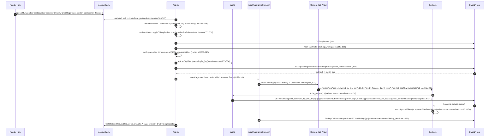

# Flow: UI navigation and filter propagation

How a reader moves between screens and how the URL hash, the top-bar filters and the lens turn into `/api` calls. No router: `location.hash` is the only navigation state, written with `history.replaceState`.

## Screen flow

- Navigation calls:
  - `selectArea(key)` resets sub-tab, domain and focus (web/src/App.tsx:1009).
  - `onSubtabChange(key)` keeps the area and clears focus (web/src/App.tsx:1010).
  - `goTo(target)` sets tab/subtab/domain/focus; CTO + a check id opens the Guide drawer instead (web/src/App.tsx:988-1000).
  - `onExternalJump(queryId)` -> `homeForQuery(row)` + focus (web/src/App.tsx:1002-1007; web/src/components/tab_registry.ts:396-416).
- Guards:
  - Tab outside the lens -> lens home (web/src/App.tsx:50-52, 802-808).
  - CFO outside money/guide/cost/waste/mlai -> money (web/src/App.tsx:797-801).
  - Unknown hash tab -> ignored (web/src/components/nav_hash.ts:32-33).
  - Old keys redirected (web/src/components/nav_hash.ts:112-128).
- Back/forward and pasted links: the `hashchange` listener re-reads nav, window, env, attr, tags, role and workspaces (web/src/App.tsx:809-829). App's own writes use `replaceState` and fire no `hashchange` (web/src/components/hash_state.tsx:11-18). Guide links set `location.hash` on purpose so back works (web/src/components/nav_hash.ts:75-85).

## Hash -> state -> API (sequence)

## How each filter reaches the API

| Control | State change | Hash write | Effect on requests |
|---|---|---|---|
| Window button | `setWindow_` (web/src/App.tsx:1078) | `w=` (web/src/App.tsx:917-922) | `window=` on every hook (key includes window) (web/src/components/hooks.ts:90) and refetch of `/api/findings` (web/src/App.tsx:915) |
| Env picker | `setEnvFilter` (web/src/App.tsx:1086) | `env=` (web/src/App.tsx:930-933) | `env=` repeated; workspace list narrowed to those envs (web/src/App.tsx:356-358) |
| Attribute picker | `onAttrChange` (web/src/App.tsx:962-968) | `attr_<key>=` group (web/src/App.tsx:935-941) | client-side: workspaces whose attribute matches -> `workspace_ids=` (web/src/App.tsx:873-895) |
| Workspaces | `toggleWorkspace` / `selectAll` / `selectNone` / `setManyWorkspaces` (web/src/App.tsx:949-960) | `ws=` (omitted when all) (web/src/App.tsx:924-928) | `workspace_ids=` repeated; none -> `__no_workspace_matches_filters__` (web/src/App.tsx:888; web/src/components/filters.tsx:159) |
| Tag picker | `setTagFilterState` (web/src/App.tsx:1090) | `tags=` JSON (web/src/App.tsx:943-947) | `Api.setTagFilter(activeTag)` (web/src/App.tsx:834) -> `tag=key:value` on findings, finding, aggregate, rollup, tables, volumes, workspace_usage, workspace_tags, tag_origins, tag_compliance (web/src/api.ts:53-57, 88-108, 122, 139) |
| Lens | `applyRole` (web/src/App.tsx:786-792) | `role=` (omitted for finops) (web/src/App.tsx:803) | sidebar, landing, `summaryOnly` and `canDrill` change; data requests unchanged |
| Sub-tab | `onSubtabChange` (web/src/App.tsx:1010) | `subtab=` | new Content mounts, its hooks fetch |
| Row expand | FindingsTable state | `focus=` (web/src/components/findings_table.tsx:269) | `GET /api/finding/{qid}` |
| Job click | `JobFocus.open` (web/src/components/names.tsx:258-263) | `job=ws:id` (web/src/components/names.tsx:243-245) | `GET /api/finding/{id}?job_id=` x JOB_PANEL_IDS (web/src/components/job_panel.tsx:79) |

- Exceptions that ignore filters on purpose:
  - Commit burndown sends `[]` workspaces, `[]` envs and `noTagFilter` (web/src/tabs/tab_cost.tsx:1196-1197; web/src/api.ts:139).
  - The job panel sends no tag filter (web/src/api.ts:122).
  - Some endpoints take only the window or no filter: `abac_policies`, `table_sizes`, `coverage`, `table`, `volume_users`, `person_tables`, `warehouse` (web/src/api.ts:76, 91-102).
- Refetch trigger: every hook's memo key = qid + window + JSON(workspaceIds) + JSON(envs) + options + `Api.tagFilterKey()` (web/src/components/hooks.ts:90, 119-123). Changing any filter re-runs every mounted hook.
- Note: the tag filter is module state, not a prop. Components outside these hooks must add `Api.tagFilterKey()` to their dependencies themselves, as `FindingDetail` does (web/src/components/finding_detail.tsx:1250-1254).

## Example: a shared link

`http://127.0.0.1:8000/#tab=jobs&subtab=timing&w=7&ws=111,222&role=data_engineer&job=111:987`

1. `subtab=timing` is an old key -> `slow` (web/src/components/tab_registry.ts:388; web/src/components/nav_hash.ts:126).
2. `role=data_engineer` is valid -> lens set; jobs is in that lens's sidebar (web/src/App.tsx:765-770; web/src/components/roles.ts:34).
3. `w=7` overrides `meta.open_window` (web/src/App.tsx:855).
4. `ws=111,222` is matched against `/api/workspaces`; unknown ids are dropped, and if none match every workspace is used (web/src/App.tsx:709-712).
5. Jobs > Slow & queued mounts `JobsSlowContent`. Its hooks call e.g. `GET /api/finding/lakeflow_job_duration_regression?window=7&workspace_ids=111&workspace_ids=222&limit=5000&offset=0` (web/src/tabs/tab_jobs.tsx:374; web/src/components/hooks.ts:97) (param order inferred from web/src/api.ts:113-122).
6. `job=111:987` reopens the run panel at load (web/src/components/names.tsx:248-256).
