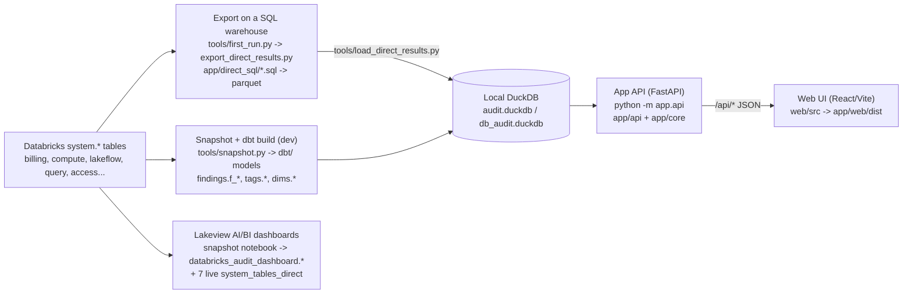

# Crosshire knowledge graph: index

Crosshire is a read-only audit of a Databricks account: about 160 SQL checks on `system.*` tables are exported to a local DuckDB file (`README.md:6`), served by a FastAPI app (`app/api/app.py`) to a React UI (`web/src`), and also shipped as Lakeview dashboards (`databricks_dashboards/`).

Start here, then open a page from the table below. Every fact on a page cites `path:line` in the repo at commit `c2e5f91`. Graph data is in `graph/nodes.jsonl` and `graph/edges.jsonl`; see [README.md](README.md).

## Big picture

- Export path: `tools/first_run.py:162-194` runs the export (`tools/export_direct_results.py:1508`) and the load (`tools/load_direct_results.py:931`, writes the DuckDB in `_load_root` at `tools/load_direct_results.py:486`). See [flows/export_load_serve.md](flows/export_load_serve.md).
- dbt path: `python tools/snapshot.py` then `python tools/dbt_run.py build --target dev` writes `data/db_audit.duckdb` (`README.md:689-690`). See [flows/dbt_lineage.md](flows/dbt_lineage.md).
- The app opens DuckDB read-only (`app/core/data.py:233`) and serves `/api/*` (e.g. `app/api/app.py:350`). See [flows/api_request.md](flows/api_request.md).
- Lakeview: the notebook `databricks_dashboards/Lakehouse Health 00 - Snapshot.py` fills a snapshot schema the 14 dashboards read; 7 more dashboards read `system.*` live. See [flows/dashboards_snapshot.md](flows/dashboards_snapshot.md).

## Entry points

| Command | What it does | Code |
|---|---|---|
| `python tools/first_run.py [--windows 90]` | Export every check on a warehouse, then load into `audit.duckdb` | `tools/first_run.py:162`, `README.md:68-69` |
| `python -m app.api` | Start the app on `http://127.0.0.1:8000/` (uvicorn) | `app/api/__main__.py:14-25` |
| `POST /api/refresh?days=N` (Refresh button) | Export + load as subprocesses into a new DuckDB (4 h / 30 min timeouts; with rls on, only `refresh.admins` or users granted everything) | `app/api/refresh.py:51-73` |
| `python tools/export_direct_results.py` | Export only (direct SQL -> parquet) | `tools/export_direct_results.py:1508` |
| `python tools/load_direct_results.py` | Load exported parquet into DuckDB | `tools/load_direct_results.py:931` |
| `python tools/snapshot.py` | Copy `system.*` to local parquet (`snapshot/`) | `tools/snapshot.py:1577` |
| `python tools/dbt_run.py build --target dev` | dbt build over the snapshot -> `data/db_audit.duckdb` | `tools/dbt_run.py:474`, `README.md:690` |
| `python tools/deploy_app.py` | Stage, sync and deploy as a Databricks App | `tools/deploy_app.py:175` |
| `python tools/app_start.py` | Start command inside Databricks Apps | `tools/app_start.py:34` |
| `python tools/build_databricks_dashboards.py` | Regenerate the 14 Lakehouse Health dashboards + notebook | `tools/build_databricks_dashboards.py:1470` |
| `python tools/build_direct_dashboards.py` | Regenerate the 7 live dashboards | `tools/build_direct_dashboards.py:956` |
| `python tools/gate.py [--quick]` | Run lint, sync checks, web, dbt and pytest | `tools/gate.py:230` |
| `python tools/sync_queries.py` | Re-vendor the public query library | `tools/sync_queries.py:574` |
| `python tools/generate_models.py` / `build_direct_sql.py` | Generate dbt models / `app/direct_sql` from check SQL | `tools/generate_models.py:777`, `tools/build_direct_sql.py:147` |
| `npm run build` (in `web/`) | Vite build into `app/web/dist` | `web/package.json:7` |
| Notebook `Lakehouse Health 00 - Snapshot.py` | Widgets `catalog`, `tag_keys`, ...; fills `databricks_audit_dashboard` | `databricks_dashboards/Lakehouse Health 00 - Snapshot.py:15-18` |

## Where to look for what

### Modules

| Question | Page |
|---|---|
| Which `/api/*` routes exist and how does a request get its outcome? | [modules/app_api.md](modules/app_api.md) |
| Settings, DuckDB store, check registry, tag logic, row-level access | [modules/app_core.md](modules/app_core.md) |
| What every `tools/*.py` script does, its CLI, inputs and outputs | [modules/tools.md](modules/tools.md) |
| The dbt project: sources, findings, tags, dims, macros, seeds | [modules/dbt.md](modules/dbt.md) |
| Check SQL files: vendored, app, tag_spend, headers, generators | [modules/queries.md](modules/queries.md) |
| The React app: structure, hash navigation, `api.ts` | [modules/web.md](modules/web.md) |
| Every tab: what it shows, which API calls feed it | [modules/ui_screens.md](modules/ui_screens.md) |
| Lakehouse Health and live Lakeview dashboards | [modules/dashboards.md](modules/dashboards.md) |

### Flows

| Question | Page |
|---|---|
| First run: export -> load -> serve | [flows/export_load_serve.md](flows/export_load_serve.md) |
| What the Refresh button does | [flows/refresh_in_app.md](flows/refresh_in_app.md) |
| A tab's request end to end (hook -> Api -> FastAPI -> service -> DuckDB) | [flows/api_request.md](flows/api_request.md) |
| Running inside Databricks Apps | [flows/databricks_app.md](flows/databricks_app.md) |
| How a `system.*` row becomes an app number (dbt lineage) | [flows/dbt_lineage.md](flows/dbt_lineage.md) |
| How the snapshot dashboards get their numbers | [flows/dashboards_snapshot.md](flows/dashboards_snapshot.md) |
| Adding a new check (inferred order) | [flows/add_a_check.md](flows/add_a_check.md) |
| URL hash, top-bar filters and lens -> `/api` calls | [flows/ui_navigation.md](flows/ui_navigation.md) |

### Business logic

| Question | Page |
|---|---|
| All rules, one line each | [logic/index.md](logic/index.md) |
| How a dollar is computed (list price) | [logic/list_price_dollarization.md](logic/list_price_dollarization.md) |
| What the discount setting changes | [logic/discount_what_if.md](logic/discount_what_if.md) |
| Why "actual vs list" is never assessed | [logic/actual_vs_list.md](logic/actual_vs_list.md) |
| Splitting billed usage into tag-able parts | [logic/cost_allocation_to_tags.md](logic/cost_allocation_to_tags.md) |
| Tag values at compute / work / workspace level | [logic/cost_unit_tag_levels.md](logic/cost_unit_tag_levels.md) |
| Proving the rollup sums to the bill | [logic/cost_reconciliation.md](logic/cost_reconciliation.md) |
| Nested tag rollup (work -> compute -> workspace) | [logic/nested_tag_rollup.md](logic/nested_tag_rollup.md) |
| By-tag top values per level | [logic/by_tag_top_levels.md](logic/by_tag_top_levels.md) |
| Splitting untagged dollars | [logic/untagged_split.md](logic/untagged_split.md) |
| Tag key normalisation, `__x__` sentinels | [logic/tag_key_normalisation_and_sentinels.md](logic/tag_key_normalisation_and_sentinels.md) |
| Inferring a workspace's tags from the bill | [logic/workspace_tag_inference.md](logic/workspace_tag_inference.md) |
| `top_tags` headlines and aliases | [logic/top_tags_aliases.md](logic/top_tags_aliases.md) |
| Tag filter AND/OR semantics | [logic/tag_filter_semantics.md](logic/tag_filter_semantics.md) |
| Tag filter on non-spend checks (lookup chain) | [logic/tag_chain_per_finding.md](logic/tag_chain_per_finding.md) |
| Tag filter on spend checks | [logic/tag_spend_filter.md](logic/tag_spend_filter.md) |
| Bill tag overriding performance tags | [logic/bill_tag_overrides_perf.md](logic/bill_tag_overrides_perf.md) |
| Mandatory tag compliance | [logic/mandatory_tag_compliance.md](logic/mandatory_tag_compliance.md) |
| Materiality floors, severity cap, admin groups | [logic/materiality_and_severity.md](logic/materiality_and_severity.md) |
| A check card's dollar figure and "N of M" count | [logic/finding_money_and_affected.md](logic/finding_money_and_affected.md) |
| Waste headline total | [logic/waste_total.md](logic/waste_total.md) |
| Cost of one SQL statement | [logic/query_cost_split.md](logic/query_cost_split.md) |
| Period-over-period spend rise | [logic/period_over_period.md](logic/period_over_period.md) |
| Oversized job and its saving | [logic/oversized_job_savings.md](logic/oversized_job_savings.md) |
| Threshold precedence (`thresholds.yml` vs header) | [logic/thresholds_precedence.md](logic/thresholds_precedence.md) |
| Workspace -> prod/uat/dev mapping | [logic/workspace_env_mapping.md](logic/workspace_env_mapping.md) |
| Masking user identities | [logic/identity_masking.md](logic/identity_masking.md) |
| Row-level security | [logic/row_level_security.md](logic/row_level_security.md) |
| Table usage class, workspace / catalog / schema indexes | [logic/data_usage_class_and_index.md](logic/data_usage_class_and_index.md) |
| Databricks SQL -> DuckDB translation | [logic/sql_translation.md](logic/sql_translation.md) |
| Query registry and library corrections | [logic/query_library_registry_and_corrections.md](logic/query_library_registry_and_corrections.md) |

### Data model

| Question | Page |
|---|---|
| What is in the DuckDB file (overview, keys, relations) | [data/model.md](data/model.md), [data/model.json](data/model.json) |
| The `f_<query_id>` findings table pattern | [data/findings_pattern.md](data/findings_pattern.md) |
| `system.billing.usage`, the most-read source | [data/system_billing_usage.md](data/system_billing_usage.md) |
| The single dollar split | [data/cost_alloc.md](data/cost_alloc.md) |
| Cost per allocation unit / with tags / per day | [data/cost_unit.md](data/cost_unit.md), [data/cost_unit_tag.md](data/cost_unit_tag.md), [data/cost_day.md](data/cost_day.md) |
| Reconciliation table | [data/cost_reconciliation.md](data/cost_reconciliation.md) |
| Performance metrics per tag value | [data/perf_unit_tag.md](data/perf_unit_tag.md) |
| Workspace tags (history and current) | [data/tag_workspace_history.md](data/tag_workspace_history.md), [data/tag_workspace.md](data/tag_workspace.md) |
| Every tagged object / tag search index | [data/tag_entity.md](data/tag_entity.md), [data/tag_index.md](data/tag_index.md) |
| When a tag value started on the bill | [data/bill_tag_dates.md](data/bill_tag_dates.md) |
| Name lookups: jobs, clusters, warehouses, pipelines | [data/dim_job.md](data/dim_job.md), [data/dim_cluster.md](data/dim_cluster.md), [data/dim_warehouse.md](data/dim_warehouse.md), [data/dim_pipeline.md](data/dim_pipeline.md) |

### Processes

| Question | Page |
|---|---|
| Set up and run on a laptop | [processes/run_locally.md](processes/run_locally.md) |
| Deploy as a Databricks App | [processes/deploy_databricks_app.md](processes/deploy_databricks_app.md) |
| Every setting, env var and secret name | [processes/config_and_secrets.md](processes/config_and_secrets.md) |
| Tests: pytest, fixtures, fake account, vitest | [processes/tests.md](processes/tests.md) |
| Build the web UI | [processes/build_web.md](processes/build_web.md) |
| Update vendored queries | [processes/update_vendored_queries.md](processes/update_vendored_queries.md) |
| Rebuild the dashboards | [processes/build_dashboards.md](processes/build_dashboards.md) |
| The gate (all checks before commit) | [processes/gate.md](processes/gate.md) |
| Upgrade to a new version | [processes/update_to_new_version.md](processes/update_to_new_version.md) |

### Repo documents (summaries)

| Document | Page |
|---|---|
| `README.md` (main user guide) | [documents/readme.md](documents/readme.md) |
| `docs/databricks-app.md` | [documents/databricks-app.md](documents/databricks-app.md) |
| Lakeview `.lvdash.json` format reference | [documents/lakeview-dashboard-format.md](documents/lakeview-dashboard-format.md) |
| Waste dashboard query guide | [documents/waste-dashboard-queries.md](documents/waste-dashboard-queries.md) |
| `databricks_dashboards/README.md` | [documents/databricks_dashboards-readme.md](documents/databricks_dashboards-readme.md) |
| Repo review 2026-11-10 | [documents/review-2026-11-10-repo.md](documents/review-2026-11-10-repo.md) |
