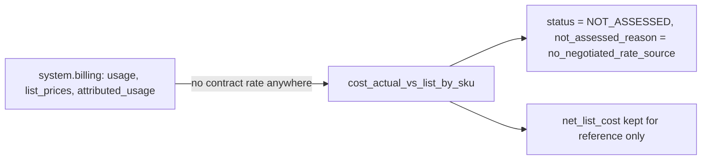

# Actual vs list (not assessable)

The "actual vs list" comparison can never be computed: `system.billing` has no negotiated rate, so `cost_actual_vs_list_by_sku` always reads NOT_ASSESSED with reason `no_negotiated_rate_source`.



## Rule in plain words
- No system table holds contract rates - `README.md:348-350`, `app/queries/vendored/cost/cost_actual_vs_list_by_sku.sql:8`.
- The query emits only `net_list_cost` (effective list price) plus a constant `'NOT_ASSESSED'` status - `app/queries/vendored/cost/cost_actual_vs_list_by_sku.sql:18-22`.
- The old second column (`net_default_cost`, from `pricing.default`) was dropped; one basis everywhere - `app/core/pricing.py:34-45`.
- Disclosed as a library correction: the vendored query banded CRITICAL on a ratio that is always >= 1 - `config/library_corrections.yml:3-16`.

## Formula
```
net_list_cost = SUM(usage_quantity * list_rate)   -- reference only
status        = 'NOT_ASSESSED'                     -- always
```

## Example (test)
- `/api/finding/cost_actual_vs_list_by_sku` returns `net_list_cost` + `_disc` twin and no `net_default_cost` column - `tests/test_api.py:1175-1189`.
- Built row is priced at the current rate and reads NOT_ASSESSED - `tests/test_findings/test_cost_priced.py:426-430`.

## Edge / rejected cases
- A "realization ratio" between two list-price estimates is rejected as not a real discount signal - `app/queries/vendored/cost/cost_actual_vs_list_by_sku.sql:15`.
- Use `cost_dollarized_by_sku_day.net_list_cost` for spend ranking - `app/queries/vendored/cost/cost_actual_vs_list_by_sku.sql:11`.

## Implementing code
- `app/queries/vendored/cost/cost_actual_vs_list_by_sku.sql:1-22`

## Config knobs
- None. `discount_pct` (`config/settings.yml:13-15`) only gives a what-if; set `contract` (`config/settings.yml:121-127`) for a commit burndown.
