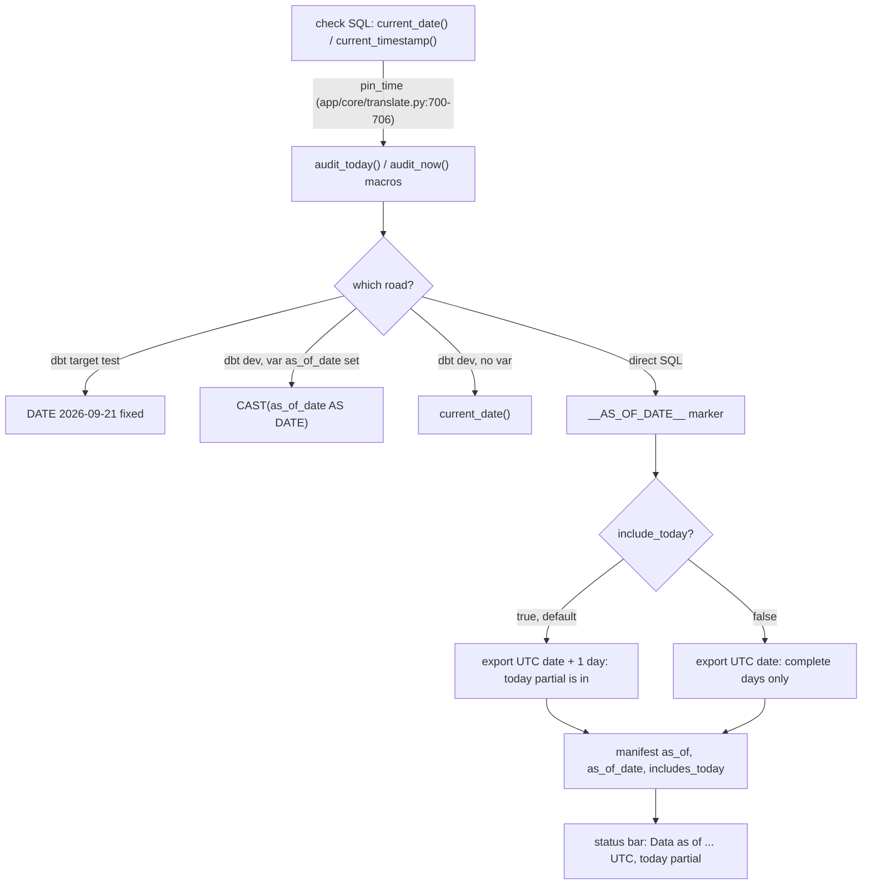

# As-of cutoff: which days a number includes

Every check and tag model reads rows strictly before one as-of date (`audit_today()`); on a dbt build that is the build day (today excluded), on a direct export it is the first day left out, which is TOMORROW when `include_today: true` (shipped default), so today's partial day is counted and the UI says "today partial".

## Rule in plain words
- Check bodies never call the clock directly: `pin_time` rewrites `current_date()`/`current_timestamp()` to `{{ audit_today() }}`/`{{ audit_now() }}` - `app/core/translate.py:700-706`; it is also the last DuckDB rewrite rule - `app/core/translate.py:709-710,874`.
- dbt dispatch: test target -> fixed `DATE '2026-09-21'`; else `var('as_of_date')` (regex-checked YYYY-MM-DD); else the dialect's `current_date` - `dbt/macros/audit_time.sql:12-26`; same for `audit_now` - `dbt/macros/audit_time.sql:28-42`.
- Direct SQL renders `audit_today()` as the marker `__AS_OF_DATE__` - `tools/build_direct_sql.py:90`, `tools/export_direct_results.py:56-59`.
- Export replaces it with `_cutoff(now, include_today)`: `now + 1 day` when `include_today`, else `now` (one UTC instant for the whole run) - `tools/export_direct_results.py:332-341`, `tools/export_direct_results.py:1548`.
- `include_today` comes from settings, default true; unreadable settings also mean true - `config/settings.yml:19-22`, `tools/export_direct_results.py:203-208`.
- Windows end at the cutoff, so a w-day window with include_today is today (partial) plus the w-1 days before it (inferred from `usage_date >= audit_today() - INTERVAL w DAY AND usage_date < audit_today()`, e.g. `dbt/models/tags/cost_reconciliation.sql:31-32`).
- Manifest records `as_of` (timestamp), `as_of_date` (the first day left out) and `includes_today` - `tools/export_direct_results.py:1328-1331`; the loader copies them to `direct_export_meta`; the app reads them back - `app/core/data.py:3426-3434`.
- UI: `includes_today` -> "Data as of <ts> UTC", "today partial", note "billing can lag a few hours" - `web/src/App.tsx:177-184`.
- Some checks still say "the current day is excluded" in their own caveat text (written for the complete-day case), e.g. `app/queries/app/cost/cost_period_over_period.sql:65-67`; with include_today on, their `current_date()` is pinned to tomorrow like every other check (inferred from the pin_time + marker chain above).

## Example
- Test target: `audit_today()` = 2026-09-21, so the tagworld fixture's D0 rows (999 DBU on `tg_cl_a1`) are never counted - `dbt/macros/audit_time.sql:13-14`, `tests/fixtures/tagworld.py:27-29`.
- Illustrative: an export run at 2026-11-10T08:15Z with include_today true writes `as_of_date` 2026-11-11; the 7-day window covers 2026-11-04..2026-11-10 with 11-10 partial (derived from `tools/export_direct_results.py:332-341`).

## Implementing code
- `dbt/macros/audit_time.sql:12-42`, `app/core/translate.py:700-710`, `tools/build_direct_sql.py:85-92`, `tools/export_direct_results.py:203-208,332-341`

## Config knobs
- `include_today` (`config/settings.yml:22`, next export); dbt vars `as_of_date` / `as_of_ts` (`dbt/dbt_project.yml:28-33`).
