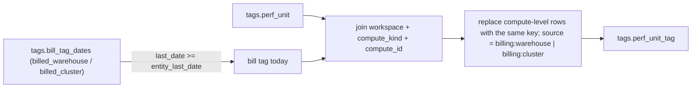

# Bill tags ride over a resource's own tags (performance rollup)

At load time, the bill's tag on a warehouse's or cluster's LAST billed day replaces that resource's own tag value at the compute level of `tags.perf_unit_tag`, so performance and cost read the same compute tag.

## Rule in plain words
- A tag on the bill's last day is "on it today" - `app/core/tag_bill.py:8-15`.
- Only compute-level rows with the SAME key are replaced; others are kept; work level untouched - `app/core/tag_bill.py:29-36`.
- Returns how many rows came from the bill - `app/core/tag_bill.py:37-39`.
- Cost already uses the bill as the compute level (`custom_tags`) - `app/core/tag_bill.py:1-2`, `dbt/models/tags/cost_unit_tag.sql:28-46`.
- Run once in the loader - `tools/load_direct_results.py:702-703`.

## Example (test)
- u1: bill `bill_cc` replaces own `own_cc`; u2 keeps `kept` because its bill tag is gone before the last day; work level unchanged; returns 2 - `tests/test_tag_bill.py:16-39`.

## Edge / rejected cases
- A tag removed from the bill before the resource's last billed day is not applied - `app/core/tag_bill.py:14`.

## Implementing code
- `app/core/tag_bill.py:9-39`

## Config knobs
- None.
