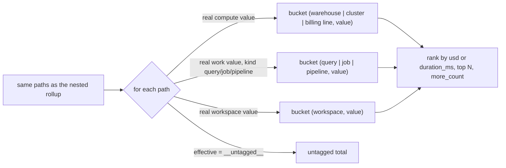

# Top tag values per level (by_tag_top)

`/api/rollup/top` ranks the top values of one key PER LEVEL (query, warehouse, cluster, job, pipeline, workspace, billing line) and never merges levels; rows overlap by design, so only `tagged = total - untagged` reconciles.



## Rule in plain words
- Levels list - `app/core/rollup.py:45-49`; compute mapping warehouse/cluster else "billing line" - `app/core/rollup.py:1126`; work mapping - `app/core/rollup.py:1127`.
- One path adds to EVERY level where it has a real value - `app/core/rollup.py:1206-1220`.
- Rank: cost by `usd`, performance by `duration_ms` - `app/core/rollup.py:1159`, sort `app/core/rollup.py:1222`.
- `tagged = total - untagged`; `rows_overlap_across_levels: True` - `app/core/rollup.py:1224`, `app/core/rollup.py:1255-1259`.
- `more_count = groups - top` - `app/core/rollup.py:1252-1253`.

## Formula
```
row(level, value).usd = SUM(path.usd where path has real value at that level)
tagged = total - SUM(path.usd where effective == '__untagged__')
```

## Example (test, tg_cc, 30d)
- `(cluster, etl)` 20 and `(job, etl)` 20 are two rows - `tests/test_api_rollup.py:190-202`.
- alpha on three levels: workspace 362, warehouse 150, cluster 80, none the sum of the others - `tests/test_api_rollup.py:203-207`.
- Serverless budget policy tag `shared` reads `billing line` 15 - `tests/test_api_rollup.py:209-217`.
- top=5: untagged 50, `group_count` 15, `more_count` 10 - `tests/test_api_rollup.py:220-229`.
- Performance ranks by query time; workspace/alpha first - `tests/test_api_rollup.py:232-241`.

## Edge / rejected cases
- Idle/unsplit/none work kinds never create a work row - `app/core/rollup.py:1127`.
- Summing rows or taking shares of `total` overstates tagged spend - `app/core/rollup.py:1255-1258`.

## Implementing code
- `app/core/rollup.py:1142-1267`

## Config knobs
- `top` request param (default 10) - `app/core/rollup.py:1146`; `discount_pct` - `config/settings.yml:13-15`.
