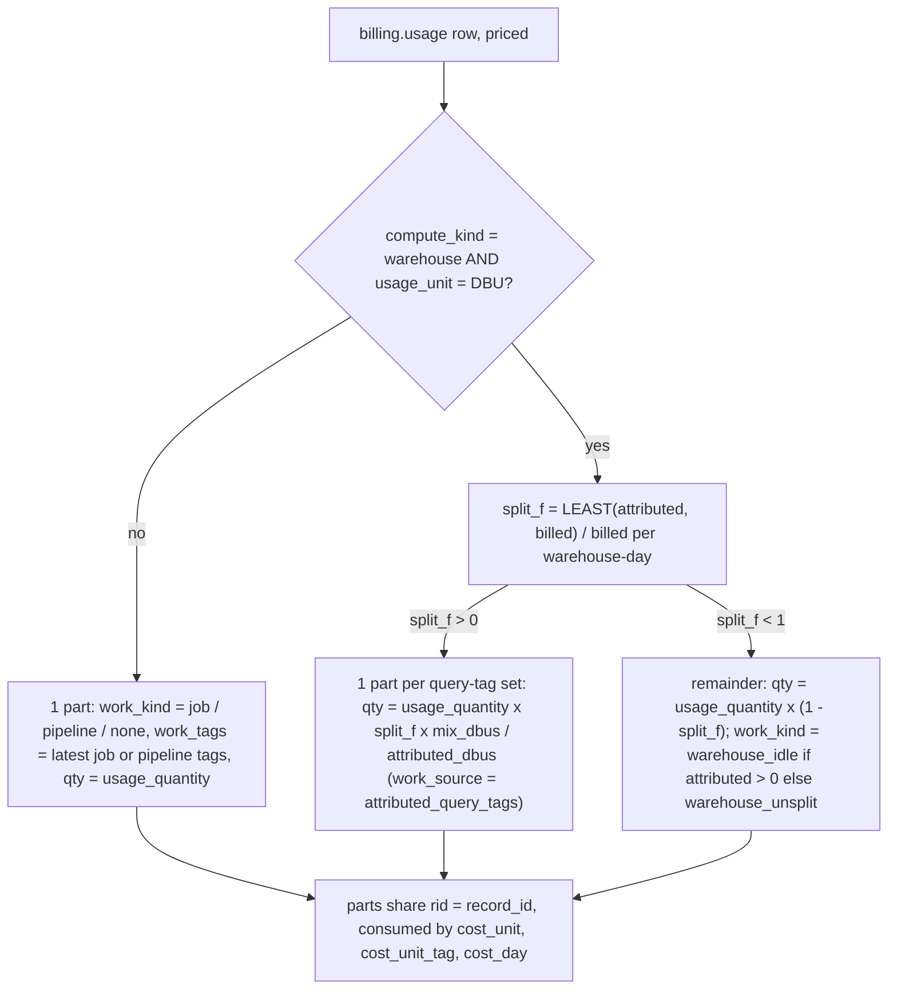

# Cost allocation: splitting a billed row into parts (tags.cost_alloc)

Each `system.billing.usage` row becomes one or more priced *parts*: a SQL warehouse's DBUs split into one part per distinct query-tag set (by Databricks' attributed DBUs) plus an idle/unsplit remainder; every other row is one part labelled with its job's or pipeline's latest tags.



## Rule in plain words
- `compute_kind` precedence: warehouse_id -> cluster_id -> endpoint -> app -> serverless (job/pipeline/notebook/budget or usage policy/`is_serverless`) -> other - `dbt/models/tags/cost_alloc.sql:22-32`.
- `compute_id` = first non-null of warehouse, cluster, endpoint id/name, app, budget policy, usage policy - `dbt/models/tags/cost_alloc.sql:33-35`.
- Warehouse-day split fraction: `LEAST(attributed, billed)/billed` when both > 0, else 0 - `dbt/models/tags/cost_alloc.sql:55-68`.
- Query mix: attributed DBUs grouped by the exact `query_tags` map - `dbt/models/tags/cost_alloc.sql:70-75`.
- Query parts - `dbt/models/tags/cost_alloc.sql:85-93`; remainder part - `dbt/models/tags/cost_alloc.sql:95-103`; all non-warehouse-DBU rows - `dbt/models/tags/cost_alloc.sql:105-117`.
- Job/pipeline tags are the LATEST SCD2 row (`ORDER BY change_time DESC`) - `dbt/models/tags/cost_alloc.sql:76-83`.
- `compute_source` label per kind (`billing:warehouse`, `billing:budget_policy` when a policy id exists, else `billing:serverless`, ...) - `dbt/models/tags/cost_alloc.sql:119-127`.
- Parts sum back exactly to the billed quantity (split_f + (1-split_f) = 1; mix sums to attributed) - inferred from `dbt/models/tags/cost_alloc.sql:89,100`; proven by [cost_reconciliation](cost_reconciliation.md).

## Formula
```
split_f    = CASE WHEN billed>0 AND attributed>0 THEN LEAST(attributed, billed)/billed ELSE 0 END
query part = usage_quantity * split_f * mix_dbus / attributed_dbus
remainder  = usage_quantity * (1 - split_f)      -> warehouse_idle | warehouse_unsplit
```

## Example (fixture `tests/fixtures/tagworld.py:17-23`, $1/DBU)
| Warehouse-day | billed | attributed | split_f | parts |
|---|---|---|---|---|
| `tg_wh_a1` D(1) | 100 | 70 (q_fin 40, none 20, bi 10) | 0.7 | q_fin 40, none 20, bi 10, idle 30 |
| `tg_wh_a1` D(3) | 50 | 0 | 0 | unsplit 50 |
| `tg_wh_a2` D(1) | 40 | 50 (q_mkt 30, none 20) | 1.0 | q_mkt 24, none 16, no idle |

- Pinned tree: `warehouse tag: alpha` 150 = q_fin 40 + untagged queries 30 + idle 30 + not split 50 - `tests/test_tag_rollup_models.py:160-168`.
- Scaled day (attributed > billed): children `q_mkt 24`, `untagged queries 16`, no idle node - `tests/test_tag_rollup_models.py:364-388`.
- Unsplit days: `tg_wh_a1` 50, `tg_wh_a3` 25 - `tests/test_tag_rollup_models.py:391-405`.

## Edge / rejected cases
- Attributed > billed is scaled down, never billed twice; counted in `scaled_warehouse_days` - `dbt/models/tags/cost_reconciliation.sql:108-113`.
- Attributed DBUs on a warehouse-day with no bill are dropped (`attributed_unmatched_dbus`) - `dbt/models/tags/cost_reconciliation.sql:84-96`.
- Non-DBU warehouse rows are not split - `dbt/models/tags/cost_alloc.sql:117`.
- DuckDB only; Databricks twin is `app/direct_sql/tags/_cost_alloc.sql` - `dbt/models/tags/cost_alloc.sql:7-9`.

## Implementing code
- `dbt/models/tags/cost_alloc.sql:1-128` (ephemeral)
- Unit grain: `dbt/models/tags/cost_unit.sql:6-18`, `dbt/models/tags/cost_unit.sql:23-38`

## Config knobs
- dbt var `windows` `[7, 30, 90]` - `dbt/dbt_project.yml:31` (window join in `dbt/models/tags/cost_unit.sql:20-21`).
