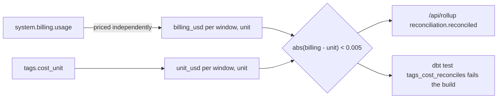

# Cost reconciliation (tags rollup == billing)

`tags.cost_reconciliation` recomputes the priced billing total straight from `system.billing.usage` and compares it to `tags.cost_unit`'s total per (window, usage_unit); the rollup is "reconciled" only when they differ by less than $0.005.



## Rule in plain words
- Billing side never reads `cost_unit`, so a split defect cannot hide itself - `dbt/models/tags/cost_reconciliation.sql:2-8`.
- Billing total per window: priced usage in `[today - w, today)` - `dbt/models/tags/cost_reconciliation.sql:19-50`.
- DBU-only bookkeeping: `attributed_dbus`, `attributed_unmatched_dbus`, `scaled_warehouse_days`, `warehouse_idle_usd`, `warehouse_unsplit_usd` (NULL on non-DBU rows) - `dbt/models/tags/cost_reconciliation.sql:10-12`, `:57-131`, `:141-145`.
- API: `reconciled = abs(billing_usd - rollup_usd) < 0.005`, scope always "account" - `app/core/rollup.py:782-811`.
- Unpriced quantities are listed per usage unit - `app/core/rollup.py:770-779`.
- Performance area "reconciles" by statement count from `perf_unit` - `app/core/rollup.py:812-821`.

## Formula
```
billing_usd = SUM(usage_quantity * list_rate) WHERE list_rate IS NOT NULL
unit_usd    = SUM(tags.cost_unit.usd)
reconciled  = |billing_usd - unit_usd| < 0.005
```

## Example (test)
- For every window, billing == cost_unit == cost_reconciliation (usd < 0.005, quantity < 0.0001), from raw parquet - `tests/test_tag_rollup_models.py:66-85`.
- tagworld totals 652 / 672 / 692 at 7 / 30 / 90 days, `reconciled is True` - `tests/test_tag_rollup_models.py:231-236`.
- Cross-screen agreement: chargeback, period-over-period and rollup totals equal `cost_dollarized_by_sku_day` - `tests/test_totals_agree.py:41-57`.
- `scaled_warehouse_days >= 1` (tg_wh_a2) - `tests/test_tag_rollup_models.py:364-372`.

## Edge / rejected cases
- A rollup filtered by workspace drops account-level (NULL workspace) spend and reports it as `excluded_account_level` - `app/core/rollup.py:627-638`, `app/core/rollup.py:701-704`; partitions + excluded = unfiltered - `tests/test_totals_agree.py:60-84`.
- DuckDB only - `dbt/models/tags/cost_reconciliation.sql:13-15`.

## Implementing code
- `dbt/models/tags/cost_reconciliation.sql:1-150`
- `app/core/rollup.py:782-821`

## Config knobs
- `windows` `dbt/dbt_project.yml:31`.
