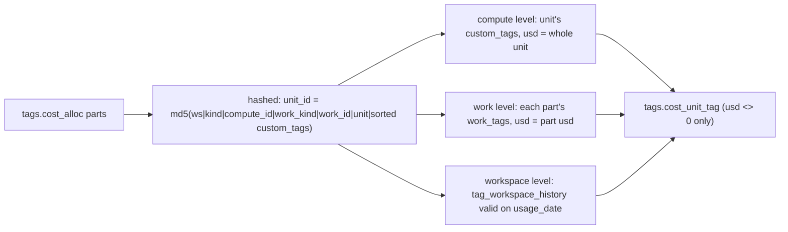

# Cost unit tags by level (tags.cost_unit_tag)

For every cost unit and window, `cost_unit_tag` lists the REAL tag values at three levels - compute (the bill's `custom_tags`), work (job/pipeline/query tags) and workspace (the inferred workspace tag valid on each billed day) - with the dollars each covers; untagged remainders are never stored.



## Rule in plain words
- `unit_id` is stable across windows: md5 of workspace|compute_kind|compute_id|work_kind|work_id|usage_unit|sorted k=v custom tags; a tag change mid-window makes two units - `dbt/models/tags/cost_unit.sql:6-18`, same formula `dbt/models/tags/cost_unit_tag.sql:15-18`.
- Compute level: one row per normalised key, alphabetically-first raw key wins; `usd` = the unit's whole usd - `dbt/models/tags/cost_unit_tag.sql:28-46`.
- Workspace level: joined to `tag_workspace_history` where `is_allocating` and `valid_from <= usage_date < valid_to` - `dbt/models/tags/cost_unit_tag.sql:51-59`.
- Work level: per part's `work_tags`, deduped per (rid, tag set, normalised key) - `dbt/models/tags/cost_unit_tag.sql:65-82`.
- Empty or blank values and keys normalising to `''` are skipped - `dbt/models/tags/cost_unit_tag.sql:40`, `dbt/models/tags/cost_unit_tag.sql:71-72`.
- No untagged rows: `app/core/rollup.py` derives the remainder at request time - `dbt/models/tags/cost_unit_tag.sql:2-5`, remainder `app/core/rollup.py:367-375`.

## Formula
```
compute row usd   = SUM(part_usd) over the unit                  (dbt/models/tags/cost_unit_tag.sql:30)
work row usd      = SUM(part_usd) over parts carrying key=value  (dbt/models/tags/cost_unit_tag.sql:79)
workspace row usd = SUM(part_usd) on days the version is valid   (dbt/models/tags/cost_unit_tag.sql:53)
part_usd          = qty * list_rate, NULL when unpriced          (dbt/models/tags/cost_unit_tag.sql:14)
```

## Example (fixture)
- `tg_cl_a2` job cluster: compute row `tg_cc=etl` (bill) and work row `tg_cc=etl` (job tag), both $20; effective level is work - pinned `cluster tag: etl` 20 with child `job tag: etl` attributed_here 20 - `tests/test_tag_rollup_models.py:181-182`, scenario `tests/fixtures/tagworld.py:30-31`.
- `TG-CC` spelling on `tg_wh_a3` normalises to `tgcc` - `tests/fixtures/tagworld.py:25`, pinned `warehouse tag: beta` 25 - `tests/test_tag_rollup_models.py:175-177`.

## Edge / rejected cases
- Rows with `usd = 0` are dropped from every level - `dbt/models/tags/cost_unit_tag.sql:84-98`.
- A unit whose `usd = 0 AND quantity = 0` never exists - `dbt/models/tags/cost_unit.sql:38`.
- DuckDB only - `dbt/models/tags/cost_unit_tag.sql:7-9`.

## Implementing code
- `dbt/models/tags/cost_unit_tag.sql:1-98`, `dbt/models/tags/cost_unit.sql:1-38`
- Key normaliser `dbt/macros/norm_tag_key.sql:18-24`

## Config knobs
- `windows` `dbt/dbt_project.yml:31`; workspace floors feed the workspace level - see [workspace_tag_inference](workspace_tag_inference.md).
