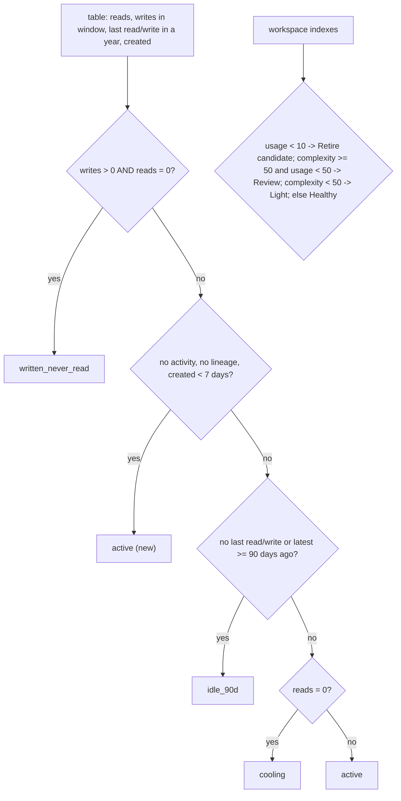

# Data usage: table class, workspace indexes and signal

Each table/volume gets exactly one usage class (first rule wins: written-never-read, idle 90d+, cooling, active); each workspace gets a log-scaled complexity index and usage index (0-100 against the largest workspace) and a signal from the two.



## Rule in plain words
- Classes and order - `app/core/usage.py:13-19`; rule - `app/core/usage.py:49-64`.
- `IDLE_DAYS` 90, `NEW_DAYS` 7 - `app/core/usage.py:10-11`.
- System, samples, hive_metastore and `__databricks_internal*` catalogs are skipped - `app/core/usage.py:22-27`.
- `scale`: `100 x log1p(v) / log1p(max)`, all 0 when max is 0 - `app/core/usage.py:67-70`.
- Complexity weights: views .20, view columns .15, tables .20, table columns .15, volume files .10, size .20 - `app/core/usage.py:30-31`, index `app/core/usage.py:73-75`.
- Usage weights: active people .35, service principals .15, queries .30, plus active days .20 linear - `app/core/usage.py:32-33`, index `app/core/usage.py:78-83`.
- Signal - `app/core/usage.py:86-95`.
- Clean-up order: unread sensitive tables first, then class rank, then biggest - `app/core/usage.py:98-101`.
- Used by Data usage screens and the workspace usage dashboard - `app/core/data.py:1692-1725`, `tools/direct_data_usage.py:13`.

## Formula
```
complexity = SUM w_k * scale(k)
usage      = SUM w_k * scale(k) + 0.20 * 100 * min(active_days, window) / window
```

## Example (test)
- Written yesterday, never read -> written_never_read; read 45 days ago in a 30-day window -> cooling; created 3 days ago, no lineage -> active (new); last read exactly 90 days ago -> idle_90d - `tests/test_usage.py:15-26`.
- Largest workspace -> 100; empty workspace with 15 of 30 active days -> usage 10.0 - `tests/test_usage.py:35-44`.
- Signal (80, 5) Retire candidate; (60, 30) Review; (30, 30) Light; (60, 70) Healthy; (None, 40) Light - `tests/test_usage.py:47-52`.
- Clean-up order `pii_idle, big_wo, small_wo, big_idle` - `tests/test_usage.py:53-58`.

## Edge / rejected cases
- New tables are "not shamed" - `app/core/usage.py:56-58`.
- Weights sum to 1 - `tests/test_usage.py:42-43`.

## Implementing code
- `app/core/usage.py:1-101`

## Config knobs
- None in config files (constants in code); `idle_days` is a function argument - `app/core/usage.py:50`.
