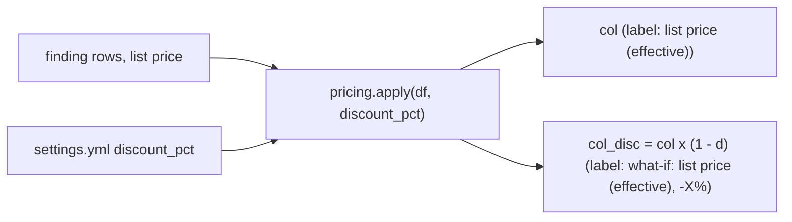

# Discount what-if

`discount_pct` never changes a stored dollar: every list-price column gets a `<col>_disc` twin = `col x (1 - discount_pct)`, labelled "what-if"; the raw column always reads "list price (effective)".



## Rule in plain words
- Only columns matching `^(?:est_(?:[a-z]+_)?usd_list|net_list_cost(?:_usd)?)$` get a twin; `*_share` and DBU columns are never scaled - `app/core/pricing.py:21-26`, `app/core/pricing.py:48-57`.
- `data.py` returns raw list-priced rows; the API applies the discount after reading - `app/core/pricing.py:10-11`, call site `app/api/app.py:1249`.
- Label text: `"list price (effective)"` at 0, else `"what-if: list price (effective), -X%"`, X = `round(d*100, 1)` with trailing zeros dropped (no banker's-rounding bug) - `app/api/service.py:972-982`.
- The raw column is always labelled at 0%; only the `_disc` twin carries the real discount - `app/api/service.py:985-993`.
- No "own-basis" money columns remain (the dict that held them is empty) - `app/core/pricing.py:28-45`.
- Rollup totals carry `usd` and `usd_disc = round(usd x (1-d), 2)` - `app/core/rollup.py:475-479`.
- Bulk `money.usd` on `/api/findings` is already discounted - `app/core/data.py:1175-1176`.
- Waste total and below-floor dollars apply `(1 - discount_pct)` client-side - `web/src/components/waste_total.ts:95`, `web/src/components/waste_total.ts:210`.

## Formula
```
col_disc = col * (1 - discount_pct)      # discount_pct is a fraction: 0.15 = 15% off
```

## Example (test)
- `discount_pct = 0.2`: `net_list_cost` label "list price (effective)", `net_list_cost_disc` label "what-if: list price (effective), -20%" - `tests/test_api.py:1164-1189`.
- Illustrative (derived from `app/api/service.py:980-981`): 0.125 -> "-12.5%", not "-12%".

## Edge / rejected cases
- `discount_pct` 0/None -> base label only - `app/api/service.py:979-980`.
- A `_disc` column whose base is not a list-price column gets no money label - `app/api/service.py:991-992`.

## Implementing code
- `app/core/pricing.py:48-57` (`apply`)
- `app/api/service.py:972-993` (`est_label`, `_money_label`)
- `app/core/rollup.py:475-479`, `app/core/rollup.py:640-645`

## Config knobs
- `config/settings.yml:13-15` `discount_pct` (fraction, default 0.0; page refresh). README `README.md:348-350`.
