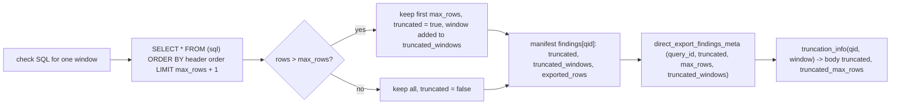

# Export row cap and truncation flag

A direct export keeps at most `max_rows` rows per check run (50,000 by default, 500,000 from in-app Refresh), ordered by the check's own ORDER BY; it asks for one extra row to detect the cut, records `truncated` per check and per window, and the app shows it on the check.

## Rule in plain words
- Cap query: wrap, add the header's ORDER BY (rewritten for the export), `LIMIT max_rows + 1` - `tools/export_direct_results.py:397-402`, order `tools/export_direct_results.py:288-298`.
- More than `max_rows` rows back -> slice to `max_rows`, `truncated = True`; masking applied after the cut - `tools/export_direct_results.py:406-420`.
- Defaults: `DEFAULT_MAX_ROWS = 50_000` (`tools/export_direct_results.py:183`); Refresh passes `--max-rows 500000` (`app/api/refresh.py:57`).
- Each window run is capped on its own; an alias window inherits its source's truncation - `tools/export_direct_results.py:1279-1283`.
- Loader writes `direct_export_findings_meta` rows `[qid, truncated, max_rows, truncated_windows]` - `tools/load_direct_results.py:863-869`.
- App: `truncation_info(query_id, window_days)` answers per window when `truncated_windows` is set, else the overall flag; a dbt build has no cap (`_NO_TRUNCATION`) - `app/core/data.py:3453-3487`.
- `/api/finding/{id}` and the aggregate body carry `truncated` and `truncated_max_rows` - `app/api/app.py:1309-1310`, `app/api/app.py:1441-1442`; `/api/meta` lists `truncated_query_ids` on a direct export - `app/api/app.py:706`.

## Example (test)
- 10 rows, `max_rows=3`: 3 rows kept, `truncated is True`, statement ends with `LIMIT 4` - `tests/test_export_direct_results.py:237-250`.
- 3 rows, `max_rows=20`: not truncated - `tests/test_export_direct_results.py:253-261`.

## Edge cases
- A truncated check's totals are a lower bound on the account (inferred: rows past the cap are never exported, and the ORDER BY keeps the header's own ranking first).
- An older db without `truncated_windows` falls back to the one per-check flag - `app/core/data.py:3469-3474`.

## Config knobs
- `--max-rows` on `tools/export_direct_results.py` (`tools/export_direct_results.py:1478-1479`). Not to be confused with `config/settings.yml:27` `max_rows`, which caps rows a UI table loads at once (`config/settings.yml:24-27`).
