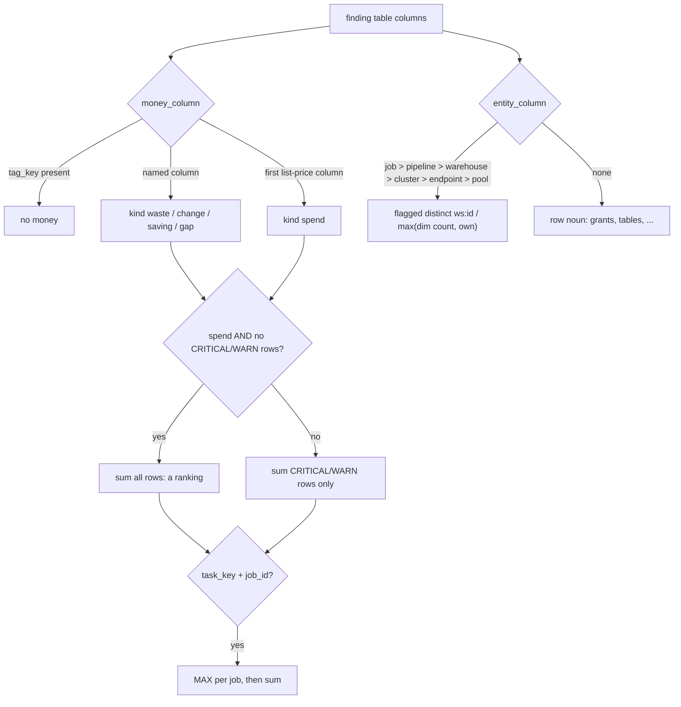

# Finding headline: money and "N of M affected"

Each check's card shows one dollar figure (waste, change, saving, gap or spend) summed over its flagged rows, and an "N of M <noun>" count of distinct flagged objects against every object of that kind in scope.



## Rule in plain words
- Named kinds - `app/core/finding_columns.py:15-22`; otherwise the first list-price column is "spend" - `app/core/finding_columns.py:75-88`.
- A table with `tag_key` has no money figure (each key repeats the same dollars) - `app/core/finding_columns.py:79-81`.
- A spend ranking with no flags sums all its rows; otherwise only CRITICAL/WARN (effective status) - `app/core/data.py:1165-1174`.
- Money is discounted: `usd = round(raw x (1 - discount_pct), 2)` - `app/core/data.py:1175-1176`.
- Task rows repeat the job's spend: once per (workspace, job) - `app/core/finding_columns.py:39-50`, `app/core/data.py:1020-1024`.
- Entity key is `workspace_id:id` (ids repeat across workspaces) - `app/core/data.py:1013-1017`.
- Entity priority (job/pipeline beat warehouse) - `app/core/finding_columns.py:25-36`, `app/core/finding_columns.py:91-100`.
- Total: own rows when the check lists OK rows too or has no dim; else `max(dim count in scope, own)` - `app/core/data.py:1189-1199`.
- No entity id -> count rows; noun from column shapes - `app/core/finding_columns.py:53-72`, `app/core/data.py:1201-1209`.

## Formula
```
money.usd  = round(SUM(col WHERE flagged or ranked) * (1 - discount_pct), 2)
affected   = count(DISTINCT ws:id WHERE flagged) of (own_total | max(dim_total, own_total))
```

## Example (test)
- Task rows `(1,a,t1,100) (1,a,t2,100) (1,b,t1,50) (2,a,t1,25)`: once per job = 175, raw sum 275 - `tests/test_api.py:2100-2108`.
- `cost_chargeback_by_workspace` money column `change_usd_list` kind change; affected noun warehouses - `tests/test_api.py:2021-2055`.

## Edge / rejected cases
- NULL sum -> 0.0 - `app/core/data.py:1175`.
- Endpoints and pools have no dim: own rows are the base - `app/core/finding_columns.py:30-32`.

## Implementing code
- `app/core/finding_columns.py:1-100`, `app/core/data.py:1013-1024`, `app/core/data.py:1160-1209`

## Config knobs
- `discount_pct` (`config/settings.yml:13-15`); floors in `config/materiality.yml` change what is flagged.
