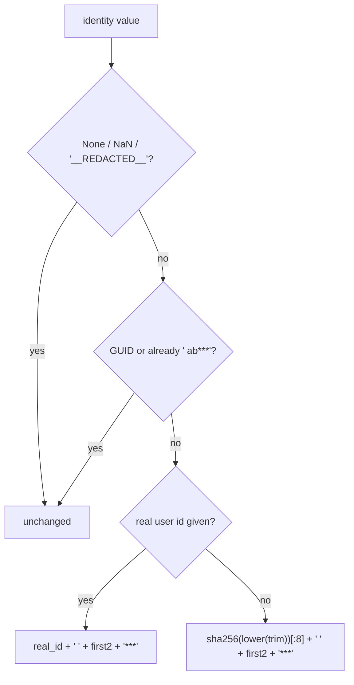

# User identity masking

When `privacy.mask_user_identities` is on, a person's identity reads `<id> <first 2 chars>***`, where `<id>` is the row's real Databricks user id or the first 8 hex chars of `sha256(lower(trim(value)))`; NULL, `__REDACTED__`, service-principal GUIDs and already-masked values pass through unchanged.



## Rule in plain words
- Off by default - `app/core/identity.py:63-65`, `config/settings.yml:76-80`.
- Python formatter - `app/core/identity.py:68-100`; GUID and masked-shape regexes - `app/core/identity.py:55-58`.
- dbt/Spark SQL twin (`sha256` on DuckDB, `sha2(...,256)` on Spark), no-op when the var is off - `dbt/macros/mask_user.sql:7-25`.
- Vendored inline CASE masks are rewritten into one macro call, keeping a coalesced real id - `app/core/translate.py:285-292`.
- Masking is idempotent so dims masked at export are not re-hashed - `app/core/identity.py:56-58`, `app/core/identity.py:92-93`.
- Groups, service principals and resource names stay readable; takes effect at the next export or reload; data loaded while on stays masked - `config/settings.yml:76-78`.
- Data readers apply it to identity columns and job dims - `app/core/data.py:3103-3146`.
- The load masks people columns in place when the setting is on, so an export made with masking off shows no raw emails: `storage.table_detail.owner`, `storage.table_history.user_name`, `usage.*` `identity`/`grantee`, `warehouse.*` `identity` (`_mask_people`, each distinct value once) - `tools/load_direct_results.py:147-159`, `tools/load_direct_results.py:508`, `tools/load_direct_results.py:756-772`, `tools/load_direct_results.py:802-827`.

## Formula
```
masked = (real_id or sha256(lower(strip(value)))[:8]) + ' ' + value[:2] + '***'
```

## Example (test)
- Off: `owned_by` stays raw; on: value changes and ends with `***` - `tests/test_identity_masking.py:26-45`.
- Job dims `run_as_user_name` / `creator_user_name` masked when on - `tests/test_identity_masking.py:48-69`.
- Inline CASE -> `{{ mask_user('executed_by', 'executed_by_user_id') }}` - `tests/test_translate.py:571-580`.
- Illustrative (from `app/core/identity.py:98-100`): user A's email `ab...@...` with no real id -> `<8 hex> ab***`.

## Edge / rejected cases
- `__REDACTED__` (FedRamp "identity unavailable") is never hashed into a fake person - `app/core/identity.py:83-85`.

## Implementing code
- `app/core/identity.py:55-100`, `dbt/macros/mask_user.sql:7-25`, `tools/load_direct_results.py:147-159`

## Config knobs
- `config/settings.yml:79-80` `privacy.mask_user_identities` (bool, default false).
