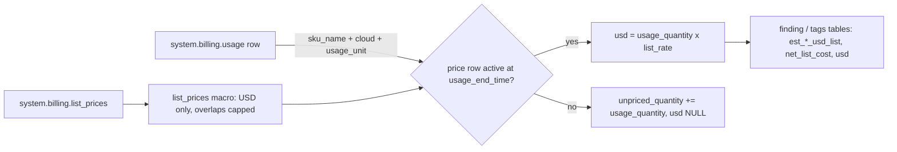

# List-price dollarization

Every dollar in the app is `usage_quantity x pricing.effective_list.default` from `system.billing.list_prices`, joined on the price row active at the usage row's end time; nothing else is ever a dollar.



## Rule in plain words
- One price basis: the *effective list price* (`pricing.effective_list.default`), "no discount assumed by default" - `app/core/pricing.py:24-26`, README `README.md:348-350`.
- DBUs are never dollars; a dollar column always ends in a list-price name (`est_..._usd_list`, `net_list_cost[_usd]`) - `app/core/pricing.py:5-8`, regex `app/core/pricing.py:26`.
- The join key is `sku_name + cloud + usage_unit` and the price window `usage_end_time >= price_start_time AND (price_end_time IS NULL OR usage_end_time < price_end_time)` - `dbt/models/tags/cost_alloc.sql:38-45`, same in `dbt/models/tags/cost_reconciliation.sql:23-30`, `app/queries/app/cost/cost_period_over_period.sql:81-90`.
- `list_prices()` macro de-duplicates: USD rows only, each row's end capped at the next row's start for the same (sku, cloud, unit), rows with no open interval dropped - so one usage row matches exactly one price - `dbt/macros/list_prices.sql:1-37` (cap `:18-23`, USD `:32`, drop `:35`).
- Every read stops before `audit_today()` (`usage_date < audit_today()` - `dbt/models/tags/cost_alloc.sql:46`). On a dbt/snapshot build that is the snapshot day, so today is excluded (`dbt/macros/audit_time.sql:12-26`). On a direct export with `include_today: true` (the shipped default) the cutoff is TOMORROW, so today's partial day is included and the UI marks it partial - `tools/export_direct_results.py:332-341`, `config/settings.yml:19-22`; see [as_of_cutoff](as_of_cutoff.md). Trailing day is provisional - `app/queries/app/cost/cost_period_over_period.sql:65-67`.
- A row with no price adds nothing to `usd` (a fully unpriced unit's `usd` is COALESCEd to 0) and keeps its quantity as `unpriced_quantity`; it is never priced as `$0` - `dbt/models/tags/cost_unit.sql:32-34`, `dbt/models/tags/cost_day.sql:54-56`.

## Formula
```
list_rate  = CAST(pricing.effective_list.default AS DOUBLE)      -- dbt/models/tags/cost_alloc.sql:40
usd        = COALESCE(SUM(CASE WHEN list_rate IS NOT NULL THEN qty * list_rate END), 0)   -- dbt/models/tags/cost_unit.sql:32
unpriced_q = COALESCE(SUM(CASE WHEN list_rate IS NULL THEN qty ELSE 0 END), 0)        -- dbt/models/tags/cost_unit.sql:33
```

## Example (fixture)
- tagworld prices: `tg_SKU_SQL $1`, `tg_SKU_JOBS $1`, `tg_SKU_SERVERLESS $1`, `tg_SKU_AP $2` per DBU; `tg_SKU_NOPRICE` has no price - `tests/fixtures/tagworld.py:11-12`.
- `tg_cl_a1` D(1): 30 DBU at $2 -> $60; 5 DBU on `tg_SKU_NOPRICE` -> unpriced 5, $0 added; D0 999 DBU never counted (today) - `tests/fixtures/tagworld.py:27-29`.
- Price-window join picks the CURRENT row, not the expired one, with no fan-out - `tests/test_findings/test_cost_priced.py:317-430` (asserts `net_list_cost == qty * list_current`, `!= qty * list_expired` at `:426-428`).
- Overlapping price rows fold to one open interval; `rec_SKU_FANOUT` usage sums equal the raw usage once - `tests/test_generate_models.py:503-530`.

## Edge / rejected cases
- Non-USD price rows are dropped (`currency_code = 'USD'`) - `dbt/macros/list_prices.sql:32`.
- `usage_end_time < price_end_time` alone would zero recent usage; the `IS NULL OR` branch is required - caveat in `app/queries/vendored/cost/cost_actual_vs_list_by_sku.sql:15`.
- Some checks deliberately read the raw table (reconcile check) - `tests/test_generate_models.py:509-511`.
- Cloud VM bill is out of scope (no system table) - `README.md:348-350`.

## Implementing code
- `dbt/macros/list_prices.sql:10-37`
- `dbt/models/tags/cost_alloc.sql:11-47` (priced CTE)
- `dbt/models/tags/cost_reconciliation.sql:19-33`
- `app/core/pricing.py:26` (`_LIST_COL_RE`, which columns count as list-price dollars)

## Config knobs
- None for the basis itself; `discount_pct` only adds a what-if twin - see [discount_what_if](discount_what_if.md).
