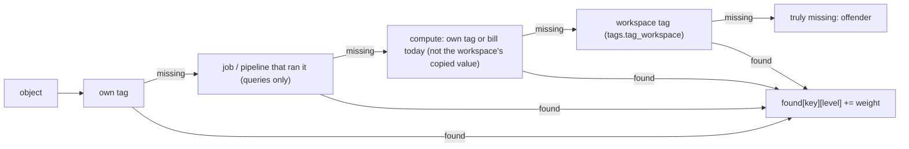

# Mandatory tag compliance (Tags page)

For each mandatory key, every query, job, pipeline, serverless notebook, cluster, warehouse and workspace is checked level by level, most specific first; the first level holding the key gets the credit, and an object missing it at every level is "truly missing".

## Rule in plain words
- Level order per object type - `app/core/tag_compliance.py:4-12`; query levels `own, job, compute, workspace` - `app/core/tag_compliance.py:350`.
- First level wins; "missing" when none - `app/core/tag_compliance.py:225-229`.
- Queries weigh by statement count over the window; others are objects as of the export - `app/core/tag_compliance.py:14-16`, `_Tally.add` `app/core/tag_compliance.py:216-241`.
- A key is on the bill "today" when its last day is the bill's last day - `app/core/tag_compliance.py:150-176`.
- A bill value equal to the workspace's own value is the workspace's tag (Azure copies it onto every row), unless a usage policy put it there - `app/core/tag_compliance.py:113-121`, `app/core/tag_compliance.py:12-14`.
- A bill over 7 days older than the data's last day carries its date - `app/core/tag_compliance.py:197-198`, `app/core/tag_compliance.py:180-182`.
- `env` counts as `environment` (unless both are mandatory) - `app/core/tag_compliance.py:40-53`.
- This app's own export queries (query tag `auditapp`) are skipped - `app/core/tag_compliance.py:200-201`, `app/core/tag_compliance.py:358-359`.
- Clusters: only all-purpose (sources JOB, PIPELINE, PIPELINE_MAINTENANCE, SQL, MODELS excluded) - `app/core/tag_compliance.py:29-30`.
- Own tag vs bill disagreement is a conflict; the bill's value is what the cost carries - `app/core/tag_compliance.py:16-18`, `app/core/tag_compliance.py:500-508`.
- Offenders capped at 500 per type - `app/core/tag_compliance.py:31`, `app/core/tag_compliance.py:248-249`.

## Example (test)
- Queries: own 2, job 3, compute 0, workspace 5, missing 0; the warehouse bill carrying only the workspace value does not count for the warehouse - `tests/test_tag_compliance.py:129-158`.
- Bill dates: wh1 counts (on the last day), wh2 is the workspace's value and stale since 2026-06-12, wh3 counts because a policy set it - `tests/test_tag_compliance.py:78-105`.
- Key on both object and bill is credited to the object (`own`) - `tests/test_tag_compliance.py:108-115`.
- Own `a` vs bill `b` -> conflict; bill no longer today -> no conflict - `tests/test_tag_compliance.py:118-126`.

## Edge / rejected cases
- Export without `delete_time`: every row counts, page says so - `app/core/tag_compliance.py:56-60`.
- No `bill_tag_dates`: falls back to the dominant billed value - `app/core/tag_compliance.py:185-194`.

## Implementing code
- `app/core/tag_compliance.py:204-314` (`_Tally`, `compliance`), `app/core/tag_compliance.py:149-194` (`_bill`)

## Config knobs
- `config/settings.yml:30-36` `mandatory_tag_keys` (default `cost_center`, `domain`, `environment`). README `README.md:556-584`.
