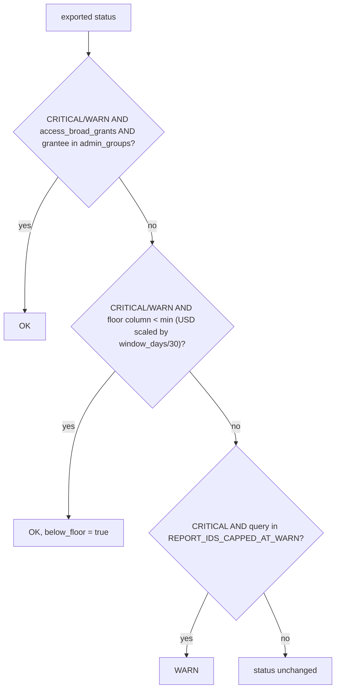

# Effective status: materiality floor, admin groups, severity cap

A finding row's on-screen status is computed at read time from its exported `status`: admin-group grants and rows under the check's materiality floor move CRITICAL/WARN to OK (flagged `below_floor`), then trend reports are capped at WARN; OK and NOT_ASSESSED rows never change.



## Rule in plain words
- CASE order: admin, floor, cap; no rule applies -> bare `t."status"` - `app/core/materiality.py:142-168`.
- A floor applies only when configured AND the table has `status` AND the floor's column - `app/core/materiality.py:121-128`.
- A USD `min` is per 30 days: `min * window_days / 30`; count/DBU/minutes/bytes floors never scale; no `window_days` -> flat min - `app/core/materiality.py:131-139`, header `config/materiality.yml:6-8`.
- `below_floor` is true only for a CRITICAL/WARN row the floor suppressed - `app/core/materiality.py:171-178`; both columns added by `app/core/data.py:449-471`.
- Effective status drives counts, worst status, sort and money sums - `config/materiality.yml:2-5`.
- Floors are left out where the SQL already gates on size, for governance checks, and where the status already uses that column - `config/materiality.yml:11-17`.
- Floors reload on file change (mtime, size), never at import - `app/core/materiality.py:90-118`.
- Admin groups: only `access_broad_grants`, match `LOWER(TRIM(grantee))` - `app/core/materiality.py:76-87`.
- Trend/chargeback reports (17 ids) top out at WARN - `app/core/materiality.py:49-73`, `README.md:365`.

## Formula
```
min_eff = unit == 'USD' and window_days > 0 ? min * window_days / 30 : min
status' = admin hit -> OK | (status in CRIT,WARN and col < min_eff) -> OK | (CRIT and capped) -> WARN | status
```

## Example (test)
- Floor $50/30d: a $30 CRITICAL row reads OK at 30d, stays CRITICAL at 7d ($11.67) - `tests/test_materiality.py:136-155`.
- Count floor 20: 15 events at 7d -> OK (not scaled) - `tests/test_materiality.py:157-173`.
- Floor applied in SQL: CRITICAL 264 stays, CRITICAL 5 / WARN 2 -> OK + below_floor, NOT_ASSESSED 1 and OK 3 untouched (min 10) - `tests/test_materiality.py:176-243`.
- Severity cap and admin groups - `tests/test_materiality.py:414-438`, `tests/test_materiality.py:442-471`.
- Shipped floor: `compute_warehouse_idle_minutes` `est_wasted_usd_list` $50 per 30 days - `config/materiality.yml:29-33`.

## Edge / rejected cases
- Stale config column -> floor silently not applied, never an error - `app/core/materiality.py:121-128`.
- Settings error -> no admin rule (error already shown) - `app/core/materiality.py:80-83`.
- The exported `status` column is never rewritten - `config/materiality.yml:5`.

## Implementing code
- `app/core/materiality.py:40-178`, `app/core/data.py:449-471`

## Config knobs
- `config/materiality.yml:19-147` (25 floors: column, min, unit, label; editable without re-export).
- `admin_groups` (`config/settings.yml:63-66`, default `[]`, max 50 - `app/core/config.py:423-427`).
