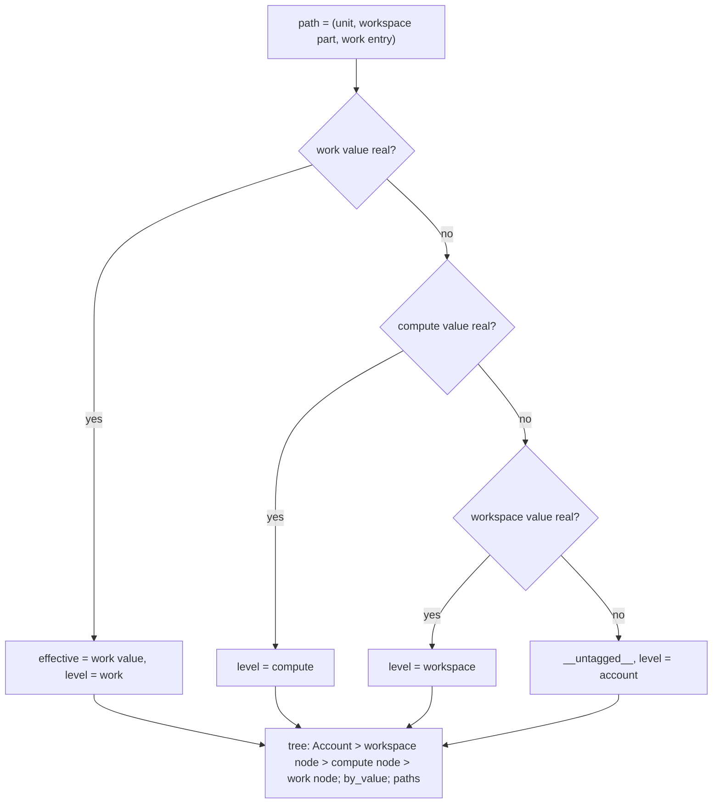

# Nested tag rollup: effective value and attributed level

For one tag key, each cost (or performance) unit is walked work -> compute -> workspace; the first REAL value wins and is the dollar's effective value and attributed level; with no real value anywhere it is `__untagged__` at the account level.



## Rule in plain words
- Walk order and sentinel rule - `app/core/rollup.py:249-259`; `is_real_value` excludes None, `__untagged__`, `__mixed__`, `__none__` - `app/core/tag_keys.py:87-89`, sentinels `app/core/tag_keys.py:14-19`.
- A unit's compute value applies to its whole total; its work values partition the total, with one untagged/`__none__` remainder when they do not cover it - `app/core/rollup.py:9-16`, remainder `app/core/rollup.py:367-375`.
- Remainder value: `__untagged__` for query/job/pipeline work kinds, `__none__` otherwise (idle, unsplit, none) - `app/core/rollup.py:371`.
- Workspace parts: one part per dated workspace value on the unit's days, plus a rest part (before the tag showed, or a mixed/untagged current value); shares are fractions of the unit - `app/core/rollup.py:287-320`.
- No workspace at all -> `__none__` ("no workspace (account-level usage)") - `app/core/rollup.py:291-292`, label `app/core/rollup.py:169-171`.
- `untagged` metric bubbles to every ancestor; `attributed_here` marks only the node at the attributed level - `app/core/rollup.py:903-910`.
- `overrides_outer`: an inner value differs from a real outer value - `app/core/rollup.py:262-271`, summed in `app/core/rollup.py:991-992`.
- Children sorted by primary metric desc, sentinel nodes last; shares rounded to 4 dp - `app/core/rollup.py:861-896`.
- Tag filter on the SAME key narrows per path; other keys narrow per unit - `app/core/rollup.py:516-580`, `app/core/rollup.py:617-625`.
- Required sources: cost needs `billing.usage` + `billing.list_prices`; perf needs `query.history`; missing `attributed_usage`/`lakeflow.jobs`/`pipelines` only degrade labels - `app/core/rollup.py:51-68`, `app/core/rollup.py:124-150`.
- Outcome: `ok_rows`, `ok_empty_filters` (a filter matched nothing), `ok_empty_window` - `app/core/rollup.py:655-658`.

## Formula
```
effective(p) = first real of (work_value, compute_value, workspace_value) else ('__untagged__', 'account')
path usd     = work_entry_usd * workspace_fraction
remainder    = unit.usd - SUM(work rows usd)
```

## Example (test, key tg_cc, 30d, tg workspaces)
| Node | usd | untagged | attributed_here |
|---|---|---|---|
| Account | 672 | 50 | 50 |
| workspace tag: alpha | 362 | 0 | 16 |
| warehouse tag: alpha | 150 | 0 | 110 |
| query tag: q_fin | 40 | 0 | 40 |
| workspace tag: mixed > untagged cluster | 10 | 10 | 0 |
Source: `tests/test_tag_rollup_models.py:160-204`.

- by_value alpha = 206 (compute 190 + workspace 16); `__untagged__` 50; all values sum to 672 - `tests/test_tag_rollup_models.py:239-268`.
- 7d / 90d only `cluster tag: alpha` moves (60 / 100) - `tests/test_tag_rollup_models.py:213-224`.
- API: `selected` alpha 206, `__untagged__` 50 - `tests/test_api_rollup.py:45-68`.

## Edge / rejected cases
- Bad area/window/empty key -> `RollupError` -> 422 - `app/core/rollup.py:95-103`, `tests/test_api_rollup.py:25-43`.
- Tags models missing -> NOT_ASSESSED `tag_models_not_built` - `app/core/rollup.py:604-605`.
- Workspace scope drops NULL-workspace paths into `excluded_account_level` - `app/core/rollup.py:627-638`.
- `__mixed__` never allocates; a mixed workspace reads "workspace tag: mixed" - `app/core/rollup.py:172-173`.

## Implementing code
- `app/core/rollup.py:583-716` (`rollup`), `app/core/rollup.py:323-385` (`_fetch_cost_paths`), `app/core/rollup.py:388-460` (`_fetch_perf_paths`), `app/core/rollup.py:913-1008` (tree, by_value)

## Config knobs
- `discount_pct` (`config/settings.yml:13-15`) for `usd_disc`; windows fixed to 7/30/90 - `app/core/rollup.py:32`.
