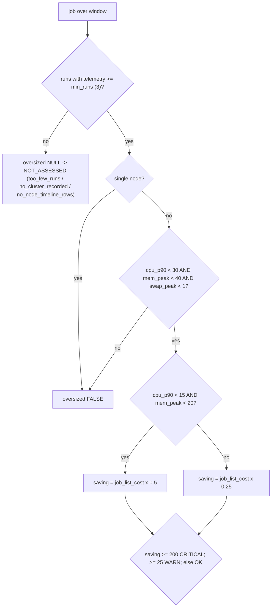

# Oversized job clusters and the saving estimate

A job is oversized when its workers' CPU p90 and memory PEAK sit under thresholds and no worker swapped, over at least 3 telemetry runs; its estimated saving is 50% of its measured job-cluster list cost when both are under half the thresholds, else 25%.



## Rule in plain words
- Oversized decision - `app/queries/app/jobs_pipelines/lakeflow_job_oversized.sql:282-293`.
- Saving tiers - `app/queries/app/jobs_pipelines/lakeflow_job_oversized.sql:350-360`, rationale `:96-100`.
- Status bands and NA reasons - `app/queries/app/jobs_pipelines/lakeflow_job_oversized.sql:392-402`.
- Only measured classic job clusters count; serverless/unmeasured compute cannot shrink - `app/queries/app/jobs_pipelines/lakeflow_job_oversized.sql:38-42`.
- Cost excludes usage rows with no `job_run_id`, so it can be below `cost_by_job` - `app/queries/app/jobs_pipelines/lakeflow_job_oversized.sql:106-110`.
- Telemetry capped at `LEAST(:period_days, 90)` days - `app/queries/app/jobs_pipelines/lakeflow_job_oversized.sql:12-13`.
- A rough estimate from measured use, never a resize forecast - `README.md:384-387`.

## Formula
```
saving = NULL if oversized NULL | 0 if not oversized | NULL if cost NULL
       | cost * 0.5  if cpu_p90 < cpu_pct/2 AND mem_peak < mem_pct/2
       | cost * 0.25 otherwise
```

## Example (test)
- $1000 job, both under half -> saving 500 -> CRITICAL - `tests/test_findings/test_lakeflow_job_oversized.py:67-93`.
- $400 job, CPU 25% / mem 35% -> saving 100 -> WARN, "one node size down" - `tests/test_findings/test_lakeflow_job_oversized.py:96-113`.
- CPU/mem 60% -> not oversized, saving 0, OK - `tests/test_findings/test_lakeflow_job_oversized.py:116-127`.
- 1 run -> NOT_ASSESSED `too_few_runs`, saving None - `tests/test_findings/test_lakeflow_job_oversized.py:130-143`.
- Memory peak or swap blocks oversized - `tests/test_findings/test_lakeflow_job_oversized.py:146-164`.

## Edge / rejected cases
- NULL cost with oversized TRUE reads OK on dollar bands - read `oversized` itself - `app/queries/app/jobs_pipelines/lakeflow_job_oversized.sql:102-105`.
- Single-node jobs are never sized down - `app/queries/app/jobs_pipelines/lakeflow_job_oversized.sql:288`.

## Implementing code
- `app/queries/app/jobs_pipelines/lakeflow_job_oversized.sql`

## Config knobs
- `:min_runs` 3, `:oversized_cpu_pct` 30, `:oversized_mem_pct` 40, `:oversized_swap_pct` 1, `:warn_saving_usd` 25, `:crit_saving_usd` 200, `:top_n` 100000 - `app/queries/app/jobs_pipelines/lakeflow_job_oversized.sql:12-24`; override in `config/thresholds.yml`.
