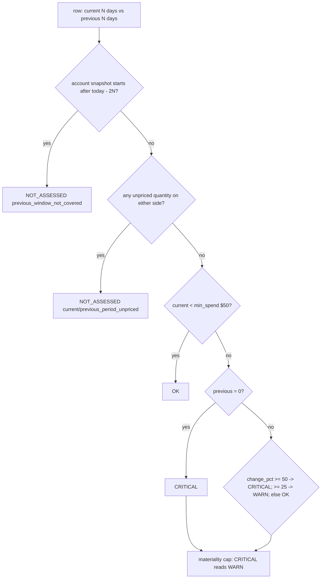

# Period-over-period spend change

Per (workspace, billing origin product), the last N days' list-priced spend is compared with the N days before; a rise of >= 25% is WARN and >= 50% (or spend from nothing) is CRITICAL, but only when current spend is at least $50, both sides are fully priced and the account's history covers both windows; the app caps the result at WARN.



## Rule in plain words
- Params - `app/queries/app/cost/cost_period_over_period.sql:8-14`.
- Coverage is account-wide: earliest `usage_date` over all history - `app/queries/app/cost/cost_period_over_period.sql:68-74`, used `:146-147`.
- A side with no rows at all is a real $0; a side with only unpriced rows stays NULL - `app/queries/app/cost/cost_period_over_period.sql:122-131`.
- `change_pct = (cur - prev) / prev x 100`, NULL when prev = 0 - `app/queries/app/cost/cost_period_over_period.sql:138`.
- `price_basis` over both windows: unpriced / free / priced - `app/queries/app/cost/cost_period_over_period.sql:139-145`.
- Status and reasons - `app/queries/app/cost/cost_period_over_period.sql:146-169`.
- Corrections are netted (all record types summed); today excluded - `app/queries/app/cost/cost_period_over_period.sql:63-67`.
- Capped at WARN - `app/core/materiality.py:52`.

## Formula
```
change_pct = (eff_current - eff_previous) / NULLIF(eff_previous, 0) * 100
```

## Example (test)
- 130 vs 100 -> 30% -> WARN - `tests/test_findings/test_cost_period_over_period.py:104-115`.
- 200 vs 100 -> CRITICAL - `tests/test_findings/test_cost_period_over_period.py:118-128`.
- 40 vs 5 -> OK by the $50 floor - `tests/test_findings/test_cost_period_over_period.py:131-142`.
- Brand-new 80 vs 0 -> CRITICAL, `change_pct` None - `tests/test_findings/test_cost_period_over_period.py:145-159`.
- Coverage is account-wide, not per workspace - `tests/test_findings/test_cost_period_over_period.py:180-197`.
- Unpriced on either side -> NOT_ASSESSED - `tests/test_findings/test_cost_period_over_period.py:200-243`.
- Chargeback = period-over-period = rollup totals - `tests/test_totals_agree.py:41-57`.

## Edge / rejected cases
- Free-usage SKUs read a real $0 (`price_basis = free`) - `tests/test_findings/test_cost_period_over_period.py:246-278`.
- A percent on a tiny base is noise -> min spend gate - `app/queries/app/cost/cost_period_over_period.sql:12-14`.

## Implementing code
- `app/queries/app/cost/cost_period_over_period.sql`, tag-filtered twin `app/queries/tag_spend/cost_period_over_period.sql`

## Config knobs
- `:period_days` 30, `:warn_increase_pct` 25, `:crit_increase_pct` 50, `:min_spend_usd` 50 - override in `config/thresholds.yml` (see [thresholds_precedence](thresholds_precedence.md)).
